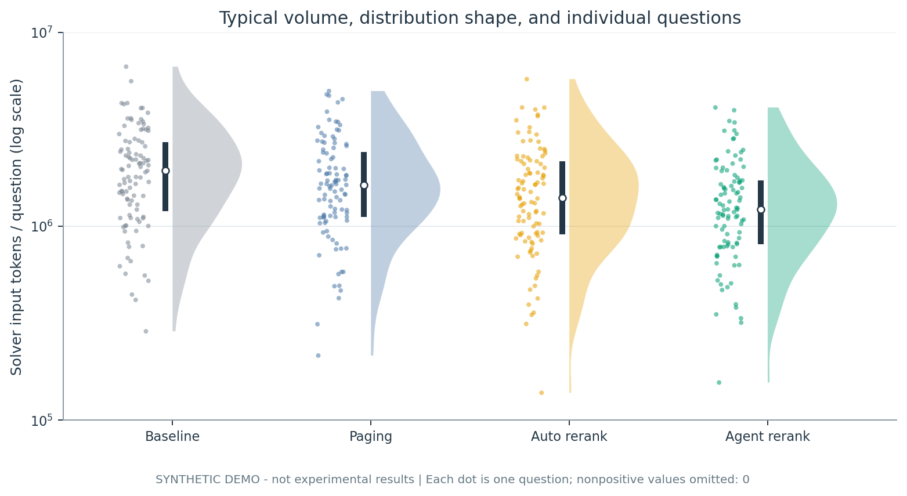
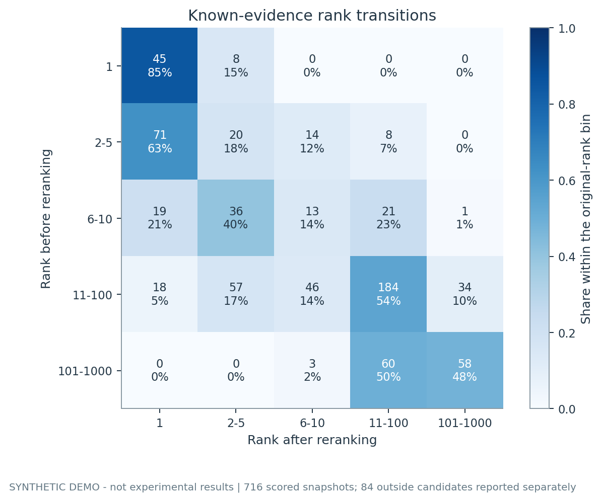
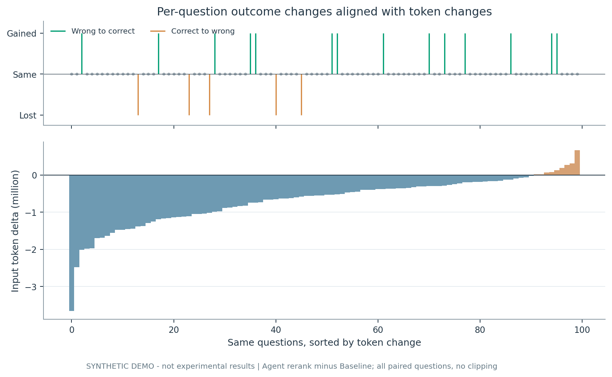
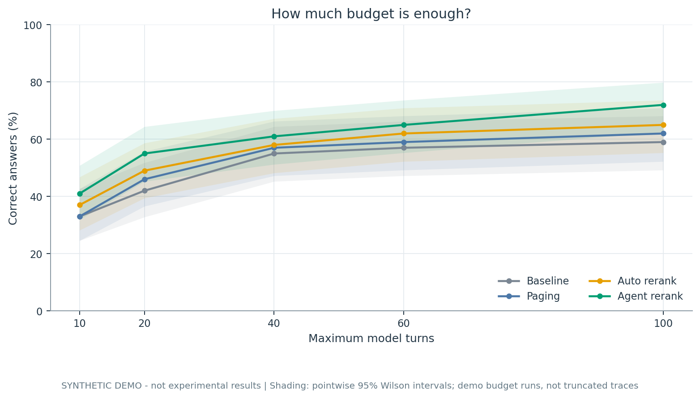
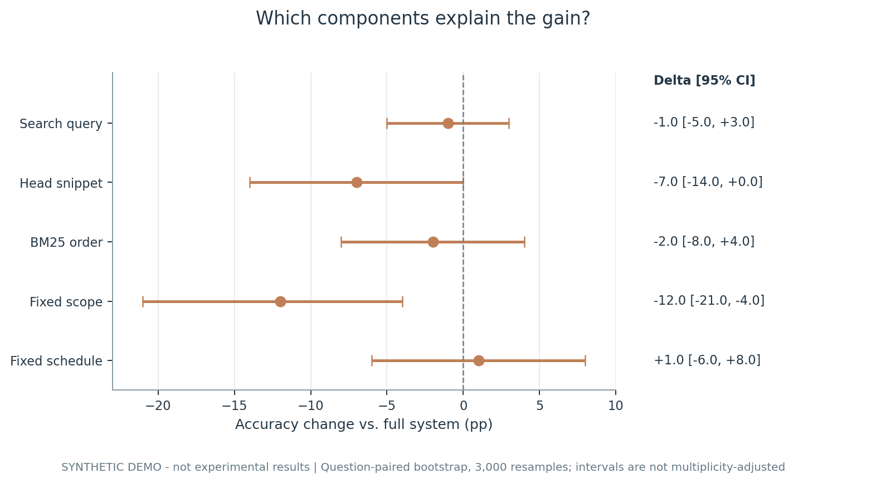

# Research Figure Gallery · 科研图表画法示例

按用途收录 10 张图，每张只展示一次，附仓库内绘图代码。

**当前仅为合成数据的画法演示，尚未接入并核验你们的真实实验。** 合成脚本预设了部分方法差异和趋势；出图成功与统计检查通过不能证明实验结论。下文列出的是使用条件，尚不是论文选图建议。

[图型来源](REFERENCES.md) · [数据与字段](data/README.md) · [视觉筛选记录](CURATION.md) · [缩略图速览](assets/overview.png)（[速览代码](scripts/contact_sheet.py)）

## 用途索引

| 用途 | 示例编号 |
| --- | --- |
| Token 与资源消耗 | 02 |
| 工具使用与行为 | 04 |
| 检索质量与证据利用 | 07、08 |
| 效果、预算与稳定性 | 09、12、14、19 |
| 失败分析与案例 | 16 |
| 消融分析 | 17 |

## A · Token 与资源消耗

### 02 · 逐题 Token 雨云图



**代码：[examples/02_token_raincloud/plot.py](examples/02_token_raincloud/plot.py)** · [SVG](assets/02_token_raincloud.svg) · [图型参考](https://github.com/RainCloudPlots/RainCloudPlots)

适用条件：统计每题完整轨迹的主模型输入；只能说明这一项用量分布，不能代替含 reranker 开销的总成本。

## B · 工具使用与行为

### 04 · 调用占比与返回字符占比


**代码：[examples/04_call_vs_output_share/plot.py](examples/04_call_vs_output_share/plot.py)** · [SVG](assets/04_call_vs_output_share.svg) · [图型参考](https://github.com/holtzy/The-Python-Graph-Gallery)

适用条件：从实际日志统计显式调用和返回字符；后台自动重排另记，不能按显式调用为零就认定没有开销。

## C · 检索质量与证据利用

### 07 · 重排前后排名迁移



**代码：[examples/07_rank_transition/plot.py](examples/07_rank_transition/plot.py)** · [SVG](assets/07_rank_transition.svg) · [图型参考](https://github.com/DingWB/PyComplexHeatmap)

适用条件：同一候选快照须有真实证据标注及完整前后排名；候选集外和跌出 Top-K 的证据均需保留。

### 08 · 两种 Query 的配对哑铃图


**代码：[examples/08_query_paired_comparison/plot.py](examples/08_query_paired_comparison/plot.py)** · [SVG](assets/08_query_paired_comparison.svg) · [图型参考](https://github.com/holtzy/The-Python-Graph-Gallery)

适用条件：比较同题两种 query 时固定候选集、reranker、片段和返回预算，并用真实相关性标签计算指标。

## D · 效果、预算与稳定性

### 09 · 逐题效果变化与 Token 变化



**代码：[examples/09_token_outcome_pairs/plot.py](examples/09_token_outcome_pairs/plot.py)** · [SVG](assets/09_token_outcome_pairs.svg) · [图型参考](https://arxiv.org/abs/2608.02751)

适用条件：按题号配对真实对错与 token；展示相关变化，不能据此单独归因于自主调用。

### 12 · 准确率—成本 Pareto 图


**代码：[examples/12_accuracy_cost_frontier/plot.py](examples/12_accuracy_cost_frontier/plot.py)** · [SVG](assets/12_accuracy_cost_frontier.svg) · [图型参考](https://github.com/garrettj403/SciencePlots)

适用条件：使用同一评测集和一致的实际成本口径，计入主模型及 reranker；禁止用合成 cost_units 解释真实效率。

### 14 · 预算—效果曲线



**代码：[examples/14_budget_accuracy/plot.py](examples/14_budget_accuracy/plot.py)** · [SVG](assets/14_budget_accuracy.svg) · [图型参考](https://github.com/garrettj403/SciencePlots)

适用条件：每个预算下实际运行评测；事后截断完整轨迹不能代替独立预算实验。

### 19 · 论文主结果表


**代码：[examples/19_results_table/plot.py](examples/19_results_table/plot.py)** · [SVG](assets/19_results_table.svg) · [图型参考](https://github.com/garrettj403/SciencePlots)

适用条件：统一问题集、模型、返回字符预算和停止条件，接入真实评测结果；不能将演示排序当作当前实验结论。

## E · 失败分析与案例

### 16 · 工具轨迹与证据时间线


**代码：[examples/16_trajectory_timeline/plot.py](examples/16_trajectory_timeline/plot.py)** · [SVG](assets/16_trajectory_timeline.svg) · [图型参考](https://github.com/holtzy/The-Python-Graph-Gallery)

适用条件：替换为可追溯的真实题号、动作和证据事件，并交代案例选择依据；单个案例不能证明整体提升。

## F · 消融分析

### 17 · 消融效果森林图



**代码：[examples/17_ablation_forest/plot.py](examples/17_ablation_forest/plot.py)** · [SVG](assets/17_ablation_forest.svg) · [图型参考](https://github.com/garrettj403/SciencePlots)

适用条件：先核验工具实现，再一次只改变 query、snippet、范围或时机中的一项，其他条件固定并按题配对。

## 运行与替换数据

Python 3.10+；默认读取已提交的 `data/demo/`，输出到 `assets/`。

```bash
python -m venv .venv
source .venv/bin/activate
python -m pip install -r requirements-lock.txt
python scripts/build_gallery.py
```

只运行某张图，或使用自己的 CSV：

```bash
python examples/02_token_raincloud/plot.py
python examples/02_token_raincloud/plot.py --data-dir /path/to/csv --output-dir /path/to/figures --formats png svg pdf
```

输入文件映射见 [gallery.json](gallery.json)，CSV 字段和统计口径见 [data/README.md](data/README.md)。共享样式与统计函数位于 [gallerylib/__init__.py](gallerylib/__init__.py)。接入真实数据时需同时核验指标定义、对照条件、单位和脚注。

```bash
python -m unittest discover -s tests -v
python scripts/package_release.py
```

[verification.json](verification.json) 记录代码与数据检查、图片校验及 SHA-256，不验证实验是否成立。代码采用 [MIT 许可](LICENSE)；外部参考项目保留各自许可。
