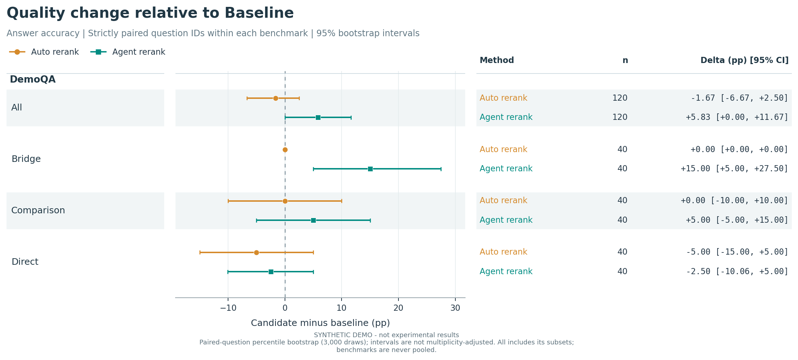

# Rerank 科研绘图：一图多用途

将相似画法合并为 **11 种图型**，每类只保留一张代表图，在下方列出多个实验用途、论文位置和对应代码。出处统一放在每图的说明与[代码来源索引](docs/FIGURE_INDEX.md)中。

图中的数值来自合成示例或公开材料，均不是我们的实测结果。使用时选择对应用途的代码与数据格式；同一画法不意味着不同指标或分母可以混用。

[安装与构建](#quick-start) · [全部代码、输入与来源](docs/FIGURE_INDEX.md) · [逐题数据格式](rerank_templates/2026-11-16/DATA_FORMAT.md)

<a id="figure-catalog"></a>

## 按图型选择

| 图型 | 可回答的问题 |
| --- | --- |
| [F01 · 结果表](#f01) | 各方法在同一题集上的最终回答质量、主模型用量、工具调用与耗时分别是多少？ |
| [F02 · 配对比较](#f02) | 重排开关是否改变最终答案质量，提供金标准证据后还剩多少回答失误？；重排或 query 改写能否把相关、含答案材料提前，哪些题目获得收益或出现损失？；保持候选内容不变时，随机打乱输入顺序会使重排质量变化多少？；替换解码实现或检索接口后，重排时延与返回文本量各减少多少？ |
| [F03 · 差值森林图](#f03) | 相对不重排基线，多种策略在总体与各题型上的质量差值及不确定性如何？；去掉 query、snippet、候选范围或调用时机等组件后，最终质量损失有多大？ |
| [F04 · 分布雨云图](#f04) | 平均耗时之外，哪些方法出现慢题、长尾或大量零重排开销？；主模型输入 token 的节省是否普遍，还是主要来自少数高开销题目？；不同 benchmark 或题型的成本分布是否不同，整体长尾由哪一组产生？ |
| [F05 · 双目标权衡散点图](#f05) | 不同 reranker、触发策略或滑动窗口设置中，哪些配置在质量与实测资源之间更合适？；增加有效证据覆盖时，引用是否仍能准确支撑回答中的声明？；LLM judge 的批量设置如何影响评估费用和与人工标注的一致性？ |
| [F06 · 趋势与敏感性曲线](#f06) | 增加最大轮次或运行预算时，各方法的回答质量如何变化，收益是否趋于饱和？；增大重排模型容量是否在不同任务上都带来收益？；增加搜索轮数还能带来多少独立来源，还是主要增加重复调用？；方法在概念广度、推理嵌套或探索难度不同的任务组上，表现是否一致？ |
| [F07 · 矩阵热图](#f07) | 证据从哪些原始名次区间被提前或压后，进入 top-k 的材料来自哪里？；候选评分或错误模式是否随题型、方法和文档属性形成可解释的局部结构？；多模型、多任务的若干固定指标能否在统一小面板布局中同时比较？ |
| [F08 · 条形与组成分析](#f08) | 重排策略是否改变工具调用结构，调用频繁的工具是否也返回了最多文本？；总耗时主要来自检索、重排、生成还是 I/O，哪个阶段值得优化？；失败主要来自证据获取、证据利用、放弃作答还是评价问题，某类失败内部又如何构成？；哪些题目节省或增加了主模型 token，这些题目同时出现了哪些正确性翻转？ |
| [F09 · 工具轨迹图](#f09) | 某次重排触发后，后续搜索、读取、首次看到答案证据与最终作答的路径如何改变？ |
| [F10 · 多方法秩比较](#f10) | 在多个独立评价分块上，哪些方法通常排在前面，哪些方法间未检出差异？ |
| [F11 · 集合交集图](#f11) | BM25、Dense、重排后 top-k 与最终读取集合中，哪些证据重合、哪些互补或被丢弃？；共同保留和各自独有的证据，其相关性、排名或文本开销是否不同？ |

<a id="f01"></a>

## F01 · 结果表


**这张图怎么看：** 每行汇总一种方法的准确率及 Wilson 95% 区间、每题平均主模型输入、平均显式工具调用数和耗时中位数。浅色底纹仅标出当前合成示例中准确率最高的行，不能替代成本与不确定性的比较。

**可以用于：**

- **各方法在同一题集上的最终回答质量、主模型用量、工具调用与耗时分别是多少？** 建议位置：正文主结果表；在说明评测协议后并列报告质量与主要资源指标。；需要：逐题 question_id、method、正确性或明确的质量分数、主模型输入 token、端到端耗时及逐工具调用账本；另记失败计分、后台重排开销和各列有效样本数。。实现参考：[主结果表](docs/FIGURE_INDEX.md#variant-m03)。

**使用边界：** 不同指标保留各自单位与汇总方式，不能把均值、中位数和准确率当成同一种统计量，也不能合并不同 benchmark 或不同分母。单方法 Wilson 区间不是方法间配对差值区间。代表代码当前实现准确率及固定成本列；替换其他指标需同步修改统计与表头，合成示例的最高分行不代表真实实验结论。

<details>
<summary>代表图代码、数据与运行方法</summary>

[主代码](examples/19_results_table/plot.py) · [公共函数](gallerylib/__init__.py)

输入：[questions.csv](data/demo/questions.csv) · [tool_calls.csv](data/demo/tool_calls.csv)。

执行状态：本地可运行。

安装依赖后，在仓库根目录执行：

```bash
python examples/19_results_table/plot.py --output-dir dist/f01 --formats png svg
```

[本图型的全部用途实现、数据与来源](docs/FIGURE_INDEX.md#f01)

</details>

示例类型：合成模板。图型参考：[SciencePlots](https://github.com/garrettj403/SciencePlots)。

[返回图型目录](#figure-catalog)

<a id="f02"></a>

## F02 · 配对比较


**这张图怎么看：** 左侧逐题连接 search query 与 rerank query 的 nDCG@10，右侧显示同题的 rerank-minus-search 差值，行按差值排序。标题给出配对平均差及 bootstrap 区间，负向条也完整保留。

**可以用于：**

- **重排开关是否改变最终答案质量，提供金标准证据后还剩多少回答失误？** 建议位置：正文主结果或证据获取诊断；将重排开关消融与 oracle 条件作为不同对照说明。；需要：同题各条件的最终答案、统一 EM／准确率判定、生成模型与上下文预算；oracle 条件还需金标准证据及上下文溢出记录。每个任务内比较相同指标。。实现参考：[推理时重排对最终回答的影响](docs/FIGURE_INDEX.md#variant-m01) · [证据充分对照](docs/FIGURE_INDEX.md#variant-m14)。

- **重排或 query 改写能否把相关、含答案材料提前，哪些题目获得收益或出现损失？** 建议位置：正文排序质量与 query 消融；逐题配对线和差值分布可放附录定位得失案例。；需要：稳定 question_id、冻结候选池、两种 query 或重排前后顺序、qrels／答案标注；分别计算固定 k 的 nDCG 或 Answer Recall，记录逐题值以估计配对差和区间。。实现参考：[前 5 条中的含答案材料召回](docs/FIGURE_INDEX.md#variant-m02) · [Query 配对比较](docs/FIGURE_INDEX.md#variant-m05) · [配对样本与均值差分布](docs/FIGURE_INDEX.md#variant-g01)。

- **保持候选内容不变时，随机打乱输入顺序会使重排质量变化多少？** 建议位置：正文鲁棒性实验或附录输入顺序敏感性分析。；需要：相同题目、候选文档、相关性标注、模型与提示词；原顺序及多次打乱的种子、逐题输出排名和评价结果，明确区间跨题目还是跨打乱运行计算。。实现参考：[输入顺序鲁棒性](docs/FIGURE_INDEX.md#variant-m04)。

- **替换解码实现或检索接口后，重排时延与返回文本量各减少多少？** 建议位置：正文实现效率或检索工作空间分析；两种资源分别作同条件配对比较。；需要：逐题配置标签及重排秒数，固定硬件、batch、候选数量与片段长度；文本暴露量需实际返回文本的 tokenizer 计数、文档 ID 和重复读取规则。连续资源的配对分布需原始观测。。实现参考：[解码方式与重排时延](docs/FIGURE_INDEX.md#variant-m10) · [检索暴露文本量](docs/FIGURE_INDEX.md#variant-s06) · [配对样本与均值差分布](docs/FIGURE_INDEX.md#variant-g01)。

**使用边界：** 配对比较可以采用双点连线、棒棒糖或配对差分布，但每个面板必须统一量纲、指标定义和题集；秒数、暴露 token、模型输入 token 不能混算。Answer Recall 的 k 是读取截断，不是候选池大小；oracle 改变证据条件，不能当作纯重排收益。打乱运行区间与逐题 bootstrap 区间不同，公开均值不能恢复逐题分布。代表代码只实现 query 排序分的逐题比较，其他用途应参考本类对应脚本并重接真实数据。

<details>
<summary>代表图代码、数据与运行方法</summary>

[主代码](examples/08_query_paired_comparison/plot.py) · [公共函数](gallerylib/__init__.py)

输入：[query_pairs.csv](data/demo/query_pairs.csv)。

执行状态：本地可运行。

安装依赖后，在仓库根目录执行：

```bash
python examples/08_query_paired_comparison/plot.py --output-dir dist/f02 --formats png svg
```

[本图型的全部用途实现、数据与来源](docs/FIGURE_INDEX.md#f02)

</details>

示例类型：合成模板。图型参考：[The-Python-Graph-Gallery](https://github.com/holtzy/The-Python-Graph-Gallery)。

[返回图型目录](#figure-catalog)

<a id="f03"></a>

## F03 · 差值森林图



**这张图怎么看：** 每个 benchmark 内按 All 与题型分组，点表示候选方法减去 baseline 的逐题平均分差，横线为配对题目 bootstrap 的 95% 区间。先看零线两侧的方向，再结合样本量与区间宽度判断估计是否稳定。

**可以用于：**

- **相对不重排基线，多种策略在总体与各题型上的质量差值及不确定性如何？** 建议位置：正文分组结果或误差分析；总体平均可能掩盖题型差异时使用。；需要：每个 benchmark 内所有方法严格配对的 question_id、逐题 score、预先定义的 subset、baseline、展示单位和有效 n；按题目重采样候选方法减基线的差值。。实现参考：[子集收益森林图](docs/FIGURE_INDEX.md#variant-t01) · [多方法分组森林图](docs/FIGURE_INDEX.md#variant-g02)。

- **去掉 query、snippet、候选范围或调用时机等组件后，最终质量损失有多大？** 建议位置：正文组件消融；组件较多时可在附录补充全部估计。；需要：完整系统及每个消融版本在同题上的判分，一项对照改变一个明确设置，记录其余固定条件、交互因素和配对差值区间。。实现参考：[组件消融森林图](docs/FIGURE_INDEX.md#variant-m09)。

**使用边界：** 各 benchmark 和指标单位分别估计，不池化不同实验；All 与子组重叠，组件消融差值不能相加为总贡献，逐项区间也不自动包含多重比较校正。回归系数参考图是回归系数示例，其数值与区间不能换标签后沿用。代表代码可计算配置方法相对基线的配对差，消融的因果解释仍取决于实验设计；布局变体见对应成员代码。

<details>
<summary>代表图代码、数据与运行方法</summary>

[主代码](rerank_templates/2026-11-16/plot_forest.py) · [公共函数](rerank_templates/2026-11-16/common.py)

输入：[逐题 CSV](rerank_templates/2026-11-16/data/demo/observations.csv) · [配置](rerank_templates/2026-11-16/config.json)。

执行状态：本地可运行。

安装依赖后，在仓库根目录执行：

```bash
python rerank_templates/2026-11-16/plot_forest.py --output-dir dist/f03 --formats png svg
```

[本图型的全部用途实现、数据与来源](docs/FIGURE_INDEX.md#f03)

</details>

示例类型：合成模板。图型参考：[LSYS/forestplot](https://github.com/LSYS/forestplot/blob/b7591e3be7004f9962fd7cd7f91aa4cac91c45fc/docs/images/multimodel.png)；本库独立实现，默认数据为合成示例。

[返回图型目录](#figure-catalog)

<a id="f04"></a>

## F04 · 分布雨云图


**这张图怎么看：** 每个小面板是一种 benchmark／题型组合，散点保留逐题成本，粗条与短线显示四分位区间和中位数，半侧密度展示分布形状。默认横轴为线性尺度，也可使用保留零值的 log1p 位置变换，刻度仍标原单位。

**可以用于：**

- **平均耗时之外，哪些方法出现慢题、长尾或大量零重排开销？** 建议位置：正文效率分析或附录尾部诊断。；需要：逐题端到端秒数或独立重排评分秒数、方法、终止状态、硬件与并发条件；确认未调用为零，未知成本留空，保留超时观测及样本量。。实现参考：[分面耗时雨云图](docs/FIGURE_INDEX.md#variant-t02)。

- **主模型输入 token 的节省是否普遍，还是主要来自少数高开销题目？** 建议位置：正文资源分析；补充均值表无法呈现的中位数、分位数与分布形状。；需要：逐题累计主模型输入 token、方法和终止状态；分别记录缓存输入、主模型输出和 reranker 输入，明确累计规则与零值处理。。实现参考：[逐题 Token 用量分布](docs/FIGURE_INDEX.md#variant-m11) · [分面耗时雨云图](docs/FIGURE_INDEX.md#variant-t02)。

- **不同 benchmark 或题型的成本分布是否不同，整体长尾由哪一组产生？** 建议位置：正文分层效率结果或附录；用分面保留组间差异。；需要：逐题一种明确成本、method、benchmark 与预先定义的 subset；统一组内单位、密度平滑和缺失筛选规则，并报告各组 n。。实现参考：[分面耗时雨云图](docs/FIGURE_INDEX.md#variant-t02) · [分面雨云图：分布、散点与四分位](docs/FIGURE_INDEX.md#variant-g04)。

**使用边界：** 秒数与不同模型的 token 分开作图，不混合实验环境或不同筛选分母。密度宽度不是样本量，p95 也不是置信区间；超时值不能解释为无限时运行的完成时间。旧 token 分布实现的 log10 会排除非正值，真实零值应另示或采用 代表代码的 log1p。代表代码支持其字段契约内的成本，其他分面或样式需参考成员代码适配。

<details>
<summary>代表图代码、数据与运行方法</summary>

[主代码](rerank_templates/2026-11-16/plot_raincloud.py) · [公共函数](rerank_templates/2026-11-16/common.py)

输入：[逐题 CSV](rerank_templates/2026-11-16/data/demo/observations.csv) · [配置](rerank_templates/2026-11-16/config.json)。

执行状态：本地可运行。

安装依赖后，在仓库根目录执行：

```bash
python rerank_templates/2026-11-16/plot_raincloud.py --output-dir dist/f04 --formats png svg
```

[本图型的全部用途实现、数据与来源](docs/FIGURE_INDEX.md#f04)

</details>

示例类型：合成模板。图型参考：[RainCloudPlots/RainCloudPlots](https://github.com/RainCloudPlots/RainCloudPlots/blob/4ceeb06dc5bd5b9911e7147d1b0b452c4c2f9b1d/figs/tutorial_python/figureP13.png)；本库独立实现，默认数据为合成示例。

[返回图型目录](#figure-catalog)

<a id="f05"></a>

## F05 · 双目标权衡散点图


**这张图怎么看：** 每个点是一种方法在同一批题目上的平均成本与平均质量，横纵线分别为题目 bootstrap 的 95% 边际区间。实心双圈强调观测均值中未被其他方法同时以更低成本和更高质量压过的配置，空心点表示被支配的配置。

**可以用于：**

- **不同 reranker、触发策略或滑动窗口设置中，哪些配置在质量与实测资源之间更合适？** 建议位置：正文效率—质量比较或窗口／预算消融。；需要：同一 benchmark、同题集上每个配置的逐题质量与一种实测成本，记录模型、硬件、并发、候选池、窗口／步长和调用次数；缺成本时同步筛选质量题集。。实现参考：[质量—开销 Pareto 图](docs/FIGURE_INDEX.md#variant-t03) · [重排窗口重叠的成本与收益](docs/FIGURE_INDEX.md#variant-m07) · [非支配方案的 Pareto 散点图](docs/FIGURE_INDEX.md#variant-g06)。

- **增加有效证据覆盖时，引用是否仍能准确支撑回答中的声明？** 建议位置：有显式引用任务的正文证据质量分析或附录。；需要：声明与文档／URL 的对应关系、支持性标注、去重规则、每任务有效引用数与支持准确率；固定任务分母和引用抽取协议。。实现参考：[引用支持率与有效证据量](docs/FIGURE_INDEX.md#variant-s04)。

- **LLM judge 的批量设置如何影响评估费用和与人工标注的一致性？** 建议位置：评估协议章节或附录的评估器校准。；需要：固定人工校准样本、各批量配置的预测标签与统一 F1 定义、实际评估 token 和对应价格；与被评方法的运行资源分别记账。。实现参考：[评估费用与人类一致性](docs/FIGURE_INDEX.md#variant-s05)。

**使用边界：** 每种用途单独定义两个轴、优化方向与共同分母，不能把引用支持率、judge F1 和答案分数混为质量，也不能混合不同论文或硬件的成本。非支配只针对观测均值，边际区间不是联合置信区域；离散点不代表连续可达前沿。代表代码默认是一项质量最大化与一项成本最小化，双质量目标或评估器费用需参考相应脚本改造。

<details>
<summary>代表图代码、数据与运行方法</summary>

[主代码](rerank_templates/2026-11-16/plot_pareto.py) · [公共函数](rerank_templates/2026-11-16/common.py)

输入：[逐题 CSV](rerank_templates/2026-11-16/data/demo/observations.csv) · [配置](rerank_templates/2026-11-16/config.json)。

执行状态：本地可运行。

安装依赖后，在仓库根目录执行：

```bash
python rerank_templates/2026-11-16/plot_pareto.py --output-dir dist/f05 --formats png svg
```

[本图型的全部用途实现、数据与来源](docs/FIGURE_INDEX.md#f05)

</details>

示例类型：合成模板。图型参考：[tommyod/paretoset](https://github.com/tommyod/paretoset/blob/6f2803057085a696cbe10118ca3164d993cee175/scripts/example_optimization.png)；本库独立实现，默认数据为合成示例。

[返回图型目录](#figure-catalog)

<a id="f06"></a>

## F06 · 趋势与敏感性曲线


**这张图怎么看：** 横轴是最大模型轮次预算，纵轴是正确答案比例，每条线对应一种方法，阴影为各预算点的 Wilson 95% 区间。连线帮助阅读离散预算设置，不代表已测量所有中间预算。

**可以用于：**

- **增加最大轮次或运行预算时，各方法的回答质量如何变化，收益是否趋于饱和？** 建议位置：正文预算消融或附录停止规则分析。；需要：每个预算配置实际独立运行的逐题结果、统一题集与停止规则，另记实际轮次和资源消耗；每个点报告质量分母与区间。。实现参考：[预算—效果曲线](docs/FIGURE_INDEX.md#variant-s02)。

- **增大重排模型容量是否在不同任务上都带来收益？** 建议位置：正文模型规模消融或附录跨任务评测。；需要：每个模型在各任务相同候选集合上的评价结果、各任务原生指标定义与 retriever-only 参照；讨论效率时另测时延、显存与 token。。实现参考：[模型规模与任务差异](docs/FIGURE_INDEX.md#variant-m08)。

- **增加搜索轮数还能带来多少独立来源，还是主要增加重复调用？** 建议位置：附录搜索预算和来源覆盖分析。；需要：各轮数配置实际运行的逐题 search／read 账本、规范化来源或文档 ID、去重规则与样本数；明确采用均值增量之比还是逐题边际统计。。实现参考：[调用投入与独立来源增长](docs/FIGURE_INDEX.md#variant-s07)。

- **方法在概念广度、推理嵌套或探索难度不同的任务组上，表现是否一致？** 建议位置：正文适用范围分析或附录复杂度分层评测。；需要：预先定义且可复核的难度维度、每组题目与样本量、各方法逐题结果和统一评分规则；QA 与长报告任务分别定义适合自身的指标。。实现参考：[任务难度分层](docs/FIGURE_INDEX.md#variant-s08)。

**使用边界：** 连线只辅助读取已测离散设置，不代表所有中间配置；一次长轨迹的事后截断不能替代低预算重跑。参数量、轮次与实测成本不同，来源数也不等于相关证据量。不同任务的原生指标分面显示，不跨量纲平均；难度组间差异不是同题增加难度的因果效应。代表代码是预算准确率曲线，规模、来源与难度变体使用各自脚本和输入。

<details>
<summary>代表图代码、数据与运行方法</summary>

[主代码](examples/14_budget_accuracy/plot.py) · [公共函数](gallerylib/__init__.py)

输入：[budget_runs.csv](data/demo/budget_runs.csv)。

执行状态：本地可运行。

安装依赖后，在仓库根目录执行：

```bash
python examples/14_budget_accuracy/plot.py --output-dir dist/f06 --formats png svg
```

[本图型的全部用途实现、数据与来源](docs/FIGURE_INDEX.md#f06)

</details>

示例类型：合成模板。图型参考：[SciencePlots](https://github.com/garrettj403/SciencePlots)。

[返回图型目录](#figure-catalog)

<a id="f07"></a>

## F07 · 矩阵热图


**这张图怎么看：** 纵轴是已知证据重排前的名次区间，横轴是重排后的区间，格内同时给出计数和原始名次组内的比例。颜色按行归一化，往左移动表示证据进入更靠前的区间，候选池外的证据单独计数。

**可以用于：**

- **证据从哪些原始名次区间被提前或压后，进入 top-k 的材料来自哪里？** 建议位置：正文重排机制分析或附录排名迁移诊断。；需要：逐题证据文档 ID、是否在候选池中、完整前后排名与互斥分箱；同时保留格内计数、原排名组的分母和候选池外数量。。实现参考：[证据排名迁移](docs/FIGURE_INDEX.md#variant-m06)。

- **候选评分或错误模式是否随题型、方法和文档属性形成可解释的局部结构？** 建议位置：正文局部机制分析或附录注释矩阵。；需要：定义清楚的题目／文档／方法行列、同量纲分数或错误率矩阵、缺失标记，以及按实体 ID 对齐的题型和属性注释；聚类时说明距离与标准化。。实现参考：[附注释的分组热图](docs/FIGURE_INDEX.md#variant-g05)。

- **多模型、多任务的若干固定指标能否在统一小面板布局中同时比较？** 建议位置：附录多任务汇总；每个小面板的指标含义和色标保持可读。；需要：稳定的模型×任务索引、面板内各指标的数值与方向、样本量及色标定义；不同单位使用分开的图例或面板。。实现参考：[共享说明的矩阵式多面板布局](docs/FIGURE_INDEX.md#variant-g08)。

**使用边界：** 行归一化比例、绝对计数和标准化分数不能共用未说明的色标，不混算不同实验或分母。自然有序的排名分箱不得为聚类而重排；四象限布局原图为随机布局示例，不是混淆矩阵。代表代码只实现排名迁移，注释聚类与小面板布局需依据本类的注释矩阵与布局代码改造；对应上游原图与代码的许可仍分别适用。

<details>
<summary>代表图代码、数据与运行方法</summary>

[主代码](examples/07_rank_transition/plot.py) · [公共函数](gallerylib/__init__.py)

输入：[ranks.csv](data/demo/ranks.csv)。

执行状态：本地可运行。

安装依赖后，在仓库根目录执行：

```bash
python examples/07_rank_transition/plot.py --output-dir dist/f07 --formats png svg
```

[本图型的全部用途实现、数据与来源](docs/FIGURE_INDEX.md#f07)

</details>

示例类型：合成模板。图型参考：[PyComplexHeatmap](https://github.com/DingWB/PyComplexHeatmap)。

[返回图型目录](#figure-catalog)

<a id="f08"></a>

## F08 · 条形与组成分析


**这张图怎么看：** 左图按全题汇总的显式工具调用次数计算占比，右图按返回字符总量计算占比，每种方法各自归一化到 100%。这些是总量占比而非逐题占比的平均值，可区分调用频繁的工具与返回文本较多的工具。

**可以用于：**

- **重排策略是否改变工具调用结构，调用频繁的工具是否也返回了最多文本？** 建议位置：正文工具行为分析；并列显示调用占比与文本返回占比。；需要：逐题逐工具 calls 与实际 returned_chars、统一工具类别、各方法的绝对总量；自动后台重排另记事件与资源账本。。实现参考：[工具调用与返回文本占比](docs/FIGURE_INDEX.md#variant-m12)。

- **总耗时主要来自检索、重排、生成还是 I/O，哪个阶段值得优化？** 建议位置：正文性能剖析或附录模块计时。；需要：同口径的阶段起止时间、工具调用及并发关系，reranker 独立埋点；区分可相加的串行耗时与重叠阶段，统一或明确分开秒／毫秒。。实现参考：[模块耗时分解](docs/FIGURE_INDEX.md#variant-m13)。

- **失败主要来自证据获取、证据利用、放弃作答还是评价问题，某类失败内部又如何构成？** 建议位置：正文错误分析或附录人工标注分析。；需要：预先固定的失败题集、互斥一级／二级错误标签、各层样本数和人工复核记录；每层百分比指明条件分母。。实现参考：[分层失败归因](docs/FIGURE_INDEX.md#variant-m15)。

- **哪些题目节省或增加了主模型 token，这些题目同时出现了哪些正确性翻转？** 建议位置：附录逐题诊断或案例筛选；在总体质量与成本结果之后展示。；需要：两种方法严格配对的 question_id、逐题正确性与累计主模型输入 token；按差值排序但保留全部题目及负收益，能够回查对应轨迹。。实现参考：[逐题结果与 Token 联动](docs/FIGURE_INDEX.md#variant-s01)。

**使用边界：** 普通条形、绝对堆叠、100% 组成和正负差值柱共享图型，但统计含义不同：调用占比与字符占比分母不同，一级与二级错误比例不能相加，并发时长也不能直接求和。字符不等于 token，不跨量纲、题集或实验池化。正确性不变可能是都对或都错，token 变化与结果翻转不构成因果。代表代码仅实现工具组成；阶段、错误与逐题差值变体见对应脚本。

<details>
<summary>代表图代码、数据与运行方法</summary>

[主代码](examples/04_call_vs_output_share/plot.py) · [公共函数](gallerylib/__init__.py)

输入：[tool_calls.csv](data/demo/tool_calls.csv)。

执行状态：本地可运行。

安装依赖后，在仓库根目录执行：

```bash
python examples/04_call_vs_output_share/plot.py --output-dir dist/f08 --formats png svg
```

[本图型的全部用途实现、数据与来源](docs/FIGURE_INDEX.md#f08)

</details>

示例类型：合成模板。图型参考：[The-Python-Graph-Gallery](https://github.com/holtzy/The-Python-Graph-Gallery)。

[返回图型目录](#figure-catalog)

<a id="f09"></a>

## F09 · 工具轨迹图


**这张图怎么看：** 两个面板对照同一案例的工具序列，横轴是模型轮次，纵轴是工具类别，星形标记观察到含答案证据的步骤。连接线表达事件先后，不表示连续时间或工具间的数值距离。

**可以用于：**

- **某次重排触发后，后续搜索、读取、首次看到答案证据与最终作答的路径如何改变？** 建议位置：正文案例研究或附录轨迹解释，并说明案例选择依据。；需要：同题各方法真实逐步日志、工具类别、稳定轮次或事件编号、证据出现标注与最终结果；若分析并发或墙钟时间，另需起止时间。。实现参考：[工具轨迹时间线](docs/FIGURE_INDEX.md#variant-s03)。

**使用边界：** 轮次先后不是连续耗时，工具类别间距没有数值意义；看到含答案证据也不证明正确利用。不能把单案例推广为总体收益，或混合不同实验的事件编号。代表图当前是虚构的顺序轨迹，真实并发与时间轴需要调整代码及输入，不能只替换标题。

<details>
<summary>代表图代码、数据与运行方法</summary>

[主代码](examples/16_trajectory_timeline/plot.py) · [公共函数](gallerylib/__init__.py)

输入：[timeline.csv](data/demo/timeline.csv)。

执行状态：本地可运行。

安装依赖后，在仓库根目录执行：

```bash
python examples/16_trajectory_timeline/plot.py --output-dir dist/f09 --formats png svg
```

[本图型的全部用途实现、数据与来源](docs/FIGURE_INDEX.md#f09)

</details>

示例类型：合成模板。图型参考：[The-Python-Graph-Gallery](https://github.com/holtzy/The-Python-Graph-Gallery)。

[返回图型目录](#figure-catalog)

<a id="f10"></a>

## F10 · 多方法秩比较


**这张图怎么看：** 横轴是 30 个模拟分块内对 8 个模型做升序 rank(pct=True) 后的平均百分位秩，越右表示模拟分数的相对位置越高。黑色连接线连接未检出差异的模型组，不是置信区间。

**可以用于：**

- **在多个独立评价分块上，哪些方法通常排在前面，哪些方法间未检出差异？** 建议位置：附录多 benchmark 排序比较；正文先报告各任务的原始效果量。；需要：每个独立分块上所有方法的完整分数矩阵、统一的优劣方向、缺失与并列处理，明确普通名次或百分位秩，并制定总体检验、事后检验与多重比较方案。。实现参考：[平均百分位秩与差异检验（模拟演示）](docs/FIGURE_INDEX.md#variant-g03)。

**使用边界：** 不同量纲不能直接平均为性能分数；分块内转秩后仍需保证分块可比较、独立且方法集合完整，不能混入不同实验协议或把相关交叉验证折当作独立证据。所示参考图是模拟数据的升序平均百分位秩，不是名次 1 最好的普通平均秩；连接线不表示等效或置信区间。上游代码未在本项目完整执行，统计协议必须随真实实验重新确定。

<details>
<summary>代表图代码、数据与运行方法</summary>

[主代码](github_references/2026-11-15/code_sections/G03.py) · [原始快照](github_references/2026-11-15/sources/effectiveness/source_code/G03_source_tutorial.rst) · [许可全文](github_references/2026-11-15/sources/effectiveness/G03_critical_difference_LICENSE.txt)

输入：[数据与环境](github_references/2026-11-15/code_sections/effectiveness.json)。

执行状态：上游参考 · 未完整执行。

运行环境与数据要求见上述“数据与环境”链接。参考源码尚未在本项目完整执行。

[本图型的全部用途实现、数据与来源](docs/FIGURE_INDEX.md#f10)

</details>

示例类型：上游原图。上游原图：[maximtrp/scikit-posthocs](https://github.com/maximtrp/scikit-posthocs/blob/07e4c182b83314785eb879c3046de8ac5cf4febc/docs/source/_static/cd_diagram1.png)；许可：MIT。仓库 LICENSE 为 MIT，保留版权与许可证；未发现该原图的独立许可声明。

[返回图型目录](#figure-catalog)

<a id="f11"></a>

## F11 · 集合交集图


**这张图怎么看：** 底部点阵给出电影类别组合，其上柱形为交集大小，左侧横条为各集合大小；上部箱线显示片长，中部小提琴与散点显示评分，点色表示 log10 投票数。红、蓝、黄是人工指定的集合或交集高亮。

**可以用于：**

- **BM25、Dense、重排后 top-k 与最终读取集合中，哪些证据重合、哪些互补或被丢弃？** 建议位置：正文证据覆盖分析或附录检索—重排—读取衔接分析。；需要：每题各阶段的文档／chunk ID 集合、固定的截断 k、统一去重粒度与候选池定义；聚合时保留 question_id 与文档 ID 的联合身份。。实现参考：[证据集合交集与分布联合图](docs/FIGURE_INDEX.md#variant-g07)。

- **共同保留和各自独有的证据，其相关性、排名或文本开销是否不同？** 建议位置：附录交集属性诊断；为覆盖差异补充质量或资源解释。；需要：上述集合身份及逐材料相关性标签、前后排名或 tokenizer 计数；每项属性与实体严格对齐，记录各交集的样本数。。实现参考：[证据集合交集与分布联合图](docs/FIGURE_INDEX.md#variant-g07)。

**使用边界：** 重排完整候选池通常只改顺序，应比较明确定义的 top-k 或实际读取子集。包含式与互斥交集、文档与 chunk 粒度不能混算，不跨题目或实验合并同名 ID；属性单位和交集分母分别说明。所示参考图是电影数据的上游示例，高亮不是显著性标记；迁移需重建集合与属性数据，未在本项目完整运行上游环境。

<details>
<summary>代表图代码、数据与运行方法</summary>

[主代码](github_references/2026-11-15/code_sections/G07.R) · [原始快照](github_references/2026-11-15/sources/efficiency/complex_upset_README.md) · [许可全文](github_references/2026-11-15/sources/efficiency/ComplexUpset_LICENSE.txt)

输入：[数据与环境](github_references/2026-11-15/code_sections/efficiency.json)。

执行状态：上游参考 · 未完整执行。

运行环境与数据要求见上述“数据与环境”链接。参考源码尚未在本项目完整执行。

[本图型的全部用途实现、数据与来源](docs/FIGURE_INDEX.md#f11)

</details>

示例类型：上游原图。上游原图：[krassowski/complex-upset](https://github.com/krassowski/complex-upset/blob/79fa000ca4087d55ee2d8cf1a0fb7a01bb5aba7e/movies.png)；许可：MIT。原图与代码按上游许可保留；原始许可证随文件保存。

[返回图型目录](#figure-catalog)

<a id="quick-start"></a>

## 安装与构建

在仓库根目录使用 Python 3.10+：

```bash
python -m venv .venv
source .venv/bin/activate
python -m pip install -r requirements-lock.txt
python scripts/build_gallery.py --keep-existing-images
```

打开 `dist/图表汇总_2026-11-16.html`，可离线查看同一套一图多用途图库，并下载每种用途对应的代码和数据。完整发布包为 `dist/research-figure-gallery.zip`。也可从仓库 Actions 的成功构建中下载 Artifacts。

逐题输入见[数据格式](rerank_templates/2026-11-16/DATA_FORMAT.md)；旧示例字段见[数据说明](data/README.md)。代码入口、执行状态与引用信息均在[统一索引](docs/FIGURE_INDEX.md)中。

图型与用途由 [figure_families.json](figure_families.json) 统一维护，README、离线汇总和总览图由它生成。历史图片与来源证据用于代码溯源，不再作为多个独立图型重复展示。

自编代码采用 [MIT 许可](LICENSE)。来源图片、论文材料和原始源码保留各自许可，详见[来源说明](REFERENCES.md)。
