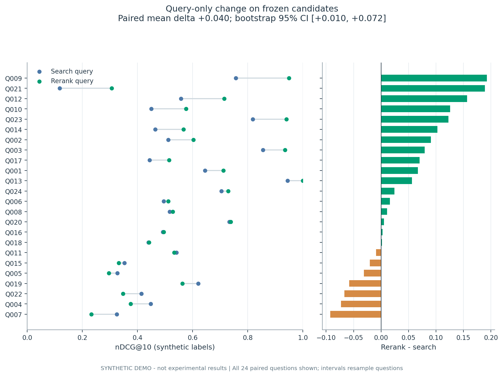
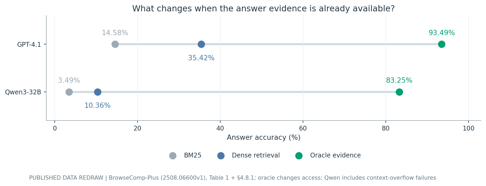
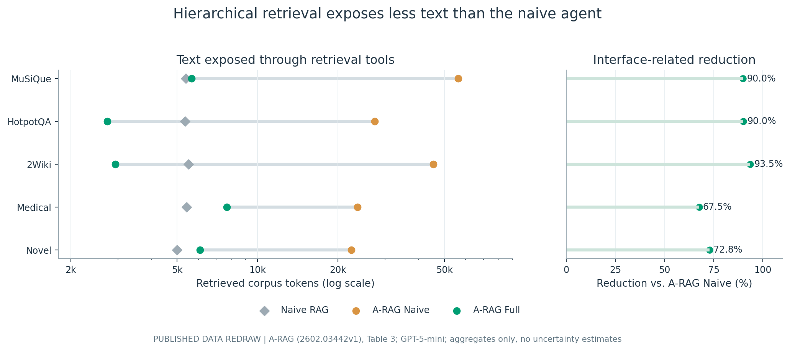
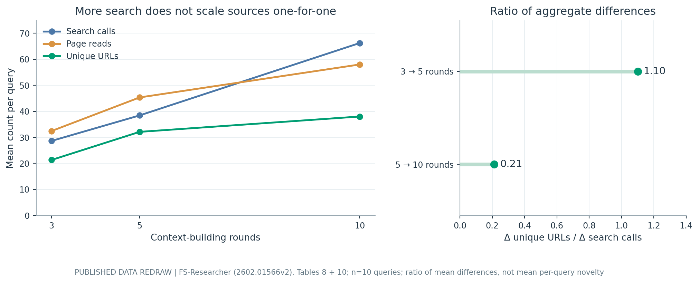
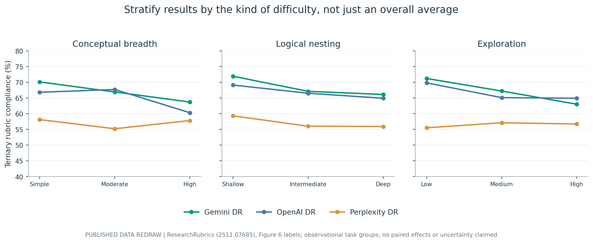

# Agentic Search 图表参考库

面向 search / rerank / 自主工具调用实验，按论文要回答的问题精选 12 张图。每张图附预览、可运行代码、输入数据和来源。

**文献数据重绘**（6 张）使用来源论文的公开数值；**合成数据模板**（6 张）仅用于展示画法。全部脚本由本仓库实现，图中数值均不属于我们的实验结果。

[精选总览](docs/gallery_overview.png)（[生成代码](scripts/build_curated_overview.py)） · [补充索引与筛选理由](SUPPLEMENT.md) · [论文与实验契合分析](paper_expansion/2026-11-01/RESEARCH_NOTES.md)

## 按论文用途选图

| 论文用途 | 图号 |
| --- | --- |
| 主结果与消融 | 01、02 |
| 重排与 Query 诊断 | 03、04、05 |
| 工具行为与证据效率 | 06、07、08 |
| 资源开销 | 09、10 |
| 失败归因与适用范围 | 11、12 |

实验比较应统一问题集、模型和停止条件。这里的“100 字符”指 search 与 rerank **返回给模型的长度预算**；主模型输入、检索暴露文本、reranker 开销需分别统计。以下是选图和迁移条件，不预设方法优劣。

## 一、主结果与消融

### 01 · 主结果表


**合成数据模板** · [代码](examples/19_results_table/plot.py) · [questions.csv](data/demo/questions.csv)、[tool_calls.csv](data/demo/tool_calls.csv) · [SVG](assets/19_results_table.svg)

在相同问题集、模型与返回字符预算下汇总准确率、主模型用量和耗时。

图型参考：[SciencePlots](https://github.com/garrettj403/SciencePlots)。

### 02 · 组件消融森林图


**合成数据模板** · [代码](examples/17_ablation_forest/plot.py) · [ablations.csv](data/demo/ablations.csv) · [SVG](assets/17_ablation_forest.svg)

展示 query、snippet、候选范围与调用时机的贡献；每项对照只改变一个变量。

图型参考：[SciencePlots](https://github.com/garrettj403/SciencePlots)。

## 二、重排与 Query 诊断

### 03 · Query 配对比较



**合成数据模板** · [代码](examples/08_query_paired_comparison/plot.py) · [query_pairs.csv](data/demo/query_pairs.csv) · [SVG](assets/08_query_paired_comparison.svg)

同题两种 query 在相同候选池、reranker 与片段设置下配对比较，直接观察逐题差值。

图型参考：[The-Python-Graph-Gallery](https://github.com/holtzy/The-Python-Graph-Gallery)。

### 04 · 证据排名迁移


**合成数据模板** · [代码](examples/07_rank_transition/plot.py) · [ranks.csv](data/demo/ranks.csv) · [SVG](assets/07_rank_transition.svg)

保留完整候选集中的前后排名；候选集外证据另计，避免只展示被提升的证据。

图型参考：[PyComplexHeatmap](https://github.com/DingWB/PyComplexHeatmap)。

### 05 · 证据充分对照



**文献数据重绘** · [代码](paper_expansion/2026-11-01/code/N03_oracle_evidence.py) · [browse_oracle.csv](paper_expansion/2026-11-01/data/browse_oracle.csv) · [SVG](paper_expansion/2026-11-01/figures/N03_oracle_evidence.svg)

诊断证据获取与后续推理的差距；Oracle 改变证据访问条件，不作为相同返回预算下的基线。

来源：[BrowseComp-Plus](https://arxiv.org/pdf/2508.06600v1#page=10)，2508.06600v1，Table 1 and §4.8.1。

## 三、工具行为与证据效率

### 06 · 工具调用与返回文本占比


**合成数据模板** · [代码](examples/04_call_vs_output_share/plot.py) · [tool_calls.csv](data/demo/tool_calls.csv) · [SVG](assets/04_call_vs_output_share.svg)

调用次数与返回字符采用各自分母；自动重排的后台计算需单独统计。

图型参考：[The-Python-Graph-Gallery](https://github.com/holtzy/The-Python-Graph-Gallery)。

### 07 · 检索暴露文本量



**文献数据重绘** · [代码](paper_expansion/2026-11-01/code/N01_retrieved_context.py) · [arag_context.csv](paper_expansion/2026-11-01/data/arag_context.csv) · [SVG](paper_expansion/2026-11-01/figures/N01_retrieved_context.svg)

将检索工具暴露的语料 token 与主模型累计输入分开；参考论文并非统一返回 100 字符的设置。

来源：[A-RAG](https://arxiv.org/pdf/2602.03442v1#page=8)，2602.03442v1，Table 3。

### 08 · 调用投入与独立来源增长



**文献数据重绘** · [代码](paper_expansion/2026-11-01/code/N07_source_growth.py) · [fs_scaling.csv](paper_expansion/2026-11-01/data/fs_scaling.csv) · [SVG](paper_expansion/2026-11-01/figures/N07_source_growth.svg)

检查更多调用是否增加独立来源；右图是均值差之比，不能解释为逐题新颖度。

来源：[FS-Researcher](https://arxiv.org/pdf/2602.01566v2#page=17)，2602.01566v2，Tables 8 and 10。

## 四、资源开销

### 09 · 逐题 Token 用量分布


**合成数据模板** · [代码](examples/02_token_raincloud/plot.py) · [questions.csv](data/demo/questions.csv) · [SVG](assets/02_token_raincloud.svg)

观察典型问题用量、离散程度和长尾；这里仅统计主模型输入，输出与 reranker 开销另计。

图型参考：[RainCloudPlots](https://github.com/RainCloudPlots/RainCloudPlots)。

### 10 · 模块耗时分解


**文献数据重绘** · [代码](paper_expansion/2026-11-01/code/N06_latency_components.py) · [fs_latency.csv](paper_expansion/2026-11-01/data/fs_latency.csv) · [SVG](paper_expansion/2026-11-01/figures/N06_latency_components.svg)

按模块定位瓶颈；参考数据中的 I/O 单列毫秒轴，我们的 reranker 需单独计时。

来源：[FS-Researcher](https://arxiv.org/pdf/2602.01566v2#page=22)，2602.01566v2，Table 15。

## 五、失败归因与适用范围

### 11 · 分层失败归因


**文献数据重绘** · [代码](paper_expansion/2026-11-01/code/N02_failure_hierarchy.py) · [arag_failures.csv](paper_expansion/2026-11-01/data/arag_failures.csv) · [SVG](paper_expansion/2026-11-01/figures/N02_failure_hierarchy.svg)

区分推理链、查询策略、语料缺失和 judge 问题；主类与子类使用不同分母，不能相加。

来源：[A-RAG](https://arxiv.org/pdf/2602.03442v1#page=15)，2602.03442v1，Tables 7–8; Figure 5。

### 12 · 任务难度分层



**文献数据重绘** · [代码](paper_expansion/2026-11-01/code/N05_task_complexity.py) · [rubric_complexity.csv](paper_expansion/2026-11-01/data/rubric_complexity.csv) · [SVG](paper_expansion/2026-11-01/figures/N05_task_complexity.svg)

为问题预先标注跳数和证据需求后分层比较；参考图为报告遵循率，不能当作 QA 准确率。

来源：[ResearchRubrics](https://arxiv.org/pdf/2511.07685v1#page=9)，2511.07685v1，Figure 6 printed numeric labels。

## 运行与替换数据

Python 3.10+。图片和 CSV 已存入仓库；更新目录与校验时保留已有图片：

```bash
python -m venv .venv
source .venv/bin/activate
python -m pip install -r requirements-lock.txt
python scripts/build_gallery.py --keep-existing-images
```

单图脚本均支持 `--data-dir`、`--output-dir` 和 `--formats`。建议输出到单独目录：

```bash
# 模板示例
python examples/08_query_paired_comparison/plot.py --data-dir data/demo --output-dir output/figures
# 文献数值重绘
python paper_expansion/2026-11-01/code/N02_failure_hierarchy.py --output-dir output/figures --formats png svg
```

模板字段定义见 [数据说明](data/README.md)；文献数值的原表、页码与文件校验信息见 [来源审计](paper_expansion/2026-11-01/data_provenance.json)。接入真实实验时重新核验指标、分母、配对关系和脚注。

```bash
python -m unittest discover -s tests -v
python scripts/package_release.py
```

## 目录与维护

- [catalog.json](catalog.json)：主图库的顺序、分类与补充条目，README 由它统一生成。
- `examples/`、`paper_expansion/2026-11-01/code/`：实际绘图脚本；`gallery.json` 和文献 `manifest.json` 保存源文件映射。
- [SUPPLEMENT.md](SUPPLEMENT.md)：未进入主图库的图及理由，图片与代码保留。
- [verification.json](verification.json)：文件摘要、代码与目录检查记录；不验证实验结论。

代码采用 [MIT 许可](LICENSE)。文献重绘保留论文署名与出处，参考项目的完整说明见 [REFERENCES.md](REFERENCES.md)。
