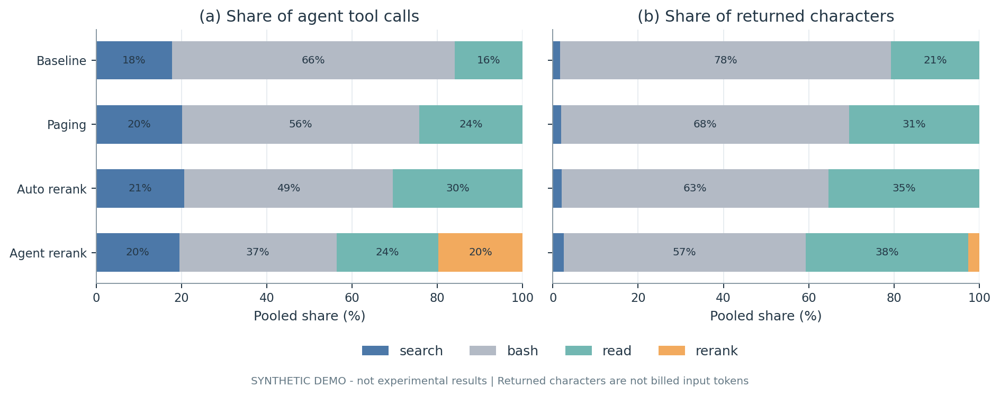
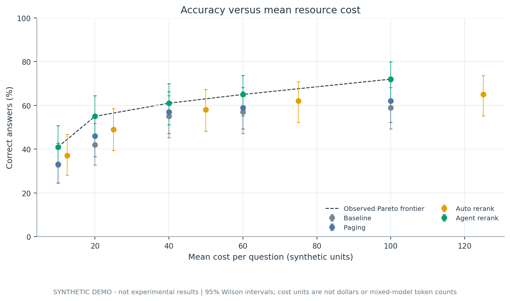
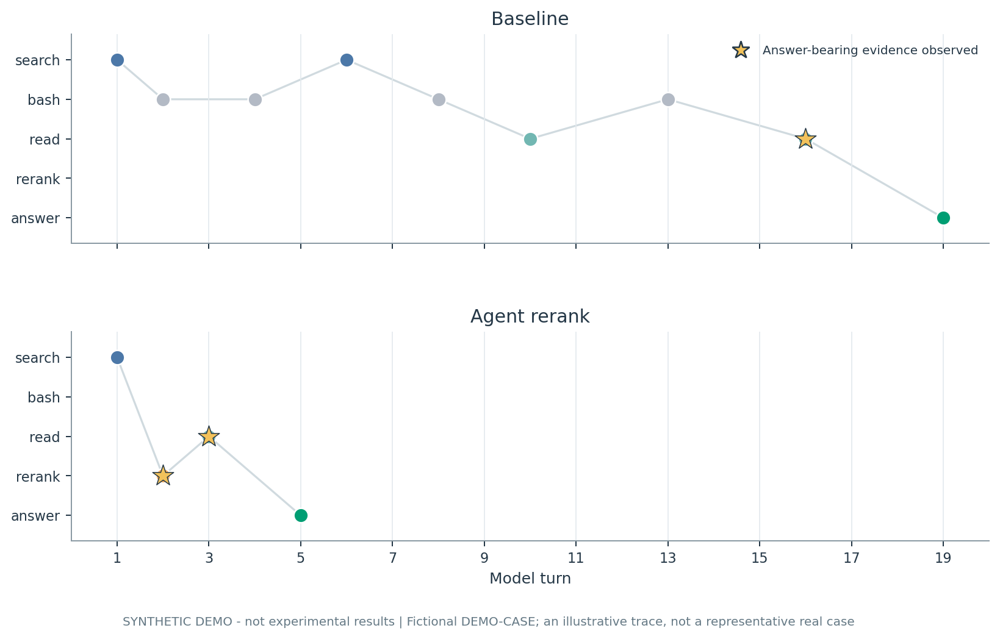
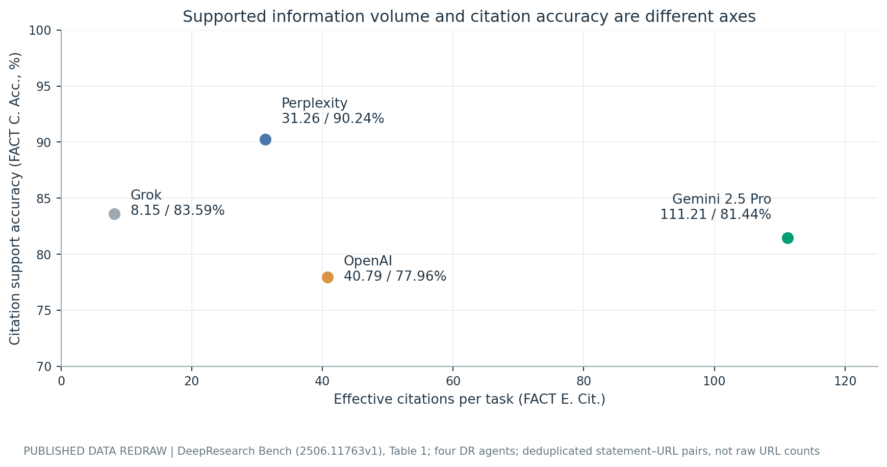

# Research Figure Gallery · 科研图表参考与代码

原有 10 张画法模板按用途展示，附仓库内代码；本轮新增的 Deep Research 真实文献数据图位于文末，另附出处和 CSV。

**下面的原有模板使用合成数据，尚未接入并核验你们的真实实验。** 合成脚本预设了部分方法差异和趋势；出图成功与统计检查通过不能证明实验结论。文末新增图使用各来源论文的数据，同样不属于我们的实验结果。

[图型来源](REFERENCES.md) · [数据与字段](data/README.md) · [视觉筛选记录](CURATION.md) · [缩略图速览](assets/overview.png)（[速览代码](scripts/contact_sheet.py)）

## 用途索引

| 用途 | 示例编号 |
| --- | --- |
| Token 与资源消耗 | 02 |
| 工具使用与行为 | 04 |
| 检索质量与证据利用 | 07、08 |
| 效果、预算与稳定性 | 09、12、14、19 |
| 失败分析与案例 | 16 |
| 消融分析 | 17 |

## A · Token 与资源消耗

### 02 · 逐题 Token 雨云图


**代码：[examples/02_token_raincloud/plot.py](examples/02_token_raincloud/plot.py)** · [SVG](assets/02_token_raincloud.svg) · [图型参考](https://github.com/RainCloudPlots/RainCloudPlots)

适用条件：统计每题完整轨迹的主模型输入；只能说明这一项用量分布，不能代替含 reranker 开销的总成本。

## B · 工具使用与行为

### 04 · 调用占比与返回字符占比



**代码：[examples/04_call_vs_output_share/plot.py](examples/04_call_vs_output_share/plot.py)** · [SVG](assets/04_call_vs_output_share.svg) · [图型参考](https://github.com/holtzy/The-Python-Graph-Gallery)

适用条件：从实际日志统计显式调用和返回字符；后台自动重排另记，不能按显式调用为零就认定没有开销。

## C · 检索质量与证据利用

### 07 · 重排前后排名迁移


**代码：[examples/07_rank_transition/plot.py](examples/07_rank_transition/plot.py)** · [SVG](assets/07_rank_transition.svg) · [图型参考](https://github.com/DingWB/PyComplexHeatmap)

适用条件：同一候选快照须有真实证据标注及完整前后排名；候选集外和跌出 Top-K 的证据均需保留。

### 08 · 两种 Query 的配对哑铃图


**代码：[examples/08_query_paired_comparison/plot.py](examples/08_query_paired_comparison/plot.py)** · [SVG](assets/08_query_paired_comparison.svg) · [图型参考](https://github.com/holtzy/The-Python-Graph-Gallery)

适用条件：比较同题两种 query 时固定候选集、reranker、片段和返回预算，并用真实相关性标签计算指标。

## D · 效果、预算与稳定性

### 09 · 逐题效果变化与 Token 变化


**代码：[examples/09_token_outcome_pairs/plot.py](examples/09_token_outcome_pairs/plot.py)** · [SVG](assets/09_token_outcome_pairs.svg) · [图型参考](https://arxiv.org/abs/2608.02751)

适用条件：按题号配对真实对错与 token；展示相关变化，不能据此单独归因于自主调用。

### 12 · 准确率—成本 Pareto 图



**代码：[examples/12_accuracy_cost_frontier/plot.py](examples/12_accuracy_cost_frontier/plot.py)** · [SVG](assets/12_accuracy_cost_frontier.svg) · [图型参考](https://github.com/garrettj403/SciencePlots)

适用条件：使用同一评测集和一致的实际成本口径，计入主模型及 reranker；禁止用合成 cost_units 解释真实效率。

### 14 · 预算—效果曲线


**代码：[examples/14_budget_accuracy/plot.py](examples/14_budget_accuracy/plot.py)** · [SVG](assets/14_budget_accuracy.svg) · [图型参考](https://github.com/garrettj403/SciencePlots)

适用条件：每个预算下实际运行评测；事后截断完整轨迹不能代替独立预算实验。

### 19 · 论文主结果表


**代码：[examples/19_results_table/plot.py](examples/19_results_table/plot.py)** · [SVG](assets/19_results_table.svg) · [图型参考](https://github.com/garrettj403/SciencePlots)

适用条件：统一问题集、模型、返回字符预算和停止条件，接入真实评测结果；不能将演示排序当作当前实验结论。

## E · 失败分析与案例

### 16 · 工具轨迹与证据时间线



**代码：[examples/16_trajectory_timeline/plot.py](examples/16_trajectory_timeline/plot.py)** · [SVG](assets/16_trajectory_timeline.svg) · [图型参考](https://github.com/holtzy/The-Python-Graph-Gallery)

适用条件：替换为可追溯的真实题号、动作和证据事件，并交代案例选择依据；单个案例不能证明整体提升。

## F · 消融分析

### 17 · 消融效果森林图


**代码：[examples/17_ablation_forest/plot.py](examples/17_ablation_forest/plot.py)** · [SVG](assets/17_ablation_forest.svg) · [图型参考](https://github.com/garrettj403/SciencePlots)

适用条件：先核验工具实现，再一次只改变 query、snippet、范围或时机中的一项，其他条件固定并按题配对。

## 运行与替换数据

Python 3.10+；默认读取已提交的 `data/demo/`，输出到 `assets/`。

```bash
python -m venv .venv
source .venv/bin/activate
python -m pip install -r requirements-lock.txt
python scripts/build_gallery.py
```

只运行某张图，或使用自己的 CSV：

```bash
python examples/02_token_raincloud/plot.py
python examples/02_token_raincloud/plot.py --data-dir /path/to/csv --output-dir /path/to/figures --formats png svg pdf
```

输入文件映射见 [gallery.json](gallery.json)，CSV 字段和统计口径见 [data/README.md](data/README.md)。共享样式与统计函数位于 [gallerylib/__init__.py](gallerylib/__init__.py)。接入真实数据时需同时核验指标定义、对照条件、单位和脚注。

```bash
python -m unittest discover -s tests -v
python scripts/package_release.py
```

[verification.json](verification.json) 记录代码与数据检查、图片校验及 SHA-256，不验证实验是否成立。代码采用 [MIT 许可](LICENSE)；外部参考项目保留各自许可。

## 新增 · Deep Research 文献真实数据图

本轮核查 8 篇已有资料索引之外的论文，从其中 6 篇新增 8 张图。**新增图均由论文表格或图上明确打印的真实数值重绘；不是我们的实验结果，也不是作者原出图脚本。** 每图附 CSV、出处页码和本地绘图代码，未猜测未公开的逐题数据或误差区间。

[论文内容与实验契合分析](paper_expansion/2026-11-01/RESEARCH_NOTES.md) · [审美筛选记录](paper_expansion/2026-11-01/AESTHETIC_REVIEW.md) · [数据来源审计](paper_expansion/2026-11-01/data_provenance.json) · [新图速览](paper_expansion/2026-11-01/new_figures_overview.png)（[速览代码](paper_expansion/2026-11-01/contact_sheet.py)）

### G · 失败归因与证据利用

**N02_failure_hierarchy · 失败原因及其内部构成**


[绘图代码](paper_expansion/2026-11-01/code/N02_failure_hierarchy.py) · [CSV](paper_expansion/2026-11-01/data/arag_failures.csv) · [SVG](paper_expansion/2026-11-01/figures/N02_failure_hierarchy.svg) · [论文原表／原图页](https://arxiv.org/pdf/2602.03442v1#page=15)

出处：2602.03442v1，Tables 7–8; Figure 5。契合点：区分取证失败、推理误用、查询策略问题和judge误判。

先固定失败样本与标注规则；右图分母只含推理链错误，不能与左图直接相加。

**N03_oracle_evidence · 证据充分时还有多大差距**


[绘图代码](paper_expansion/2026-11-01/code/N03_oracle_evidence.py) · [CSV](paper_expansion/2026-11-01/data/browse_oracle.csv) · [SVG](paper_expansion/2026-11-01/figures/N03_oracle_evidence.svg) · [论文原表／原图页](https://arxiv.org/pdf/2508.06600v1#page=10)

出处：2508.06600v1，Table 1 and §4.8.1。契合点：用证据充分诊断检查reranker能力与模型使用证据能力。

只作诊断条件，不能冒充同返回预算下的公平baseline；Qwen包含上下文溢出失败。

### H · 检索暴露量与来源增长

**N01_retrieved_context · 检索接口暴露了多少文本**


[绘图代码](paper_expansion/2026-11-01/code/N01_retrieved_context.py) · [CSV](paper_expansion/2026-11-01/data/arag_context.csv) · [SVG](paper_expansion/2026-11-01/figures/N01_retrieved_context.svg) · [论文原表／原图页](https://arxiv.org/pdf/2602.03442v1#page=8)

出处：2602.03442v1，Table 3。契合点：把工具返回文本量与主模型累计输入分开统计。

需要每次工具返回的实际token/字符及去重文档ID；原论文并未控制为100字符。

**N07_source_growth · 搜索投入与独立来源增长**


[绘图代码](paper_expansion/2026-11-01/code/N07_source_growth.py) · [CSV](paper_expansion/2026-11-01/data/fs_scaling.csv) · [SVG](paper_expansion/2026-11-01/figures/N07_source_growth.svg) · [论文原表／原图页](https://arxiv.org/pdf/2602.01566v2#page=17)

出处：2602.01566v2，Tables 8 and 10。契合点：统计多次调用是否只重复暴露旧文档，区分调用多与新证据多。

图右是均值之差的比值，不是逐题新颖度；静态语料中可将URL换为文档ID。

### I · 引用与任务难度

**N04_citation_support · 有效证据量与引用支持率**



[绘图代码](paper_expansion/2026-11-01/code/N04_citation_support.py) · [CSV](paper_expansion/2026-11-01/data/deepbench_fact.csv) · [SVG](paper_expansion/2026-11-01/figures/N04_citation_support.svg) · [论文原表／原图页](https://arxiv.org/pdf/2506.11763v1#page=6)

出处：2506.11763v1，Table 1; Figure 1 (right)。契合点：相关snippet是否变成了能支持答案的证据。

先要求可追溯的答案–证据ID对应，再做支持性核验；FACT不等于检索相关性。

**N05_task_complexity · 按不同困难类型分层**


[绘图代码](paper_expansion/2026-11-01/code/N05_task_complexity.py) · [CSV](paper_expansion/2026-11-01/data/rubric_complexity.csv) · [SVG](paper_expansion/2026-11-01/figures/N05_task_complexity.svg) · [论文原表／原图页](https://arxiv.org/pdf/2511.07685v1#page=9)

出处：2511.07685v1，Figure 6 printed numeric labels。契合点：总体分数之外，看多跳、证据需求和探索程度是否改变方案收益。

原图是长报告rubric指标；迁移到QA需重新定义分层标签，不能照搬分数或声称因果。

### J · 阶段耗时与评估可靠性

**N06_latency_components · 耗时究竟花在哪一环**


[绘图代码](paper_expansion/2026-11-01/code/N06_latency_components.py) · [CSV](paper_expansion/2026-11-01/data/fs_latency.csv) · [SVG](paper_expansion/2026-11-01/figures/N06_latency_components.svg) · [论文原表／原图页](https://arxiv.org/pdf/2602.01566v2#page=22)

出处：2602.01566v2，Table 15。契合点：给主模型、检索、重排、读文件分别计时，找到真正瓶颈。

目前参考数据只有LLM、网页工具、I/O；我们的reranker耗时需要单独埋点。

**N08_evaluator_budget · 评估费用与人类一致性**


[绘图代码](paper_expansion/2026-11-01/code/N08_evaluator_budget.py) · [CSV](paper_expansion/2026-11-01/data/judge_batch.csv) · [SVG](paper_expansion/2026-11-01/figures/N08_evaluator_budget.svg) · [论文原表／原图页](https://arxiv.org/pdf/2601.08536v3#page=8)

出处：2601.08536v3，Table 4。契合点：确认自动判分稳定，避免把judge误差误认为重排收益或退化。

费用是评估器费用，F1是与人工标注一致性；不属于agent推理成本。

新增图可单独复现，不改写原有图片：

```bash
python paper_expansion/2026-11-01/build.py
```

原始论文下载与 SHA-256 校验：`python paper_expansion/2026-11-01/fetch_sources.py`。作者仓库已按固定提交检查，本轮未定位到这些图对应的作者出图脚本；上面的“绘图代码”均是仓库内的重绘实现。
