# Rerank Research Figure Gallery

面向 search、rerank 与自主工具调用实验的科研绘图参考库。本页逐张展示 **34 张图**，说明**怎么看、适合放在论文哪里、需要什么数据，以及对应代码**。

[全部代码索引](docs/FIGURE_INDEX.md) · [精选图与研究问题](docs/GALLERY.md) · [Rerank 模板使用指南](rerank_templates/2026-11-16/README.md) · [安装与构建](#quick-start)

其中 26 个是本地可运行实现；8 个是 GitHub 上游原图与代码参考，**未在本项目完整执行**。每图标明论文数值、合成示例或上游示例；这些数值均不是我们的实测结果。论文位置是根据图所回答的问题给出的建议，最终取决于真实实验设计与结果。

如果先准备 rerank 论文的三张核心实验图，可从 [T01 子集收益](#t01)、[T02 耗时分布](#t02)、[T03 质量与开销](#t03) 开始；是否采用应由可用数据和论文主张决定。

<a id="figure-catalog"></a>

## 图表目录

**[可运行的 Rerank 模板 · 3 张](#templates)**

[T01 子集收益森林图](#t01) · [T02 分面耗时雨云图](#t02) · [T03 质量—开销 Pareto 图](#t03)

**[精选图库 · 15 张](#selected)**

[M01 推理时重排对最终回答的影响](#m01) · [M02 前 5 条中的含答案材料召回](#m02) · [M03 主结果表](#m03) · [M04 输入顺序鲁棒性](#m04) · [M05 Query 配对比较](#m05) · [M06 证据排名迁移](#m06) · [M07 重排窗口重叠的成本与收益](#m07) · [M08 模型规模与任务差异](#m08) · [M09 组件消融森林图](#m09) · [M10 解码方式与重排时延](#m10) · [M11 逐题 Token 用量分布](#m11) · [M12 工具调用与返回文本占比](#m12) · [M13 模块耗时分解](#m13) · [M14 证据充分对照](#m14) · [M15 分层失败归因](#m15)

**[补充图库 · 8 张](#supplement)**

[S01 逐题结果与 Token 联动](#s01) · [S02 预算—效果曲线](#s02) · [S03 工具轨迹时间线](#s03) · [S04 引用支持率与有效证据量](#s04) · [S05 评估费用与人类一致性](#s05) · [S06 检索暴露文本量](#s06) · [S07 调用投入与独立来源增长](#s07) · [S08 任务难度分层](#s08)

**[GitHub 原图参考 · 8 张](#github)**

[G01 配对样本与均值差分布](#g01) · [G02 多方法分组森林图](#g02) · [G03 平均百分位秩与差异检验（模拟演示）](#g03) · [G04 分面雨云图：分布、散点与四分位](#g04) · [G05 附注释的分组热图](#g05) · [G06 非支配方案的 Pareto 散点图](#g06) · [G07 证据集合交集与分布联合图](#g07) · [G08 共享说明的矩阵式多面板布局](#g08)

<a id="templates"></a>

## 可运行的 Rerank 模板 · 3 张

<a id="t01"></a>

### T01 · 子集收益森林图

**合成模板 · 本地可运行**


**这张图怎么看：** 每个 benchmark 内按 All 与题型分组，点表示候选方法减去 baseline 的逐题平均分差，横线为配对题目 bootstrap 的 95% 区间。先看零线两侧的方向，再结合样本量与区间宽度判断估计是否稳定。

**适合放在论文哪里：** 适合正文的分组结果或误差分析；当总体均值可能掩盖不同题型的收益与损失时使用。

**换成我们的实验需要：** 需要各方法在同一 benchmark 中严格对应的 question_id、逐题 score、预先定义的 subset，以及统一指标单位和 baseline 配置；失败题也应按既定计分规则保留。

**使用边界：** 当前为合成示例，All 与其子组重叠，区间未做多重比较校正，不能将这些行视为独立证据累加。

<details>
<summary>代码、数据与复现</summary>

[主代码](rerank_templates/2026-11-16/plot_forest.py) · [公共函数](rerank_templates/2026-11-16/common.py)

输入：[逐题 CSV](rerank_templates/2026-11-16/data/demo/observations.csv) · [配置](rerank_templates/2026-11-16/config.json)。

安装下方依赖后，在仓库根目录执行：

```bash
python rerank_templates/2026-11-16/plot_forest.py --output-dir dist/t01 --formats png svg
```

</details>

图型参考：[LSYS/forestplot](https://github.com/LSYS/forestplot/blob/b7591e3be7004f9962fd7cd7f91aa4cac91c45fc/docs/images/multimodel.png)；本库独立实现，默认数据为合成示例。

[返回图表目录](#figure-catalog)

<a id="t02"></a>

### T02 · 分面耗时雨云图

**合成模板 · 本地可运行**

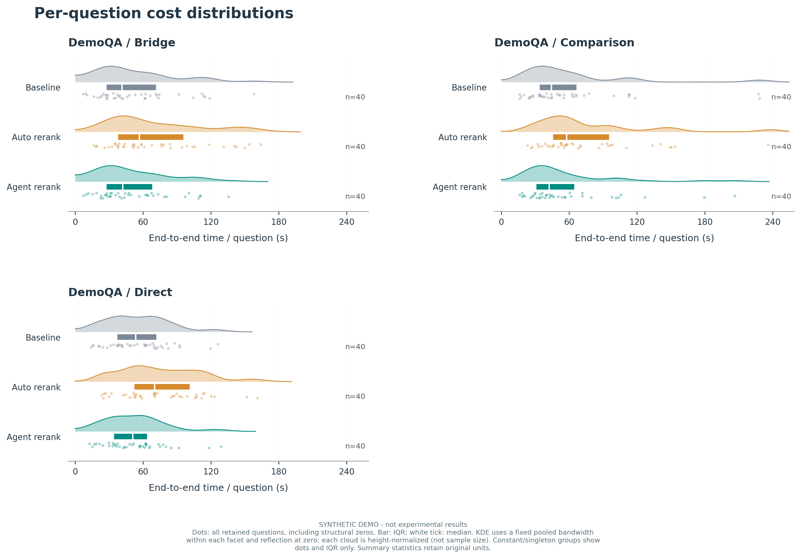

**这张图怎么看：** 每个小面板是一种 benchmark／题型组合，散点保留逐题成本，粗条与短线显示四分位区间和中位数，半侧密度展示分布形状。默认横轴为线性尺度，也可使用保留零值的 log1p 位置变换，刻度仍标原单位。

**适合放在论文哪里：** 适合正文效率分析或附录的长尾诊断；当平均耗时或平均 token 无法说明极端开销时使用。

**换成我们的实验需要：** 需要逐题记录一种明确的成本指标、方法、benchmark、题型和终止状态；结构性零值应记为 0，未知成本留空并采用明确的整题筛选规则。

**使用边界：** 当前为合成示例，每条密度单独归一化高度，云形宽度不代表样本量，缺失成本也不能当成零。

<details>
<summary>代码、数据与复现</summary>

[主代码](rerank_templates/2026-11-16/plot_raincloud.py) · [公共函数](rerank_templates/2026-11-16/common.py)

输入：[逐题 CSV](rerank_templates/2026-11-16/data/demo/observations.csv) · [配置](rerank_templates/2026-11-16/config.json)。

安装下方依赖后，在仓库根目录执行：

```bash
python rerank_templates/2026-11-16/plot_raincloud.py --output-dir dist/t02 --formats png svg
```

</details>

图型参考：[RainCloudPlots/RainCloudPlots](https://github.com/RainCloudPlots/RainCloudPlots/blob/4ceeb06dc5bd5b9911e7147d1b0b452c4c2f9b1d/figs/tutorial_python/figureP13.png)；本库独立实现，默认数据为合成示例。

[返回图表目录](#figure-catalog)

<a id="t03"></a>

### T03 · 质量—开销 Pareto 图

**合成模板 · 本地可运行**


**这张图怎么看：** 每个点是一种方法在同一批题目上的平均成本与平均质量，横纵线分别为题目 bootstrap 的 95% 边际区间。实心双圈强调观测均值中未被其他方法同时以更低成本和更高质量压过的配置，空心点表示被支配的配置。

**适合放在论文哪里：** 适合正文效率—质量比较；当需要选择 reranker、触发策略或预算配置，且质量与资源均有实测记录时使用。

**换成我们的实验需要：** 需要每个 benchmark 内所有方法共享的逐题质量与成本记录、硬件和并发设置；成本缺失时必须同步排除该题的所有方法及质量记录。

**使用边界：** 当前为合成示例，非支配只描述观测均值，横纵边际区间不是联合置信区域，也不能据此声称统计显著胜出。

<details>
<summary>代码、数据与复现</summary>

[主代码](rerank_templates/2026-11-16/plot_pareto.py) · [公共函数](rerank_templates/2026-11-16/common.py)

输入：[逐题 CSV](rerank_templates/2026-11-16/data/demo/observations.csv) · [配置](rerank_templates/2026-11-16/config.json)。

安装下方依赖后，在仓库根目录执行：

```bash
python rerank_templates/2026-11-16/plot_pareto.py --output-dir dist/t03 --formats png svg
```

</details>

图型参考：[tommyod/paretoset](https://github.com/tommyod/paretoset/blob/6f2803057085a696cbe10118ca3164d993cee175/scripts/example_optimization.png)；本库独立实现，默认数据为合成示例。

[返回图表目录](#figure-catalog)

<a id="selected"></a>

## 精选图库 · 15 张

<a id="m01"></a>

### M01 · 推理时重排对最终回答的影响

**论文数值重绘 · 本地可运行**

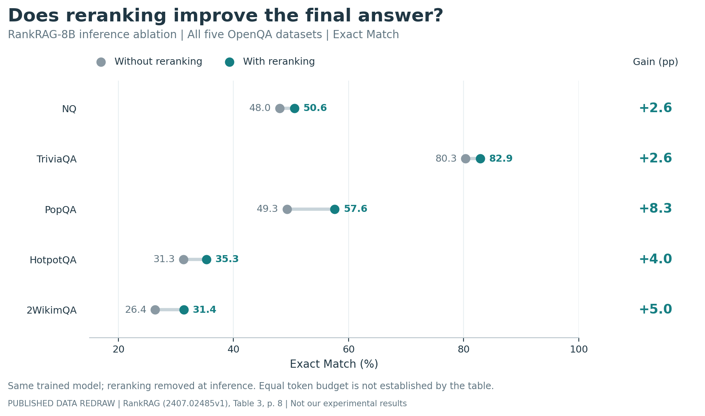

**这张图怎么看：** 每行是一个 OpenQA 任务，两个点比较同一训练模型在推理时关闭和启用重排的 Exact Match，右侧列出百分点差。现图重绘 RankRAG 的公开表格，可借其结构区分重排前后的最终回答质量。

**适合放在论文哪里：** 适合正文主结果或重排开关消融；当研究问题是重排是否改变最终回答，而非只改变排序指标时使用。

**换成我们的实验需要：** 需要同一题集上开启／关闭重排的逐题最终答案、统一 EM 判定、相同生成模型及检索设置，并另记上下文长度和实际成本。

**使用边界：** 原表不构成同 token 预算证明，论文 EM 也不能与其他图中的 F1、召回或不同 benchmark 分数混合排名。

<details>
<summary>代码、数据与复现</summary>

[主代码](rerank_expansion/2026-11-15/code/R01_rerank_qa.py) · [公共函数](rerank_expansion/2026-11-15/plotlib.py)

输入：[rankrag_qa_ablation.csv](rerank_expansion/2026-11-15/data/rankrag_qa_ablation.csv)。

安装下方依赖后，在仓库根目录执行：

```bash
python rerank_expansion/2026-11-15/code/R01_rerank_qa.py --output-dir dist/m01 --formats png svg
```

</details>

来源：[RankRAG](https://arxiv.org/pdf/2407.02485v1#page=8)，2407.02485v1，Table 3。

[返回图表目录](#figure-catalog)

<a id="m02"></a>

### M02 · 前 5 条中的含答案材料召回

**论文数值重绘 · 本地可运行**

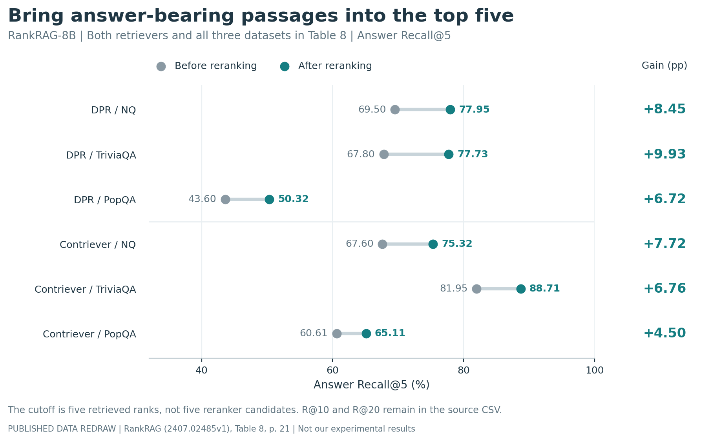

**这张图怎么看：** 每行对应一个数据集与检索器组合，比较重排前后前 5 条材料中出现答案的 Recall@5，连线长度表示变化。现图包含原表全部六个组合，其他 k 值仍保留在输入 CSV 中。

**适合放在论文哪里：** 适合正文排序质量分析，作为最终回答结果之前的中间证据；当方法目标是把含答案材料提前送入有限上下文时使用。

**换成我们的实验需要：** 需要冻结的候选集合、重排前后完整顺序、逐题答案或含答案材料标注，以及固定的读取截断 k；候选池大小应另列。

**使用边界：** 这里的 Answer Recall 是含答案材料命中率，不是全部 gold 文档的召回率，k=5 也不是重排候选数量。

<details>
<summary>代码、数据与复现</summary>

[主代码](rerank_expansion/2026-11-15/code/R02_answer_recall.py) · [公共函数](rerank_expansion/2026-11-15/plotlib.py)

输入：[rankrag_answer_recall.csv](rerank_expansion/2026-11-15/data/rankrag_answer_recall.csv)。

安装下方依赖后，在仓库根目录执行：

```bash
python rerank_expansion/2026-11-15/code/R02_answer_recall.py --output-dir dist/m02 --formats png svg
```

</details>

来源：[RankRAG](https://arxiv.org/pdf/2407.02485v1#page=21)，2407.02485v1，Table 8。

[返回图表目录](#figure-catalog)

<a id="m03"></a>

### M03 · 主结果表

**合成模板 · 本地可运行**

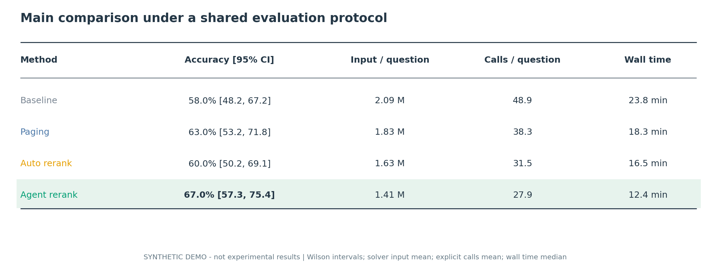

**这张图怎么看：** 每行汇总一种方法的准确率及 Wilson 95% 区间、每题平均主模型输入、平均显式工具调用数和耗时中位数。浅色底纹仅标出当前合成示例中准确率最高的行，不能替代成本与不确定性的比较。

**适合放在论文哪里：** 适合正文主结果表；当各方法采用同一题集和评价协议，需要把质量与主要开销放在一处时使用。

**换成我们的实验需要：** 需要逐题正确性、主模型 input tokens、端到端耗时，以及逐工具调用账本；明确超时和未完成题的分母、后台重排是否计入调用或另行计费。

**使用边界：** 表中均值、中位数和准确率区间的统计对象不同，单方法 Wilson 区间不能直接当作方法间配对差值的置信区间。

<details>
<summary>代码、数据与复现</summary>

[主代码](examples/19_results_table/plot.py) · [公共函数](gallerylib/__init__.py)

输入：[questions.csv](data/demo/questions.csv) · [tool_calls.csv](data/demo/tool_calls.csv)。

安装下方依赖后，在仓库根目录执行：

```bash
python examples/19_results_table/plot.py --output-dir dist/m03 --formats png svg
```

</details>

图型参考：[SciencePlots](https://github.com/garrettj403/SciencePlots)。

[返回图表目录](#figure-catalog)

<a id="m04"></a>

### M04 · 输入顺序鲁棒性

**论文数值重绘 · 本地可运行**

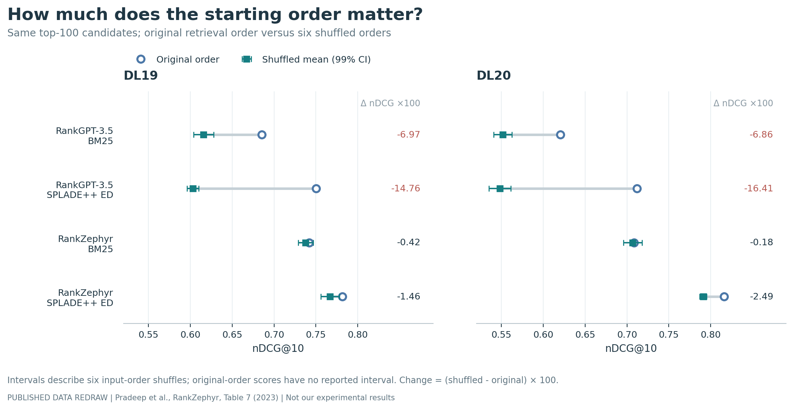

**这张图怎么看：** 每个面板是一个排序 benchmark，每行将原始候选顺序下的 nDCG@10 与多次打乱后的均值和 99% 区间并排展示。右侧差值以 nDCG×100 表示，用来观察初始位置改变后的敏感性。

**适合放在论文哪里：** 适合正文鲁棒性实验或附录；当 listwise／pairwise 重排可能依赖输入顺序，或声称对候选排列稳定时使用。

**换成我们的实验需要：** 需要相同候选文档与相关性标注、固定模型和提示词、多次随机排列的种子与输出排序，并保存每次完整评价结果。

**使用边界：** 现图区间来自 RankZephyr 原文六次打乱，不是逐题差值区间，也不能证明所有可能排列都稳定。

<details>
<summary>代码、数据与复现</summary>

[主代码](rerank_expansion/2026-11-15/code/R03_order_robustness.py) · [公共函数](rerank_expansion/2026-11-15/plotlib.py)

输入：[rankzephyr_order_robustness.csv](rerank_expansion/2026-11-15/data/rankzephyr_order_robustness.csv)。

安装下方依赖后，在仓库根目录执行：

```bash
python rerank_expansion/2026-11-15/code/R03_order_robustness.py --output-dir dist/m04 --formats png svg
```

</details>

来源：[RankZephyr](https://arxiv.org/pdf/2312.02724v1#page=11)，2312.02724v1，Table 7。

[返回图表目录](#figure-catalog)

<a id="m05"></a>

### M05 · Query 配对比较

**合成模板 · 本地可运行**


**这张图怎么看：** 左侧逐题连接 search query 与 rerank query 的 nDCG@10，右侧显示同题的 rerank-minus-search 差值，行按差值排序。标题给出配对平均差及 bootstrap 区间，负向条也完整保留。

**适合放在论文哪里：** 适合正文 query 消融或附录案例诊断；当只想隔离查询措辞对重排的影响时使用。

**换成我们的实验需要：** 需要同题两种 query、完全相同的候选池、片段和 reranker，以及同一套 qrels 计算的逐题排序分数。

**使用边界：** 当前标签与数值均为合成示例，若两种 query 同时改变检索候选，就不能把差值解释为 query 对重排本身的独立作用。

<details>
<summary>代码、数据与复现</summary>

[主代码](examples/08_query_paired_comparison/plot.py) · [公共函数](gallerylib/__init__.py)

输入：[query_pairs.csv](data/demo/query_pairs.csv)。

安装下方依赖后，在仓库根目录执行：

```bash
python examples/08_query_paired_comparison/plot.py --output-dir dist/m05 --formats png svg
```

</details>

图型参考：[The-Python-Graph-Gallery](https://github.com/holtzy/The-Python-Graph-Gallery)。

[返回图表目录](#figure-catalog)

<a id="m06"></a>

### M06 · 证据排名迁移

**合成模板 · 本地可运行**


**这张图怎么看：** 纵轴是已知证据重排前的名次区间，横轴是重排后的区间，格内同时给出计数和原始名次组内的比例。颜色按行归一化，往左移动表示证据进入更靠前的区间，候选池外的证据单独计数。

**适合放在论文哪里：** 适合正文机制分析或附录；当需要说明哪些证据被提前、哪些证据被压后，而不只报告平均 nDCG 时使用。

**换成我们的实验需要：** 需要逐题可追溯的证据文档 ID、候选池成员状态和完整前后排名，并预先定义互斥的排名分箱。

**使用边界：** 当前为合成示例，颜色不是全体证据占比，不能只留下进入 top-k 的证据或把候选池外证据伪造为末位。

<details>
<summary>代码、数据与复现</summary>

[主代码](examples/07_rank_transition/plot.py) · [公共函数](gallerylib/__init__.py)

输入：[ranks.csv](data/demo/ranks.csv)。

安装下方依赖后，在仓库根目录执行：

```bash
python examples/07_rank_transition/plot.py --output-dir dist/m06 --formats png svg
```

</details>

图型参考：[PyComplexHeatmap](https://github.com/DingWB/PyComplexHeatmap)。

[返回图表目录](#figure-catalog)

<a id="m07"></a>

### M07 · 重排窗口重叠的成本与收益

**论文数值重绘 · 本地可运行**


**这张图怎么看：** DL19 与 DL20 分开绘图，横轴为每题重排时延，纵轴为 nDCG@10×100，点上标注固定窗口 20 时不同步长和调用次数。各点是离散配置，用于并读质量变化与窗口重叠带来的计算成本。

**适合放在论文哪里：** 适合正文效率消融；当实际实现采用滑动窗口 listwise 重排，需要选择窗口重叠程度时使用。

**换成我们的实验需要：** 需要同一候选池、模型、硬件和文本长度下，各窗口／步长配置的逐题排序分数、调用次数、输入输出 token 和重排时延。

**使用边界：** 现图仅使用原论文同一张表的数据，caption 与正文的模型名称存在冲突，不能外推为任意 reranker 或其他硬件的速度规律。

<details>
<summary>代码、数据与复现</summary>

[主代码](rerank_expansion/2026-11-15/code/R05_window_budget.py) · [公共函数](rerank_expansion/2026-11-15/plotlib.py)

输入：[first_window_budget.csv](rerank_expansion/2026-11-15/data/first_window_budget.csv)。

安装下方依赖后，在仓库根目录执行：

```bash
python rerank_expansion/2026-11-15/code/R05_window_budget.py --output-dir dist/m07 --formats png svg
```

</details>

来源：[Accelerating Listwise Reranking](https://zijianchen.ca/papers/Accelerating%20Listwise%20Reranking%20Reproducing%20and%20Enhancing%20FIRST.pdf#page=7)，SIGIR 2025 author PDF; SHA256 snapshot 2026-11-15，Table 6。

[返回图表目录](#figure-catalog)

<a id="m08"></a>

### M08 · 模型规模与任务差异

**论文数值重绘 · 本地可运行**

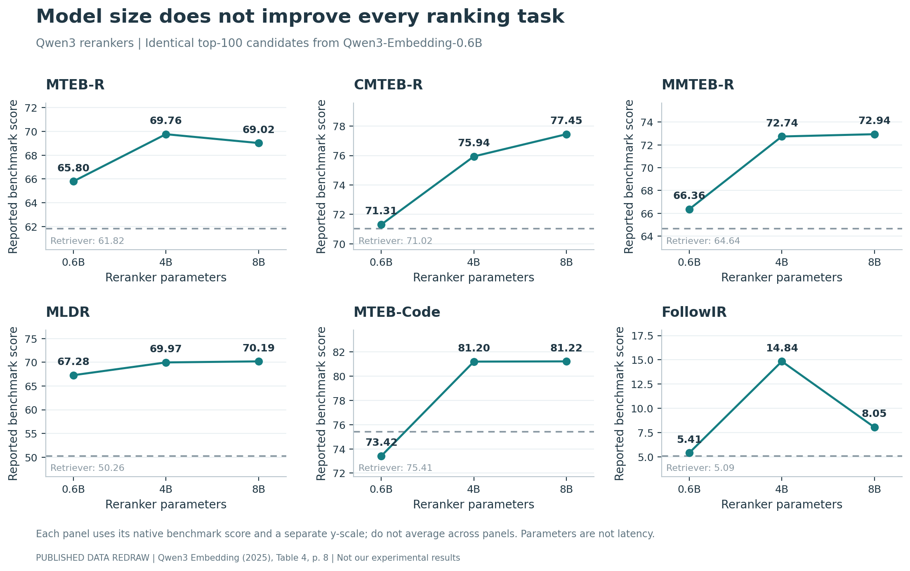

**这张图怎么看：** 六个面板分别展示一种任务的原生 benchmark 分数，比较 0.6B、4B、8B 重排器，并保留 retriever-only 参照。各面板使用独立纵轴，阅读重点是同一任务内的配置变化，而非跨面板比较点的高度。

**适合放在论文哪里：** 适合正文模型规模消融或附录跨任务评测；当需要选择模型容量并检查不同任务是否一致受益时使用。

**换成我们的实验需要：** 需要各模型在每个任务同一候选集合上的评价结果、指标定义和检索基线；若讨论效率，还需单独测量时延、显存及 token。

**使用边界：** Qwen3 论文各列不是统一量纲，不能直接平均或混合排名，参数量也不能代替实测成本。

<details>
<summary>代码、数据与复现</summary>

[主代码](rerank_expansion/2026-11-15/code/R06_model_scaling.py) · [公共函数](rerank_expansion/2026-11-15/plotlib.py)

输入：[qwen3_scaling.csv](rerank_expansion/2026-11-15/data/qwen3_scaling.csv)。

安装下方依赖后，在仓库根目录执行：

```bash
python rerank_expansion/2026-11-15/code/R06_model_scaling.py --output-dir dist/m08 --formats png svg
```

</details>

来源：[Qwen3 Embedding](https://arxiv.org/pdf/2506.05176v3#page=8)，2506.05176v3，Table 4。

[返回图表目录](#figure-catalog)

<a id="m09"></a>

### M09 · 组件消融森林图

**合成模板 · 本地可运行**


**这张图怎么看：** 每行显示一个消融版本相对完整系统的准确率差，零线左侧表示该版本在示例中的分数更低，横线是逐题配对 bootstrap 的 95% 区间。右侧文字给出差值与区间，便于同时查看效应大小和不确定性。

**适合放在论文哪里：** 适合正文组件消融；当需要区分 query、snippet、候选范围或调用时机的贡献时使用。

**换成我们的实验需要：** 需要完整系统和各消融版本在同一题集上的逐题正确性，且每个对照只改变明确的一项设置，并记录交互因素。

**使用边界：** 当前为合成示例，各组件的独立消融差值不能直接相加为总贡献，区间也未进行多重比较校正。

<details>
<summary>代码、数据与复现</summary>

[主代码](examples/17_ablation_forest/plot.py) · [公共函数](gallerylib/__init__.py)

输入：[ablations.csv](data/demo/ablations.csv)。

安装下方依赖后，在仓库根目录执行：

```bash
python examples/17_ablation_forest/plot.py --output-dir dist/m09 --formats png svg
```

</details>

图型参考：[SciencePlots](https://github.com/garrettj403/SciencePlots)。

[返回图表目录](#figure-catalog)

<a id="m10"></a>

### M10 · 解码方式与重排时延

**论文数值重绘 · 本地可运行**

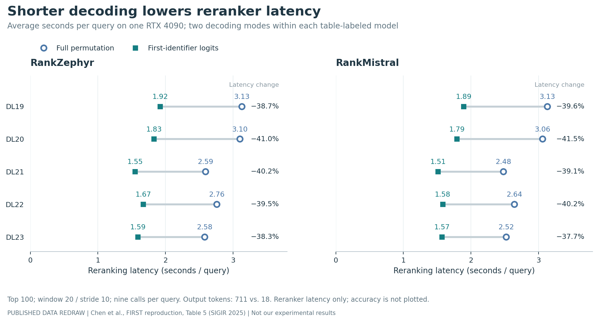

**这张图怎么看：** 两个模型分面展示，逐数据集配对比较完整排列生成与首标识符 logits 读取的重排秒数，右侧为论文报告的相对时延变化。现图只回答该解码实现的耗时差异，没有把质量数据混入同一连线。

**适合放在论文哪里：** 适合正文实现效率或附录；当实际方法改变重排输出解码策略，而非仅更换模型时使用。

**换成我们的实验需要：** 需要同卡、同批大小、同候选数量和片段长度的实测重排时延、重复测量协议及 token 数，并另评估两种实现的排序质量。

**使用边界：** 原数据为 RTX4090、top-100、窗口20／步长10下的重排耗时，不能当作 agent 端到端加速或自动推断质量不变。

<details>
<summary>代码、数据与复现</summary>

[主代码](rerank_expansion/2026-11-15/code/R04_decoding_latency.py) · [公共函数](rerank_expansion/2026-11-15/plotlib.py)

输入：[first_decoding_latency.csv](rerank_expansion/2026-11-15/data/first_decoding_latency.csv)。

安装下方依赖后，在仓库根目录执行：

```bash
python rerank_expansion/2026-11-15/code/R04_decoding_latency.py --output-dir dist/m10 --formats png svg
```

</details>

来源：[Accelerating Listwise Reranking](https://zijianchen.ca/papers/Accelerating%20Listwise%20Reranking%20Reproducing%20and%20Enhancing%20FIRST.pdf#page=6)，SIGIR 2025 author PDF; SHA256 snapshot 2026-11-15，Table 5。

[返回图表目录](#figure-catalog)

<a id="m11"></a>

### M11 · 逐题 Token 用量分布

**合成模板 · 本地可运行**


**这张图怎么看：** 每种方法的半侧小提琴、四分位条和逐题散点展示主模型输入 token 分布，纵轴按 log10 排布并用原 token 数量级标注。它适合同时查看典型用量、离散程度和高开销尾部。

**适合放在论文哪里：** 适合正文资源分析或附录；当平均 token 掩盖少量超长轨迹，且每题有独立用量记录时使用。

**换成我们的实验需要：** 需要逐题主模型输入 token 的实际累计值、方法和终止状态；主模型输出、reranker 输入及后台调用应另设字段统计。

**使用边界：** 当前合成脚本在 log10 前排除非正值并报告数量，真实的零开销应另示或使用 T02 的 log1p 方案，不能静默删除。

<details>
<summary>代码、数据与复现</summary>

[主代码](examples/02_token_raincloud/plot.py) · [公共函数](gallerylib/__init__.py)

输入：[questions.csv](data/demo/questions.csv)。

安装下方依赖后，在仓库根目录执行：

```bash
python examples/02_token_raincloud/plot.py --output-dir dist/m11 --formats png svg
```

</details>

图型参考：[RainCloudPlots](https://github.com/RainCloudPlots/RainCloudPlots)。

[返回图表目录](#figure-catalog)

<a id="m12"></a>

### M12 · 工具调用与返回文本占比

**合成模板 · 本地可运行**


**这张图怎么看：** 左图按全题汇总的显式工具调用次数计算占比，右图按返回字符总量计算占比，每种方法各自归一化到 100%。这些是总量占比而非逐题占比的平均值，可区分调用频繁的工具与返回文本较多的工具。

**适合放在论文哪里：** 适合正文工具行为分析；当 rerank 改变 search、read 等工具的使用结构或暴露文本组成时使用。

**换成我们的实验需要：** 需要逐题逐工具的调用次数与实际 returned_chars，工具类别定义一致，并单独记录自动后台重排的计算账本。

**使用边界：** 当前为合成示例，两图分母不同且比例隐藏总量，返回字符不能当作计费输入 token 或总推理成本。

<details>
<summary>代码、数据与复现</summary>

[主代码](examples/04_call_vs_output_share/plot.py) · [公共函数](gallerylib/__init__.py)

输入：[tool_calls.csv](data/demo/tool_calls.csv)。

安装下方依赖后，在仓库根目录执行：

```bash
python examples/04_call_vs_output_share/plot.py --output-dir dist/m12 --formats png svg
```

</details>

图型参考：[The-Python-Graph-Gallery](https://github.com/holtzy/The-Python-Graph-Gallery)。

[返回图表目录](#figure-catalog)

<a id="m13"></a>

### M13 · 模块耗时分解

**论文数值重绘 · 本地可运行**

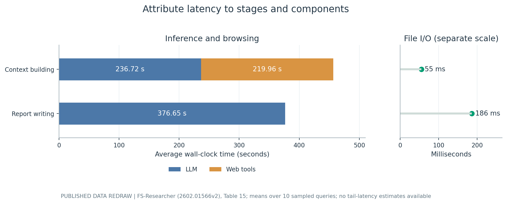

**这张图怎么看：** 每行是一个处理阶段，左侧堆叠显示推理与网页工具的平均秒数，右侧另用毫秒轴展示文件 I/O。需要分别读两套横轴，不能凭条形长度跨面板比较绝对时间。

**适合放在论文哪里：** 适合正文性能剖析或附录；当方法总耗时变化需要归因到检索、重排、生成或 I/O 时使用。

**换成我们的实验需要：** 需要同一计时口径的分阶段起止时间、工具调用和并发关系，并为 reranker 单独埋点，明确哪些时间可相加。

**使用边界：** 现图是 FS-Researcher 的模块统计且没有独立 reranker 项，不能从中推算本方法重排耗时或把并发模块时长直接相加。

<details>
<summary>代码、数据与复现</summary>

[主代码](paper_expansion/2026-11-01/code/N06_latency_components.py) · [公共函数](paper_expansion/2026-11-01/plotlib.py)

输入：[fs_latency.csv](paper_expansion/2026-11-01/data/fs_latency.csv)。

安装下方依赖后，在仓库根目录执行：

```bash
python paper_expansion/2026-11-01/code/N06_latency_components.py --output-dir dist/m13 --formats png svg
```

</details>

来源：[FS-Researcher](https://arxiv.org/pdf/2602.01566v2#page=22)，2602.01566v2，Table 15。

[返回图表目录](#figure-catalog)

<a id="m14"></a>

### M14 · 证据充分对照

**论文数值重绘 · 本地可运行**


**这张图怎么看：** 每行对应一个模型，三个点比较 BM25、Dense retrieval 与直接提供 oracle 证据时的答案准确率。差距用于观察证据访问条件改变后的表现，不是同候选池内的纯重排消融。

**适合放在论文哪里：** 适合正文诊断实验；当要区分证据获取不足与拿到证据后仍不能回答的问题时使用。

**换成我们的实验需要：** 需要同一问题集上的检索条件与 oracle 条件、明确的金标准证据、同一生成模型和评分规则，并记录上下文溢出等失败。

**使用边界：** BrowseComp-Plus 的 oracle 改变证据访问条件且部分结果含上下文溢出失败，不能当作同返回预算下的公平 baseline 或可直接实现的重排收益。

<details>
<summary>代码、数据与复现</summary>

[主代码](paper_expansion/2026-11-01/code/N03_oracle_evidence.py) · [公共函数](paper_expansion/2026-11-01/plotlib.py)

输入：[browse_oracle.csv](paper_expansion/2026-11-01/data/browse_oracle.csv)。

安装下方依赖后，在仓库根目录执行：

```bash
python paper_expansion/2026-11-01/code/N03_oracle_evidence.py --output-dir dist/m14 --formats png svg
```

</details>

来源：[BrowseComp-Plus](https://arxiv.org/pdf/2508.06600v1#page=10)，2508.06600v1，Table 1 and §4.8.1。

[返回图表目录](#figure-catalog)

<a id="m15"></a>

### M15 · 分层失败归因

**论文数值重绘 · 本地可运行**


**这张图怎么看：** 左图在原论文审查的前 100 个 MuSiQue 错误中划分推理链、放弃、judge 与语料问题，右图仅在其中的推理链错误内进一步分解原因。每个面板独立使用自己的错误总体作为百分比分母。

**适合放在论文哪里：** 适合正文错误分析或附录标注分析；当需要区分检索缺失、证据误用与评价错误，并据此改进方法时使用。

**换成我们的实验需要：** 需要预先固定的失败题集、互斥且可复核的一级／二级错误标签、各层样本数，以及人工复核或标注一致性记录。

**使用边界：** 现图重绘 A-RAG 的错误分类，左右面板分母不同不能相加，分类名称和比例也不能直接当作我们的失败分布。

<details>
<summary>代码、数据与复现</summary>

[主代码](paper_expansion/2026-11-01/code/N02_failure_hierarchy.py) · [公共函数](paper_expansion/2026-11-01/plotlib.py)

输入：[arag_failures.csv](paper_expansion/2026-11-01/data/arag_failures.csv)。

安装下方依赖后，在仓库根目录执行：

```bash
python paper_expansion/2026-11-01/code/N02_failure_hierarchy.py --output-dir dist/m15 --formats png svg
```

</details>

来源：[A-RAG](https://arxiv.org/pdf/2602.03442v1#page=15)，2602.03442v1，Tables 7–8; Figure 5。

[返回图表目录](#figure-catalog)

<a id="supplement"></a>

## 补充图库 · 8 张

<a id="s01"></a>

### S01 · 逐题结果与 Token 联动

**合成模板 · 本地可运行**


**这张图怎么看：** 上下两层按相同题目顺序对齐，下层是 Agent rerank 减去 Baseline 的主模型输入 token，上层标记错变对、对变错或正确性不变。题目按 token 差排序而非时间排列，上层的 0 同时包括两次都对和两次都错。

**适合放在论文哪里：** 适合附录逐题诊断或案例筛查；当总体质量与成本结果已报告，需要找出具体得失题目时使用。

**换成我们的实验需要：** 需要两种方法严格配对的逐题正确性和主模型输入 token，保留所有配对题目及负收益案例，并能回查原始轨迹。

**使用边界：** 当前为合成示例，同题上的 token 与结果变化不等于因果关系，正确性不变也不表示答案内容完全相同。

<details>
<summary>代码、数据与复现</summary>

[主代码](examples/09_token_outcome_pairs/plot.py) · [公共函数](gallerylib/__init__.py)

输入：[questions.csv](data/demo/questions.csv)。

安装下方依赖后，在仓库根目录执行：

```bash
python examples/09_token_outcome_pairs/plot.py --output-dir dist/s01 --formats png svg
```

</details>

图型参考：[2608.02751](https://arxiv.org/abs/2608.02751)。

[返回图表目录](#figure-catalog)

<a id="s02"></a>

### S02 · 预算—效果曲线

**合成模板 · 本地可运行**


**这张图怎么看：** 横轴是最大模型轮次预算，纵轴是正确答案比例，每条线对应一种方法，阴影为各预算点的 Wilson 95% 区间。连线帮助阅读离散预算设置，不代表已测量所有中间预算。

**适合放在论文哪里：** 适合正文预算消融或附录；当方法需要比较不同停止上限下的质量变化，且能真正运行预算扫描时使用。

**换成我们的实验需要：** 需要每个预算配置实际独立执行的逐题结果、统一题集和停止规则，并记录实际轮次与资源消耗。

**使用边界：** 当前为合成预算实验，不能把一次长轨迹事后截断当作独立低预算运行，轮次上限也不等于已支付成本。

<details>
<summary>代码、数据与复现</summary>

[主代码](examples/14_budget_accuracy/plot.py) · [公共函数](gallerylib/__init__.py)

输入：[budget_runs.csv](data/demo/budget_runs.csv)。

安装下方依赖后，在仓库根目录执行：

```bash
python examples/14_budget_accuracy/plot.py --output-dir dist/s02 --formats png svg
```

</details>

图型参考：[SciencePlots](https://github.com/garrettj403/SciencePlots)。

[返回图表目录](#figure-catalog)

<a id="s03"></a>

### S03 · 工具轨迹时间线

**合成模板 · 本地可运行**


**这张图怎么看：** 两个面板对照同一案例的工具序列，横轴是模型轮次，纵轴是工具类别，星形标记观察到含答案证据的步骤。连接线表达事件先后，不表示连续时间或工具间的数值距离。

**适合放在论文哪里：** 适合正文案例研究或附录；当需要解释一次触发重排后如何改变后续搜索、读取和作答路径时使用。

**换成我们的实验需要：** 需要真实逐步执行日志、工具调用类型、稳定的轮次／事件编号、证据出现标注及最终结果，并说明案例选择依据。

**使用边界：** 现图是虚构案例，星形只表示看到含答案证据而非已正确利用，不能用来证明典型轨迹、总体收益或墙钟加速。

<details>
<summary>代码、数据与复现</summary>

[主代码](examples/16_trajectory_timeline/plot.py) · [公共函数](gallerylib/__init__.py)

输入：[timeline.csv](data/demo/timeline.csv)。

安装下方依赖后，在仓库根目录执行：

```bash
python examples/16_trajectory_timeline/plot.py --output-dir dist/s03 --formats png svg
```

</details>

图型参考：[The-Python-Graph-Gallery](https://github.com/holtzy/The-Python-Graph-Gallery)。

[返回图表目录](#figure-catalog)

<a id="s04"></a>

### S04 · 引用支持率与有效证据量

**论文数值重绘 · 本地可运行**


**这张图怎么看：** 每个点代表原论文中的一个系统，横轴是每任务有效引用量，纵轴是引用支持准确率。两个方向分别描述有多少可支持的信息和引用是否支撑声明，不能只按引用数量判断质量。

**适合放在论文哪里：** 适合有显式引用输出的正文证据质量分析或附录；短答案任务需先建立答案与证据的对应标注。

**换成我们的实验需要：** 需要可追溯的声明—文档／URL 对、去重规则、支持性判断和任务分母，并固定引用抽取与人工复核标准。

**使用边界：** 现图是 DeepResearch Bench 的固定版本 FACT 结果，有效引用不是原始 URL 数，引用支持率也不是检索相关性或其他 benchmark 的答案准确率。

<details>
<summary>代码、数据与复现</summary>

[主代码](paper_expansion/2026-11-01/code/N04_citation_support.py) · [公共函数](paper_expansion/2026-11-01/plotlib.py)

输入：[deepbench_fact.csv](paper_expansion/2026-11-01/data/deepbench_fact.csv)。

安装下方依赖后，在仓库根目录执行：

```bash
python paper_expansion/2026-11-01/code/N04_citation_support.py --output-dir dist/s04 --formats png svg
```

</details>

来源：[DeepResearch Bench](https://arxiv.org/pdf/2506.11763v1#page=6)，2506.11763v1，Table 1; Figure 1 (right)。

[返回图表目录](#figure-catalog)

<a id="s05"></a>

### S05 · 评估费用与人类一致性

**论文数值重绘 · 本地可运行**

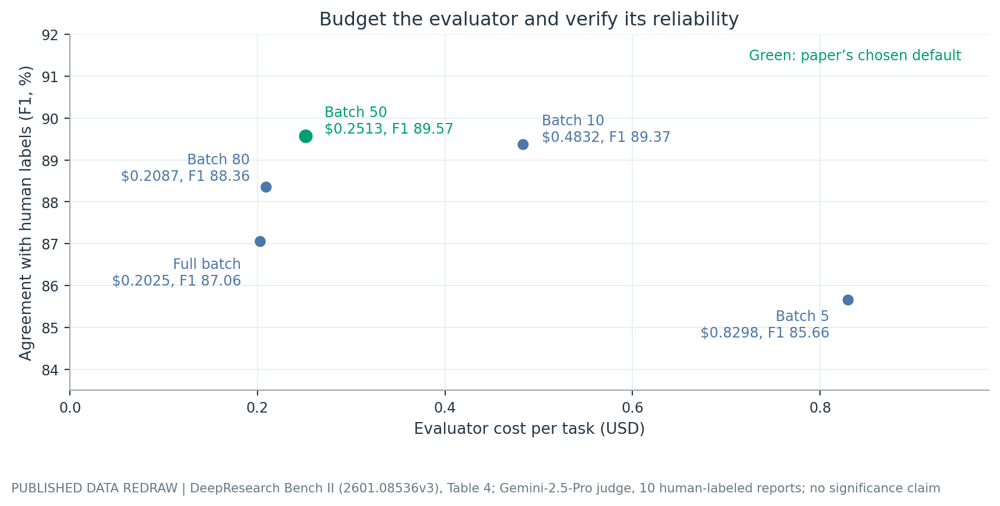

**这张图怎么看：** 每个点是一种评估批量配置，横轴为每任务 judge 费用，纵轴为与人工标注的一致性 F1。绿色点只标记原论文选择的默认配置，用于展示评价成本与可靠性的权衡。

**适合放在论文哪里：** 适合评估协议章节或附录；当实验依赖 LLM judge，需要为批处理策略和评价费用提供依据时使用。

**换成我们的实验需要：** 需要人工标注的校准样本、不同 judge 批量下的预测标签、统一 F1 定义，以及实际输入输出 token 与当次价格记录。

**使用边界：** 原文校准仅涉及 10 份报告，这里的费用属于评估器而非 agent 推理成本，F1 也不是被评方法的任务得分。

<details>
<summary>代码、数据与复现</summary>

[主代码](paper_expansion/2026-11-01/code/N08_evaluator_budget.py) · [公共函数](paper_expansion/2026-11-01/plotlib.py)

输入：[judge_batch.csv](paper_expansion/2026-11-01/data/judge_batch.csv)。

安装下方依赖后，在仓库根目录执行：

```bash
python paper_expansion/2026-11-01/code/N08_evaluator_budget.py --output-dir dist/s05 --formats png svg
```

</details>

来源：[DeepResearch Bench II](https://arxiv.org/pdf/2601.08536v3#page=8)，2601.08536v3，Table 4。

[返回图表目录](#figure-catalog)

<a id="s06"></a>

### S06 · 检索暴露文本量

**论文数值重绘 · 本地可运行**


**这张图怎么看：** 左侧在各数据集内比较检索接口暴露的语料 token，横轴为对数尺度；右侧显示相对 A-RAG Naive 的减少比例。现图观察的是送出检索接口的文本量，而非直接衡量重排质量。

**适合放在论文哪里：** 适合检索工作空间或上下文预算的专项分析；当 rerank 通过改变后续读取材料影响文本暴露量时使用。

**换成我们的实验需要：** 需要每次检索／读取实际返回的文本与 tokenizer 计数、文档 ID 和去重规则，并区分返回截断、主模型上下文及重复读取。

**使用边界：** A-RAG 原实验未控制为本项目的 100 字符返回预算，检索暴露 token 也不能直接替代模型计费 input tokens。

<details>
<summary>代码、数据与复现</summary>

[主代码](paper_expansion/2026-11-01/code/N01_retrieved_context.py) · [公共函数](paper_expansion/2026-11-01/plotlib.py)

输入：[arag_context.csv](paper_expansion/2026-11-01/data/arag_context.csv)。

安装下方依赖后，在仓库根目录执行：

```bash
python paper_expansion/2026-11-01/code/N01_retrieved_context.py --output-dir dist/s06 --formats png svg
```

</details>

来源：[A-RAG](https://arxiv.org/pdf/2602.03442v1#page=8)，2602.03442v1，Table 3。

[返回图表目录](#figure-catalog)

<a id="s07"></a>

### S07 · 调用投入与独立来源增长

**论文数值重绘 · 本地可运行**


**这张图怎么看：** 左侧随上下文构建轮数展示平均 search 调用、页面读取和独立 URL 数；右侧计算相邻轮数设置之间的独立 URL 均值增量除以 search 均值增量。它表达总体投入与来源扩展的关系，不展示逐题边际分布。

**适合放在论文哪里：** 适合附录的搜索预算分析；当 rerank 可能减少重复搜索，或任务需要覆盖多个独立来源时使用。

**换成我们的实验需要：** 需要各轮数预算下实际运行的逐题 search／read 账本和规范化来源 ID；静态语料可用文档 ID 替代 URL，但去重粒度须一致。

**使用边界：** 现图来自 FS-Researcher，右侧是均值之差的比值而非逐题新颖度，来源数增长也不等于相关证据或答案质量提高。

<details>
<summary>代码、数据与复现</summary>

[主代码](paper_expansion/2026-11-01/code/N07_source_growth.py) · [公共函数](paper_expansion/2026-11-01/plotlib.py)

输入：[fs_scaling.csv](paper_expansion/2026-11-01/data/fs_scaling.csv)。

安装下方依赖后，在仓库根目录执行：

```bash
python paper_expansion/2026-11-01/code/N07_source_growth.py --output-dir dist/s07 --formats png svg
```

</details>

来源：[FS-Researcher](https://arxiv.org/pdf/2602.01566v2#page=17)，2602.01566v2，Tables 8 and 10。

[返回图表目录](#figure-catalog)

<a id="s08"></a>

### S08 · 任务难度分层

**论文数值重绘 · 本地可运行**


**这张图怎么看：** 三个面板分别按概念广度、逻辑嵌套和探索程度分层，纵轴是原论文的三值 rubric 遵循率，折线区分系统。横向比较的是不同难度任务组，不是同一题被逐步增加难度的实验。

**适合放在论文哪里：** 适合附录或正文分层评测；当需要说明方法在哪类复杂任务上适用，并已定义可复核的难度标签时使用。

**换成我们的实验需要：** 需要预先标注的题目难度维度、每组样本数、各方法逐题结果与统一评分规则；迁移到 QA 时须重新定义符合任务的指标。

**使用边界：** ResearchRubrics 的长报告指标不能直接当作 rerank 准确率，也不能与其他论文 benchmark 混排或据组间折线声称因果。

<details>
<summary>代码、数据与复现</summary>

[主代码](paper_expansion/2026-11-01/code/N05_task_complexity.py) · [公共函数](paper_expansion/2026-11-01/plotlib.py)

输入：[rubric_complexity.csv](paper_expansion/2026-11-01/data/rubric_complexity.csv)。

安装下方依赖后，在仓库根目录执行：

```bash
python paper_expansion/2026-11-01/code/N05_task_complexity.py --output-dir dist/s08 --formats png svg
```

</details>

来源：[ResearchRubrics](https://arxiv.org/pdf/2511.07685v1#page=9)，2511.07685v1，Figure 6 printed numeric labels。

[返回图表目录](#figure-catalog)

<a id="github"></a>

## GitHub 原图参考 · 8 张

<a id="g01"></a>

### G01 · 配对样本与均值差分布

**上游原图 · 上游参考 · 未完整执行**

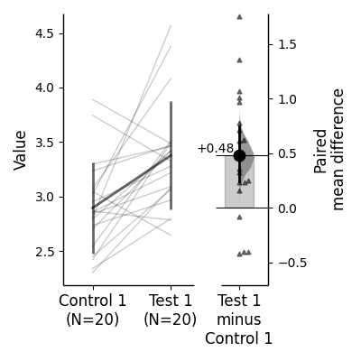

**这张图怎么看：** 左侧用线连接同一观测的 Control 与 Test，右侧展示配对均值差、其估计分布和区间。先观察个体变化是否一致，再看整体差值，避免只比较两组独立均值。

**适合放在论文哪里：** 适合正文配对效果图；当同题 rerank 前后可得到连续质量分数、耗时或 token，且希望保留逐题变化时使用。

**换成我们的实验需要：** 需要同一 question_id 下的前后数值、清晰的差值方向和配对重抽样单位；若仅有论文均值，无法恢复原始分布。

**使用边界：** 上游图使用模拟数据，不能把当前均值差当作实测收益，也不能把配对样本拆成独立两组来计算区间。

<details>
<summary>代码、数据与复现</summary>

[主代码](github_references/2026-11-15/code_sections/G01.py) · [上游源码快照](github_references/2026-11-15/sources/effectiveness/source_code/G01_source.py) · [许可全文](github_references/2026-11-15/sources/effectiveness/G01_paired_estimation_LICENSE.txt)

输入：[数据与环境](github_references/2026-11-15/code_sections/effectiveness.json)。

上游 Python / R 环境、支持数据与运行说明见上述“数据与环境”链接；本库仅核对与保存参考源码，原图不代表本地重跑结果。

</details>

上游原图：[ACCLAB/DABEST-python](https://github.com/ACCLAB/DABEST-python/blob/ec6172724e0397bf0546863c76949d40da9c5457/nbs/tests/mpl_image_tests/baseline_images/test_04_gardner_altman_paired_meandiff.png)；许可：Apache-2.0 in LICENSE; README badge says BSD-3-Clause-Clear (conflicting repository notices).。仅作带来源的研究参考；若对外再分发或改编应先澄清仓库许可冲突。

[返回图表目录](#figure-catalog)

<a id="g02"></a>

### G02 · 多方法分组森林图

**上游原图 · 上游参考 · 未完整执行**

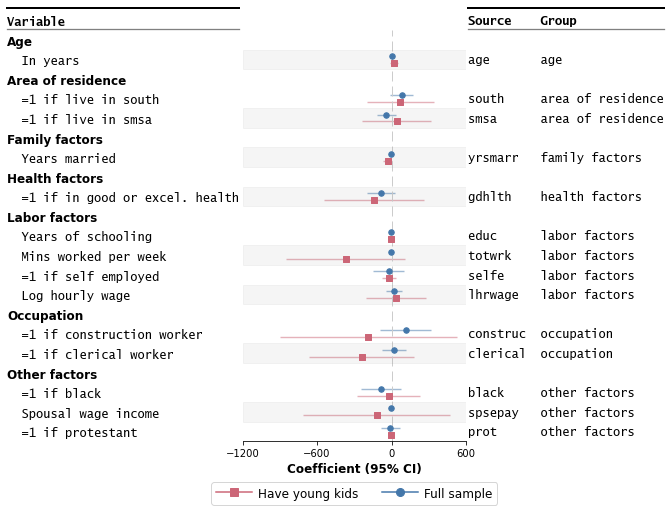

**这张图怎么看：** 每行是一个变量，点和横线表示回归系数及 95% 区间，两种符号区分完整样本与有年幼子女的样本，分组标题帮助扫描变量类别。迁移时可以保留这种多估计值并排的布局，而另行定义 rerank 效应。

**适合放在论文哪里：** 适合正文多方法分组效果图或附录；当需要在同一行比较多种方法对同一题型的效果估计时使用。

**换成我们的实验需要：** 需要各方法与 baseline 的逐题配对差值、题型标签、样本量和明确的区间计算方法，并记录组间是否重叠。

**使用边界：** 原图展示回归系数而非 rerank 分差，不能只替换坐标标题就沿用系数或区间。

<details>
<summary>代码、数据与复现</summary>

[主代码](github_references/2026-11-15/code_sections/G02.py) · [上游源码快照](github_references/2026-11-15/sources/effectiveness/source_code/G02_source_README.md) · [许可全文](github_references/2026-11-15/sources/effectiveness/G02_multimodel_forest_LICENSE.txt)

输入：[数据与环境](github_references/2026-11-15/code_sections/effectiveness.json) · [sleep-mmodel.csv](github_references/2026-11-15/code_sections/assets/sleep-mmodel.csv)。

上游 Python / R 环境、支持数据与运行说明见上述“数据与环境”链接；本库仅核对与保存参考源码，原图不代表本地重跑结果。

</details>

上游原图：[LSYS/forestplot](https://github.com/LSYS/forestplot/blob/b7591e3be7004f9962fd7cd7f91aa4cac91c45fc/docs/images/multimodel.png)；许可：MIT。仓库 LICENSE 为 MIT，保留版权与许可证；未发现该原图的独立许可声明。

[返回图表目录](#figure-catalog)

<a id="g03"></a>

### G03 · 平均百分位秩与差异检验（模拟演示）

**上游原图 · 上游参考 · 未完整执行**


**这张图怎么看：** 横轴是 30 个模拟分块内对 8 个模型做升序 rank(pct=True) 后的平均百分位秩，越右表示模拟分数的相对位置越高。黑色连接线连接未检出差异的模型组，不是置信区间。

**适合放在论文哪里：** 适合附录的多 benchmark 方法排序比较；只有在评价分块、排序方向和事后检验协议都明确时才使用。

**换成我们的实验需要：** 需要每个独立评价分块上所有方法的分数矩阵、指标方向、完整的统计检验与多重比较处理方案，并明确采用普通名次还是百分位秩。

**使用边界：** 不能将本图误读为名次 1 最好的平均排名，未检出差异不证明等效，也不能默认连接线具有 95% 区间或已做多重校正的含义。

<details>
<summary>代码、数据与复现</summary>

[主代码](github_references/2026-11-15/code_sections/G03.py) · [上游源码快照](github_references/2026-11-15/sources/effectiveness/source_code/G03_source_tutorial.rst) · [许可全文](github_references/2026-11-15/sources/effectiveness/G03_critical_difference_LICENSE.txt)

输入：[数据与环境](github_references/2026-11-15/code_sections/effectiveness.json)。

上游 Python / R 环境、支持数据与运行说明见上述“数据与环境”链接；本库仅核对与保存参考源码，原图不代表本地重跑结果。

</details>

上游原图：[maximtrp/scikit-posthocs](https://github.com/maximtrp/scikit-posthocs/blob/07e4c182b83314785eb879c3046de8ac5cf4febc/docs/source/_static/cd_diagram1.png)；许可：MIT。仓库 LICENSE 为 MIT，保留版权与许可证；未发现该原图的独立许可声明。

[返回图表目录](#figure-catalog)

<a id="g04"></a>

### G04 · 分面雨云图：分布、散点与四分位

**上游原图 · 上游参考 · 未完整执行**

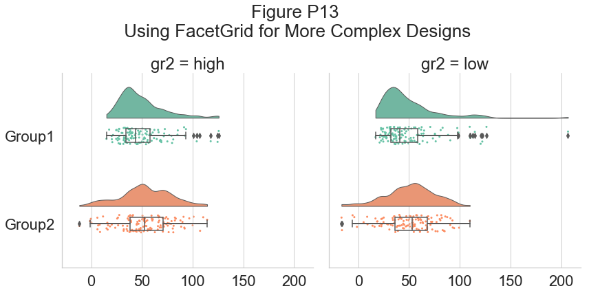

**这张图怎么看：** 两个面板由 gr2 的 high／low 分组，面板内分别比较 Group1 和 Group2 的密度、箱线摘要与原始散点。可以同时看典型值、分布形状和远端观测，而不只比较柱状均值。

**适合放在论文哪里：** 适合正文效率分布或附录；当不同题型的成本形状可能不同，需要分面而非混合总体时使用。

**换成我们的实验需要：** 需要逐题耗时或 token、方法标签与预先定义的题型，并采用一致的单位、密度平滑规则和失败题保留策略。

**使用边界：** 上游图是教程数据，密度宽度不代表样本量，真实零值和超时记录不能因画法需要而随意删除。

<details>
<summary>代码、数据与复现</summary>

[主代码](github_references/2026-11-15/code_sections/G04.py) · [上游源码快照](github_references/2026-11-15/sources/effectiveness/source_code/G04_source.ipynb) · [许可全文](github_references/2026-11-15/sources/effectiveness/G04_faceted_raincloud_LICENSE.txt)

输入：[数据与环境](github_references/2026-11-15/code_sections/effectiveness.json) · [simdat.csv](github_references/2026-11-15/code_sections/assets/simdat.csv)。

上游 Python / R 环境、支持数据与运行说明见上述“数据与环境”链接；本库仅核对与保存参考源码，原图不代表本地重跑结果。

</details>

上游原图：[RainCloudPlots/RainCloudPlots](https://github.com/RainCloudPlots/RainCloudPlots/blob/4ceeb06dc5bd5b9911e7147d1b0b452c4c2f9b1d/figs/tutorial_python/figureP13.png)；许可：MIT。仓库 LICENSE 为 MIT，保留版权与许可证；未发现该原图的独立许可声明。

[返回图表目录](#figure-catalog)

<a id="g05"></a>

### G05 · 附注释的分组热图

**上游原图 · 上游参考 · 未完整执行**

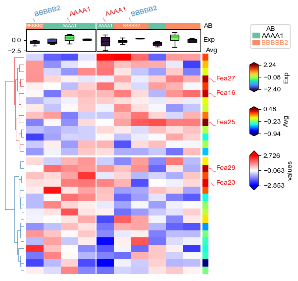

**这张图怎么看：** 中央热图展示数值矩阵并按行列分组，顶部放类别和箱线注释，右侧显示行均值及满足筛选条件的行标签。树状图描述按数值相似性形成的聚类，不是检索顺序或因果层级。

**适合放在论文哪里：** 适合正文局部机制分析或附录；当需要把候选得分、题型和关注案例放在同一矩阵中时使用。

**换成我们的实验需要：** 需要清楚定义的行／列实体、同量纲的分数或错误率矩阵，以及与实体 ID 对齐的注释和缺失值标记；若展示排名分箱，应保留其自然顺序。

**使用边界：** 原图为随机生物信息示例，聚类和多种颜色仅为展示功能，不能为美观重排有序排名或把随机筛选标签当作发现。

<details>
<summary>代码、数据与复现</summary>

[主代码](github_references/2026-11-15/code_sections/G05.py) · [上游源码快照](github_references/2026-11-15/sources/efficiency/clustermap.ipynb) · [许可全文](github_references/2026-11-15/sources/efficiency/PyComplexHeatmap_LICENSE.txt)

输入：[数据与环境](github_references/2026-11-15/code_sections/efficiency.json)。

上游 Python / R 环境、支持数据与运行说明见上述“数据与环境”链接；本库仅核对与保存参考源码，原图不代表本地重跑结果。

</details>

上游原图：[DingWB/PyComplexHeatmap](https://github.com/DingWB/PyComplexHeatmap/blob/2db32554c62c99b7e1823f5b2059a8b341ad0a9b/docs/build/html/_images/notebooks_clustermap_7_0.png)；许可：MIT。原图与代码按上游许可保留；原始许可证随文件保存。

[返回图表目录](#figure-catalog)

<a id="g06"></a>

### G06 · 非支配方案的 Pareto 散点图

**上游原图 · 上游参考 · 未完整执行**


**这张图怎么看：** 每个点是一个随机优化方案，横轴目标越低越好、纵轴目标越高越好，较大的标记突出未被其他方案同时压过的 Pareto 集合。图中没有连线表示连续可达到的解。

**适合放在论文哪里：** 适合正文质量—成本权衡；当比较多种 reranker 或触发阈值，且所有方案在同一协议下测量时使用。

**换成我们的实验需要：** 需要每个配置同题评估的质量与一种明确成本、优化方向及配置 ID；用于正式实验时应恢复数值刻度，并补充测量不确定性。

**使用边界：** 上游图由固定种子的随机目标向量生成，非支配不等于统计显著更好，不能照搬其坐标作为模型性能。

<details>
<summary>代码、数据与复现</summary>

[主代码](github_references/2026-11-15/code_sections/G06.py) · [上游源码快照](github_references/2026-11-15/sources/efficiency/paretoset_examples.py) · [许可全文](github_references/2026-11-15/sources/efficiency/paretoset_LICENSE.txt)

输入：[数据与环境](github_references/2026-11-15/code_sections/efficiency.json)。

上游 Python / R 环境、支持数据与运行说明见上述“数据与环境”链接；本库仅核对与保存参考源码，原图不代表本地重跑结果。

</details>

上游原图：[tommyod/paretoset](https://github.com/tommyod/paretoset/blob/6f2803057085a696cbe10118ca3164d993cee175/scripts/example_optimization.png)；许可：MIT。原图与代码按上游许可保留；原始许可证随文件保存。

[返回图表目录](#figure-catalog)

<a id="g07"></a>

### G07 · 证据集合交集与分布联合图

**上游原图 · 上游参考 · 未完整执行**

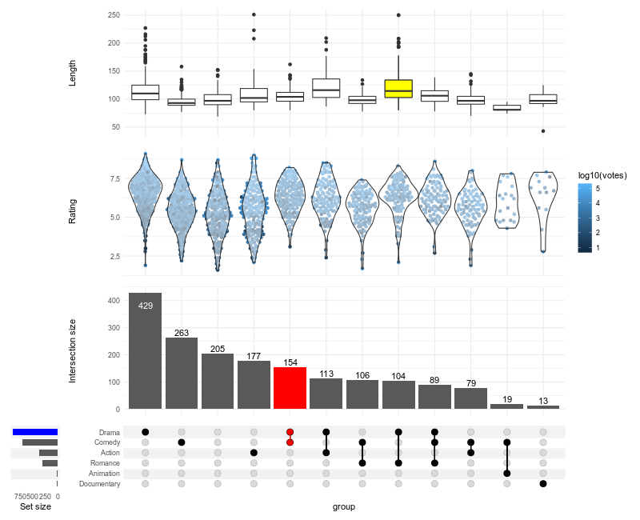

**这张图怎么看：** 底部点阵给出电影类别组合，其上柱形为交集大小，左侧横条为各集合大小；上部箱线显示片长，中部小提琴与散点显示评分，点色表示 log10 投票数。红、蓝、黄是人工指定的集合或交集高亮。

**适合放在论文哪里：** 适合正文证据覆盖分析或附录；当需要比较 BM25、Dense、rerank 与最终读取集合共享和独有的材料时使用。

**换成我们的实验需要：** 需要逐题各阶段的文档／chunk ID 集合、统一去重粒度、交集模式定义，以及对齐的相关性、排名或 token 属性。

**使用边界：** 原图是电影数据，高亮不是显著性标记，迁移时也不能把不同问题中的同名文档或包含式交集与互斥交集混算。

<details>
<summary>代码、数据与复现</summary>

[主代码](github_references/2026-11-15/code_sections/G07.R) · [上游源码快照](github_references/2026-11-15/sources/efficiency/complex_upset_README.md) · [许可全文](github_references/2026-11-15/sources/efficiency/ComplexUpset_LICENSE.txt)

输入：[数据与环境](github_references/2026-11-15/code_sections/efficiency.json)。

上游 Python / R 环境、支持数据与运行说明见上述“数据与环境”链接；本库仅核对与保存参考源码，原图不代表本地重跑结果。

</details>

上游原图：[krassowski/complex-upset](https://github.com/krassowski/complex-upset/blob/79fa000ca4087d55ee2d8cf1a0fb7a01bb5aba7e/movies.png)；许可：MIT。原图与代码按上游许可保留；原始许可证随文件保存。

[返回图表目录](#figure-catalog)

<a id="g08"></a>

### G08 · 共享说明的矩阵式多面板布局

**上游原图 · 上游参考 · 未完整执行**

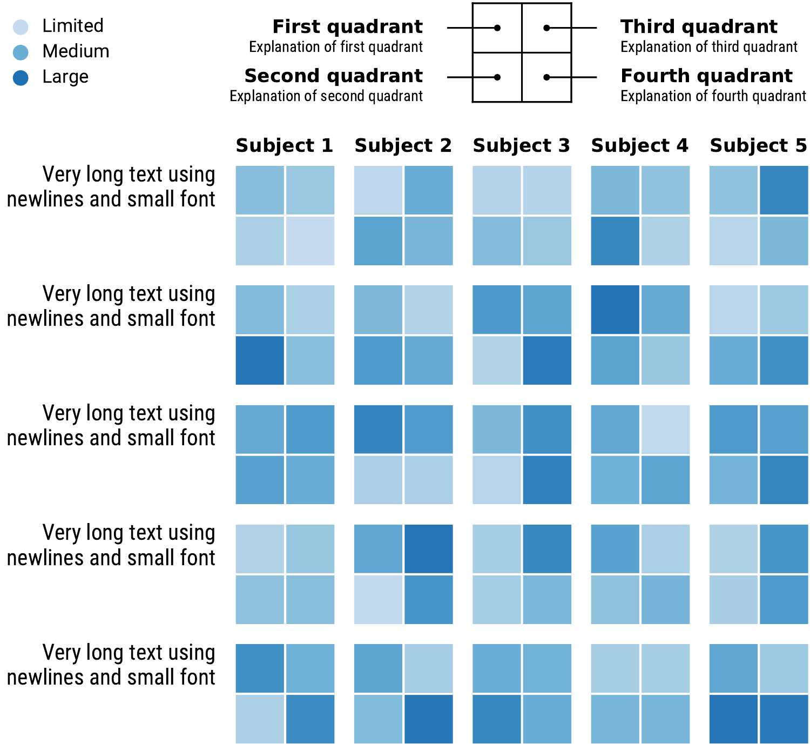

**这张图怎么看：** 这是 5×5 小面板的布局演示，每个面板包含随机生成的 2×2 色块，顶部统一解释四象限位置与颜色图例。四象限文字是占位说明，不是混淆矩阵或分类结果。

**适合放在论文哪里：** 适合附录多模型多任务汇总；当每行、每列及面板内四个指标具有稳定含义，单图仍能保持可读性时使用。

**换成我们的实验需要：** 需要明确的模型×任务索引，以及每个面板四项指标的数值、共同方向和可比较色标；指标单位不同应拆开色标或面板。

**使用边界：** 随机示例不是实测结果，原图采用 CC BY-NC-SA 4.0、代码采用 BSD-2-Clause，不能把代码许可套用于原图。

<details>
<summary>代码、数据与复现</summary>

[主代码](github_references/2026-11-15/code_sections/G08.py) · [上游源码快照](github_references/2026-11-15/sources/efficiency/complex_layout.py) · [许可全文](github_references/2026-11-15/sources/efficiency/Rougier_LICENSE.txt)

输入：[数据与环境](github_references/2026-11-15/code_sections/efficiency.json)。

上游 Python / R 环境、支持数据与运行说明见上述“数据与环境”链接；本库仅核对与保存参考源码，原图不代表本地重跑结果。

</details>

上游原图：[rougier/scientific-visualization-book](https://github.com/rougier/scientific-visualization-book/blob/62fa569f30333c817c13e4dc757877c1192fd15a/figures/layout/complex-layout.pdf)；许可：Book/figure: CC BY-NC-SA 4.0; code: BSD-2-Clause。原图与代码按上游许可保留；原始许可证随文件保存。

[返回图表目录](#figure-catalog)

<a id="quick-start"></a>

## 快速开始 / Quick start

在仓库根目录，使用 Python 3.10+：

```bash
python -m venv .venv
source .venv/bin/activate
python -m pip install -r requirements-lock.txt
python scripts/build_gallery.py --keep-existing-images
```

构建后打开 `dist/图表汇总_2026-11-16.html`：图片、逐图代码与下载包内嵌，可离线使用。完整发布包位于 `dist/research-figure-gallery.zip`。构建产物放在 `dist/`，不提交到 Git；这些文件需先构建生成。

**从 GitHub 下载：** 进入仓库的 **Actions** 页面，选择一次成功的构建，在 **Artifacts** 中下载产物并解压。流程定义见[构建工作流](.github/workflows/build.yml)。完整构建独立执行 26 个本地代码包，8 个上游包检查完整性；报告位于 `dist/`。

## 选择与运行单图

在[34 图索引](docs/FIGURE_INDEX.md)中查看主脚本、公共函数及输入文件。三个新模板共享逐题 CSV 与配置；[数据格式](rerank_templates/2026-11-16/DATA_FORMAT.md)说明如何接入真实日志。单独复制主脚本时，需一并保留公共函数和数据。

```bash
python rerank_templates/2026-11-16/plot_pareto.py --output-dir dist/custom-pareto
```

上游示例的依赖、数据和运行路径见对应代码参考包，不能用原图代替重跑验证。

## 目录与来源

| 内容 | 入口 |
| --- | --- |
| 全部图、代码与输入 | [34 图索引](docs/FIGURE_INDEX.md) |
| 精选说明与补充理由 | [精选图文](docs/GALLERY.md) · [补充索引](SUPPLEMENT.md) |
| 论文数值与出处 | [Deep Research](paper_expansion/2026-11-01/RESEARCH_NOTES.md) · [Rerank](rerank_expansion/2026-11-15/RESEARCH_NOTES.md) |
| GitHub 原图、快照与许可 | [上游参考文档](github_references/2026-11-15/GitHub科研绘图参考.md) |
| 目录维护与去重记录 | [catalog.json](catalog.json) · [筛选说明](CURATION.md) · [去重记录](curation/2026-11-15-dedup/README.md) |

本库自编代码采用 [MIT 许可](LICENSE)。上游原图与源码各自保留原许可，详见[参考来源](REFERENCES.md)；根目录许可证不覆盖这些上游材料。
