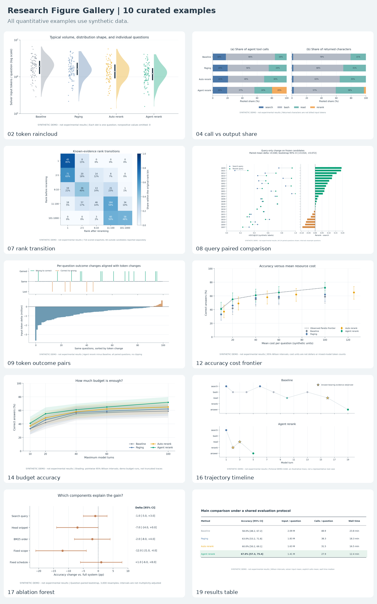

# Research Figure Gallery · 论文图表模板库

按**论文中要说明什么**查找图，再打开图旁边的本地 Python 源码。当前保留 10 张精选示例，均由本仓库代码生成，附有数据和运行命令。

本轮按视觉质量从 19 张中删去 9 张，优先保留层级清楚、配色克制、缩小后仍容易比较的例子。具体保留与删除理由见 [视觉筛选记录](CURATION.md)。沿用原编号，方便与此前版本对照。

**所有定量数值都是合成演示数据，不是当前实验结果。** 本库是自主实现的绘图模板，不声称复现参考论文的原始数值或原图代码。图形布局与图型的参考链接见各例及 [REFERENCES.md](REFERENCES.md)。代码采用 MIT 许可；参考项目与论文各自保留原许可。



速览生成代码：[scripts/contact_sheet.py](scripts/contact_sheet.py)。完整大图、代码、数据按用途列在下方。

## 开始使用

Python 3.10+；只需 Matplotlib、NumPy 和 Pillow，不依赖 TeX、联网服务或专门绘图库。

```bash
python -m venv .venv
source .venv/bin/activate
python -m pip install -r requirements-lock.txt
python scripts/build_gallery.py
```

`requirements-lock.txt` 固定本次验证所用的三个直接依赖版本；`requirements.txt` 给出兼容范围，不是完整的传递依赖锁。演示 CSV 已提交，构建无需重新生成。

```bash
# 可选：用固定种子重新生成演示数据（会覆盖 data/demo 中的 CSV）
python scripts/generate_demo_data.py --seed 20261101 --questions 100
# 只重新出指定的图
python scripts/build_gallery.py --only 02_token_raincloud 17_ablation_forest
# 单图，换成自己的 CSV，并导出 PNG、SVG、PDF
python examples/08_query_paired_comparison/plot.py --data-dir /path/to/my_csv --output-dir /path/to/figures --formats png svg pdf
# 数据、统计边界与源码映射检查
python -m unittest discover -s tests -v
# 打包源码、数据与图片
python scripts/package_release.py
```

每张图的默认输入是 `data/demo/`，默认输出是 `assets/`。真实数据放到其他目录，并通过 `--data-dir` 指定；字段定义见 [data/README.md](data/README.md)。每个脚本包含具体绘图逻辑，共享样式及统计函数位于 [gallerylib/__init__.py](gallerylib/__init__.py)。若要替换为真实结果，请同时改掉 `save()` 的合成数据脚注，保留准确的数据来源和统计说明。

## 用途索引

| 用途 | 示例 | 内容 |
| --- | --- | --- |
| Token 与资源消耗 | 02 | 逐题 Token 雨云图 |
| 工具使用与行为 | 04 | 调用占比与返回字符占比 |
| 检索质量与证据利用 | 07、08 | 重排前后排名迁移；两种 Query 的配对哑铃图 |
| 效果、预算与稳定性 | 09、12、14、19 | 逐题效果变化与 Token 变化；准确率—成本 Pareto 图；预算—效果曲线；论文主结果表 |
| 失败分析与案例 | 16 | 工具轨迹与证据时间线 |
| 消融分析 | 17 | 消融效果森林图 |


视觉上优先选用 **02 雨云图、04 横向占比图、08 哑铃图、17 消融森林图、19 主结果表**。针对当前 search / rerank 实验，主文还可选 12 效果—成本，按篇幅补 07 证据排名和 16 案例图。不要为了使用某种图而补造指标。

控制变量说明：这里将“100 字符”理解为 **search 与 rerank 返回给模型的内容长度统一**，并非 reranker 的输入长度。具体分词、截断与字符计数规则仍需在真实实验中记录。

## A · Token 与资源消耗

### 02 · 逐题 Token 雨云图

展示典型用量、偏态、长尾和单题离群值。


**代码：[`examples/02_token_raincloud/plot.py`](examples/02_token_raincloud/plot.py)** · [SVG 矢量图](assets/02_token_raincloud.svg)

数据：[questions.csv](data/demo/questions.csv)

```bash
python examples/02_token_raincloud/plot.py
```

在 log10 空间估计密度；非正值会单列数量。 [图型／布局参考](https://github.com/RainCloudPlots/RainCloudPlots)。

### 04 · 调用占比与返回字符占比

对比频繁调用的工具和大量占用返回文本的工具。


**代码：[`examples/04_call_vs_output_share/plot.py`](examples/04_call_vs_output_share/plot.py)** · [SVG 矢量图](assets/04_call_vs_output_share.svg)

数据：[tool_calls.csv](data/demo/tool_calls.csv)

```bash
python examples/04_call_vs_output_share/plot.py
```

这里统计返回字符，不把字符数写成 token 或计算成本。 [图型／布局参考](https://github.com/holtzy/The-Python-Graph-Gallery)。

### 07 · 重排前后排名迁移

检查相关证据是被提升，还是被重排压到 Top-K 之外。


**代码：[`examples/07_rank_transition/plot.py`](examples/07_rank_transition/plot.py)** · [SVG 矢量图](assets/07_rank_transition.svg)

数据：[ranks.csv](data/demo/ranks.csv)

```bash
python examples/07_rank_transition/plot.py
```

使用完整候选集排名；候选集外证据另计，不能只保留改善的样本。 [图型／布局参考](https://github.com/DingWB/PyComplexHeatmap)。

### 08 · 两种 Query 的配对哑铃图

离线比较同题 search query 与自主 rerank query 的检索指标。


**代码：[`examples/08_query_paired_comparison/plot.py`](examples/08_query_paired_comparison/plot.py)** · [SVG 矢量图](assets/08_query_paired_comparison.svg)

数据：[query_pairs.csv](data/demo/query_pairs.csv)

```bash
python examples/08_query_paired_comparison/plot.py
```

一条线对应同一道题；右侧显示差值，标题附配对 bootstrap 区间。 [图型／布局参考](https://github.com/holtzy/The-Python-Graph-Gallery)。

### 09 · 逐题效果变化与 Token 变化

把同题由错变对、由对变错与资源变化对齐。


**代码：[`examples/09_token_outcome_pairs/plot.py`](examples/09_token_outcome_pairs/plot.py)** · [SVG 矢量图](assets/09_token_outcome_pairs.svg)

数据：[questions.csv](data/demo/questions.csv)

```bash
python examples/09_token_outcome_pairs/plot.py
```

所有配对问题均保留；排序依据是 token 差，不选择性删除反例。 [图型／布局参考](https://arxiv.org/abs/2608.02751)。

### 12 · 准确率—成本 Pareto 图

比较多方法、多预算设置下的效果和资源权衡。


**代码：[`examples/12_accuracy_cost_frontier/plot.py`](examples/12_accuracy_cost_frontier/plot.py)** · [SVG 矢量图](assets/12_accuracy_cost_frontier.svg)

数据：[budget_runs.csv](data/demo/budget_runs.csv)

```bash
python examples/12_accuracy_cost_frontier/plot.py
```

成本是合成单位；前沿仅覆盖已观测配置，误差棒为 Wilson 区间。 [图型／布局参考](https://github.com/garrettj403/SciencePlots)。

### 14 · 预算—效果曲线

观察增加最大轮数后收益何时减弱。


**代码：[`examples/14_budget_accuracy/plot.py`](examples/14_budget_accuracy/plot.py)** · [SVG 矢量图](assets/14_budget_accuracy.svg)

数据：[budget_runs.csv](data/demo/budget_runs.csv)

```bash
python examples/14_budget_accuracy/plot.py
```

阴影为逐点 Wilson 区间；预算实验与事后截断轨迹要分清。 [图型／布局参考](https://github.com/garrettj403/SciencePlots)。

### 16 · 工具轨迹与证据时间线

用单个案例解释何时搜索、重排、阅读和找到证据。


**代码：[`examples/16_trajectory_timeline/plot.py`](examples/16_trajectory_timeline/plot.py)** · [SVG 矢量图](assets/16_trajectory_timeline.svg)

数据：[timeline.csv](data/demo/timeline.csv)

```bash
python examples/16_trajectory_timeline/plot.py
```

这是虚构案例；实际案例应给题号及选择依据。 [图型／布局参考](https://github.com/holtzy/The-Python-Graph-Gallery)。

### 17 · 消融效果森林图

比较 query、snippet、排序、候选范围和调用时机的贡献。


**代码：[`examples/17_ablation_forest/plot.py`](examples/17_ablation_forest/plot.py)** · [SVG 矢量图](assets/17_ablation_forest.svg)

数据：[ablations.csv](data/demo/ablations.csv)

```bash
python examples/17_ablation_forest/plot.py
```

以同题差值 bootstrap；区间未经多重比较校正，不预设真实结论。 [图型／布局参考](https://github.com/garrettj403/SciencePlots)。

### 19 · 论文主结果表

把准确率、输入量、调用次数和耗时汇总为适合主文的表格。


**代码：[`examples/19_results_table/plot.py`](examples/19_results_table/plot.py)** · [SVG 矢量图](assets/19_results_table.svg)

数据：[questions.csv](data/demo/questions.csv)、[tool_calls.csv](data/demo/tool_calls.csv)

```bash
python examples/19_results_table/plot.py
```

所有数值为合成数据；最佳值只做描述性强调，不表示显著性。 [图型／布局参考](https://github.com/garrettj403/SciencePlots)。

## B · 工具使用与行为

### 02 · 逐题 Token 雨云图

展示典型用量、偏态、长尾和单题离群值。


**代码：[`examples/02_token_raincloud/plot.py`](examples/02_token_raincloud/plot.py)** · [SVG 矢量图](assets/02_token_raincloud.svg)

数据：[questions.csv](data/demo/questions.csv)

```bash
python examples/02_token_raincloud/plot.py
```

在 log10 空间估计密度；非正值会单列数量。 [图型／布局参考](https://github.com/RainCloudPlots/RainCloudPlots)。

### 04 · 调用占比与返回字符占比

对比频繁调用的工具和大量占用返回文本的工具。


**代码：[`examples/04_call_vs_output_share/plot.py`](examples/04_call_vs_output_share/plot.py)** · [SVG 矢量图](assets/04_call_vs_output_share.svg)

数据：[tool_calls.csv](data/demo/tool_calls.csv)

```bash
python examples/04_call_vs_output_share/plot.py
```

这里统计返回字符，不把字符数写成 token 或计算成本。 [图型／布局参考](https://github.com/holtzy/The-Python-Graph-Gallery)。

### 07 · 重排前后排名迁移

检查相关证据是被提升，还是被重排压到 Top-K 之外。


**代码：[`examples/07_rank_transition/plot.py`](examples/07_rank_transition/plot.py)** · [SVG 矢量图](assets/07_rank_transition.svg)

数据：[ranks.csv](data/demo/ranks.csv)

```bash
python examples/07_rank_transition/plot.py
```

使用完整候选集排名；候选集外证据另计，不能只保留改善的样本。 [图型／布局参考](https://github.com/DingWB/PyComplexHeatmap)。

### 08 · 两种 Query 的配对哑铃图

离线比较同题 search query 与自主 rerank query 的检索指标。


**代码：[`examples/08_query_paired_comparison/plot.py`](examples/08_query_paired_comparison/plot.py)** · [SVG 矢量图](assets/08_query_paired_comparison.svg)

数据：[query_pairs.csv](data/demo/query_pairs.csv)

```bash
python examples/08_query_paired_comparison/plot.py
```

一条线对应同一道题；右侧显示差值，标题附配对 bootstrap 区间。 [图型／布局参考](https://github.com/holtzy/The-Python-Graph-Gallery)。

### 09 · 逐题效果变化与 Token 变化

把同题由错变对、由对变错与资源变化对齐。


**代码：[`examples/09_token_outcome_pairs/plot.py`](examples/09_token_outcome_pairs/plot.py)** · [SVG 矢量图](assets/09_token_outcome_pairs.svg)

数据：[questions.csv](data/demo/questions.csv)

```bash
python examples/09_token_outcome_pairs/plot.py
```

所有配对问题均保留；排序依据是 token 差，不选择性删除反例。 [图型／布局参考](https://arxiv.org/abs/2608.02751)。

### 12 · 准确率—成本 Pareto 图

比较多方法、多预算设置下的效果和资源权衡。


**代码：[`examples/12_accuracy_cost_frontier/plot.py`](examples/12_accuracy_cost_frontier/plot.py)** · [SVG 矢量图](assets/12_accuracy_cost_frontier.svg)

数据：[budget_runs.csv](data/demo/budget_runs.csv)

```bash
python examples/12_accuracy_cost_frontier/plot.py
```

成本是合成单位；前沿仅覆盖已观测配置，误差棒为 Wilson 区间。 [图型／布局参考](https://github.com/garrettj403/SciencePlots)。

### 14 · 预算—效果曲线

观察增加最大轮数后收益何时减弱。


**代码：[`examples/14_budget_accuracy/plot.py`](examples/14_budget_accuracy/plot.py)** · [SVG 矢量图](assets/14_budget_accuracy.svg)

数据：[budget_runs.csv](data/demo/budget_runs.csv)

```bash
python examples/14_budget_accuracy/plot.py
```

阴影为逐点 Wilson 区间；预算实验与事后截断轨迹要分清。 [图型／布局参考](https://github.com/garrettj403/SciencePlots)。

### 16 · 工具轨迹与证据时间线

用单个案例解释何时搜索、重排、阅读和找到证据。


**代码：[`examples/16_trajectory_timeline/plot.py`](examples/16_trajectory_timeline/plot.py)** · [SVG 矢量图](assets/16_trajectory_timeline.svg)

数据：[timeline.csv](data/demo/timeline.csv)

```bash
python examples/16_trajectory_timeline/plot.py
```

这是虚构案例；实际案例应给题号及选择依据。 [图型／布局参考](https://github.com/holtzy/The-Python-Graph-Gallery)。

### 17 · 消融效果森林图

比较 query、snippet、排序、候选范围和调用时机的贡献。


**代码：[`examples/17_ablation_forest/plot.py`](examples/17_ablation_forest/plot.py)** · [SVG 矢量图](assets/17_ablation_forest.svg)

数据：[ablations.csv](data/demo/ablations.csv)

```bash
python examples/17_ablation_forest/plot.py
```

以同题差值 bootstrap；区间未经多重比较校正，不预设真实结论。 [图型／布局参考](https://github.com/garrettj403/SciencePlots)。

### 19 · 论文主结果表

把准确率、输入量、调用次数和耗时汇总为适合主文的表格。


**代码：[`examples/19_results_table/plot.py`](examples/19_results_table/plot.py)** · [SVG 矢量图](assets/19_results_table.svg)

数据：[questions.csv](data/demo/questions.csv)、[tool_calls.csv](data/demo/tool_calls.csv)

```bash
python examples/19_results_table/plot.py
```

所有数值为合成数据；最佳值只做描述性强调，不表示显著性。 [图型／布局参考](https://github.com/garrettj403/SciencePlots)。

## C · 检索质量与证据利用

### 02 · 逐题 Token 雨云图

展示典型用量、偏态、长尾和单题离群值。


**代码：[`examples/02_token_raincloud/plot.py`](examples/02_token_raincloud/plot.py)** · [SVG 矢量图](assets/02_token_raincloud.svg)

数据：[questions.csv](data/demo/questions.csv)

```bash
python examples/02_token_raincloud/plot.py
```

在 log10 空间估计密度；非正值会单列数量。 [图型／布局参考](https://github.com/RainCloudPlots/RainCloudPlots)。

### 04 · 调用占比与返回字符占比

对比频繁调用的工具和大量占用返回文本的工具。


**代码：[`examples/04_call_vs_output_share/plot.py`](examples/04_call_vs_output_share/plot.py)** · [SVG 矢量图](assets/04_call_vs_output_share.svg)

数据：[tool_calls.csv](data/demo/tool_calls.csv)

```bash
python examples/04_call_vs_output_share/plot.py
```

这里统计返回字符，不把字符数写成 token 或计算成本。 [图型／布局参考](https://github.com/holtzy/The-Python-Graph-Gallery)。

### 07 · 重排前后排名迁移

检查相关证据是被提升，还是被重排压到 Top-K 之外。


**代码：[`examples/07_rank_transition/plot.py`](examples/07_rank_transition/plot.py)** · [SVG 矢量图](assets/07_rank_transition.svg)

数据：[ranks.csv](data/demo/ranks.csv)

```bash
python examples/07_rank_transition/plot.py
```

使用完整候选集排名；候选集外证据另计，不能只保留改善的样本。 [图型／布局参考](https://github.com/DingWB/PyComplexHeatmap)。

### 08 · 两种 Query 的配对哑铃图

离线比较同题 search query 与自主 rerank query 的检索指标。


**代码：[`examples/08_query_paired_comparison/plot.py`](examples/08_query_paired_comparison/plot.py)** · [SVG 矢量图](assets/08_query_paired_comparison.svg)

数据：[query_pairs.csv](data/demo/query_pairs.csv)

```bash
python examples/08_query_paired_comparison/plot.py
```

一条线对应同一道题；右侧显示差值，标题附配对 bootstrap 区间。 [图型／布局参考](https://github.com/holtzy/The-Python-Graph-Gallery)。

### 09 · 逐题效果变化与 Token 变化

把同题由错变对、由对变错与资源变化对齐。


**代码：[`examples/09_token_outcome_pairs/plot.py`](examples/09_token_outcome_pairs/plot.py)** · [SVG 矢量图](assets/09_token_outcome_pairs.svg)

数据：[questions.csv](data/demo/questions.csv)

```bash
python examples/09_token_outcome_pairs/plot.py
```

所有配对问题均保留；排序依据是 token 差，不选择性删除反例。 [图型／布局参考](https://arxiv.org/abs/2608.02751)。

### 12 · 准确率—成本 Pareto 图

比较多方法、多预算设置下的效果和资源权衡。


**代码：[`examples/12_accuracy_cost_frontier/plot.py`](examples/12_accuracy_cost_frontier/plot.py)** · [SVG 矢量图](assets/12_accuracy_cost_frontier.svg)

数据：[budget_runs.csv](data/demo/budget_runs.csv)

```bash
python examples/12_accuracy_cost_frontier/plot.py
```

成本是合成单位；前沿仅覆盖已观测配置，误差棒为 Wilson 区间。 [图型／布局参考](https://github.com/garrettj403/SciencePlots)。

### 14 · 预算—效果曲线

观察增加最大轮数后收益何时减弱。


**代码：[`examples/14_budget_accuracy/plot.py`](examples/14_budget_accuracy/plot.py)** · [SVG 矢量图](assets/14_budget_accuracy.svg)

数据：[budget_runs.csv](data/demo/budget_runs.csv)

```bash
python examples/14_budget_accuracy/plot.py
```

阴影为逐点 Wilson 区间；预算实验与事后截断轨迹要分清。 [图型／布局参考](https://github.com/garrettj403/SciencePlots)。

### 16 · 工具轨迹与证据时间线

用单个案例解释何时搜索、重排、阅读和找到证据。


**代码：[`examples/16_trajectory_timeline/plot.py`](examples/16_trajectory_timeline/plot.py)** · [SVG 矢量图](assets/16_trajectory_timeline.svg)

数据：[timeline.csv](data/demo/timeline.csv)

```bash
python examples/16_trajectory_timeline/plot.py
```

这是虚构案例；实际案例应给题号及选择依据。 [图型／布局参考](https://github.com/holtzy/The-Python-Graph-Gallery)。

### 17 · 消融效果森林图

比较 query、snippet、排序、候选范围和调用时机的贡献。


**代码：[`examples/17_ablation_forest/plot.py`](examples/17_ablation_forest/plot.py)** · [SVG 矢量图](assets/17_ablation_forest.svg)

数据：[ablations.csv](data/demo/ablations.csv)

```bash
python examples/17_ablation_forest/plot.py
```

以同题差值 bootstrap；区间未经多重比较校正，不预设真实结论。 [图型／布局参考](https://github.com/garrettj403/SciencePlots)。

### 19 · 论文主结果表

把准确率、输入量、调用次数和耗时汇总为适合主文的表格。


**代码：[`examples/19_results_table/plot.py`](examples/19_results_table/plot.py)** · [SVG 矢量图](assets/19_results_table.svg)

数据：[questions.csv](data/demo/questions.csv)、[tool_calls.csv](data/demo/tool_calls.csv)

```bash
python examples/19_results_table/plot.py
```

所有数值为合成数据；最佳值只做描述性强调，不表示显著性。 [图型／布局参考](https://github.com/garrettj403/SciencePlots)。

## D · 效果、预算与稳定性

### 02 · 逐题 Token 雨云图

展示典型用量、偏态、长尾和单题离群值。


**代码：[`examples/02_token_raincloud/plot.py`](examples/02_token_raincloud/plot.py)** · [SVG 矢量图](assets/02_token_raincloud.svg)

数据：[questions.csv](data/demo/questions.csv)

```bash
python examples/02_token_raincloud/plot.py
```

在 log10 空间估计密度；非正值会单列数量。 [图型／布局参考](https://github.com/RainCloudPlots/RainCloudPlots)。

### 04 · 调用占比与返回字符占比

对比频繁调用的工具和大量占用返回文本的工具。


**代码：[`examples/04_call_vs_output_share/plot.py`](examples/04_call_vs_output_share/plot.py)** · [SVG 矢量图](assets/04_call_vs_output_share.svg)

数据：[tool_calls.csv](data/demo/tool_calls.csv)

```bash
python examples/04_call_vs_output_share/plot.py
```

这里统计返回字符，不把字符数写成 token 或计算成本。 [图型／布局参考](https://github.com/holtzy/The-Python-Graph-Gallery)。

### 07 · 重排前后排名迁移

检查相关证据是被提升，还是被重排压到 Top-K 之外。


**代码：[`examples/07_rank_transition/plot.py`](examples/07_rank_transition/plot.py)** · [SVG 矢量图](assets/07_rank_transition.svg)

数据：[ranks.csv](data/demo/ranks.csv)

```bash
python examples/07_rank_transition/plot.py
```

使用完整候选集排名；候选集外证据另计，不能只保留改善的样本。 [图型／布局参考](https://github.com/DingWB/PyComplexHeatmap)。

### 08 · 两种 Query 的配对哑铃图

离线比较同题 search query 与自主 rerank query 的检索指标。


**代码：[`examples/08_query_paired_comparison/plot.py`](examples/08_query_paired_comparison/plot.py)** · [SVG 矢量图](assets/08_query_paired_comparison.svg)

数据：[query_pairs.csv](data/demo/query_pairs.csv)

```bash
python examples/08_query_paired_comparison/plot.py
```

一条线对应同一道题；右侧显示差值，标题附配对 bootstrap 区间。 [图型／布局参考](https://github.com/holtzy/The-Python-Graph-Gallery)。

### 09 · 逐题效果变化与 Token 变化

把同题由错变对、由对变错与资源变化对齐。


**代码：[`examples/09_token_outcome_pairs/plot.py`](examples/09_token_outcome_pairs/plot.py)** · [SVG 矢量图](assets/09_token_outcome_pairs.svg)

数据：[questions.csv](data/demo/questions.csv)

```bash
python examples/09_token_outcome_pairs/plot.py
```

所有配对问题均保留；排序依据是 token 差，不选择性删除反例。 [图型／布局参考](https://arxiv.org/abs/2608.02751)。

### 12 · 准确率—成本 Pareto 图

比较多方法、多预算设置下的效果和资源权衡。


**代码：[`examples/12_accuracy_cost_frontier/plot.py`](examples/12_accuracy_cost_frontier/plot.py)** · [SVG 矢量图](assets/12_accuracy_cost_frontier.svg)

数据：[budget_runs.csv](data/demo/budget_runs.csv)

```bash
python examples/12_accuracy_cost_frontier/plot.py
```

成本是合成单位；前沿仅覆盖已观测配置，误差棒为 Wilson 区间。 [图型／布局参考](https://github.com/garrettj403/SciencePlots)。

### 14 · 预算—效果曲线

观察增加最大轮数后收益何时减弱。


**代码：[`examples/14_budget_accuracy/plot.py`](examples/14_budget_accuracy/plot.py)** · [SVG 矢量图](assets/14_budget_accuracy.svg)

数据：[budget_runs.csv](data/demo/budget_runs.csv)

```bash
python examples/14_budget_accuracy/plot.py
```

阴影为逐点 Wilson 区间；预算实验与事后截断轨迹要分清。 [图型／布局参考](https://github.com/garrettj403/SciencePlots)。

### 16 · 工具轨迹与证据时间线

用单个案例解释何时搜索、重排、阅读和找到证据。


**代码：[`examples/16_trajectory_timeline/plot.py`](examples/16_trajectory_timeline/plot.py)** · [SVG 矢量图](assets/16_trajectory_timeline.svg)

数据：[timeline.csv](data/demo/timeline.csv)

```bash
python examples/16_trajectory_timeline/plot.py
```

这是虚构案例；实际案例应给题号及选择依据。 [图型／布局参考](https://github.com/holtzy/The-Python-Graph-Gallery)。

### 17 · 消融效果森林图

比较 query、snippet、排序、候选范围和调用时机的贡献。


**代码：[`examples/17_ablation_forest/plot.py`](examples/17_ablation_forest/plot.py)** · [SVG 矢量图](assets/17_ablation_forest.svg)

数据：[ablations.csv](data/demo/ablations.csv)

```bash
python examples/17_ablation_forest/plot.py
```

以同题差值 bootstrap；区间未经多重比较校正，不预设真实结论。 [图型／布局参考](https://github.com/garrettj403/SciencePlots)。

### 19 · 论文主结果表

把准确率、输入量、调用次数和耗时汇总为适合主文的表格。


**代码：[`examples/19_results_table/plot.py`](examples/19_results_table/plot.py)** · [SVG 矢量图](assets/19_results_table.svg)

数据：[questions.csv](data/demo/questions.csv)、[tool_calls.csv](data/demo/tool_calls.csv)

```bash
python examples/19_results_table/plot.py
```

所有数值为合成数据；最佳值只做描述性强调，不表示显著性。 [图型／布局参考](https://github.com/garrettj403/SciencePlots)。

## E · 失败分析与案例

### 02 · 逐题 Token 雨云图

展示典型用量、偏态、长尾和单题离群值。


**代码：[`examples/02_token_raincloud/plot.py`](examples/02_token_raincloud/plot.py)** · [SVG 矢量图](assets/02_token_raincloud.svg)

数据：[questions.csv](data/demo/questions.csv)

```bash
python examples/02_token_raincloud/plot.py
```

在 log10 空间估计密度；非正值会单列数量。 [图型／布局参考](https://github.com/RainCloudPlots/RainCloudPlots)。

### 04 · 调用占比与返回字符占比

对比频繁调用的工具和大量占用返回文本的工具。


**代码：[`examples/04_call_vs_output_share/plot.py`](examples/04_call_vs_output_share/plot.py)** · [SVG 矢量图](assets/04_call_vs_output_share.svg)

数据：[tool_calls.csv](data/demo/tool_calls.csv)

```bash
python examples/04_call_vs_output_share/plot.py
```

这里统计返回字符，不把字符数写成 token 或计算成本。 [图型／布局参考](https://github.com/holtzy/The-Python-Graph-Gallery)。

### 07 · 重排前后排名迁移

检查相关证据是被提升，还是被重排压到 Top-K 之外。


**代码：[`examples/07_rank_transition/plot.py`](examples/07_rank_transition/plot.py)** · [SVG 矢量图](assets/07_rank_transition.svg)

数据：[ranks.csv](data/demo/ranks.csv)

```bash
python examples/07_rank_transition/plot.py
```

使用完整候选集排名；候选集外证据另计，不能只保留改善的样本。 [图型／布局参考](https://github.com/DingWB/PyComplexHeatmap)。

### 08 · 两种 Query 的配对哑铃图

离线比较同题 search query 与自主 rerank query 的检索指标。


**代码：[`examples/08_query_paired_comparison/plot.py`](examples/08_query_paired_comparison/plot.py)** · [SVG 矢量图](assets/08_query_paired_comparison.svg)

数据：[query_pairs.csv](data/demo/query_pairs.csv)

```bash
python examples/08_query_paired_comparison/plot.py
```

一条线对应同一道题；右侧显示差值，标题附配对 bootstrap 区间。 [图型／布局参考](https://github.com/holtzy/The-Python-Graph-Gallery)。

### 09 · 逐题效果变化与 Token 变化

把同题由错变对、由对变错与资源变化对齐。


**代码：[`examples/09_token_outcome_pairs/plot.py`](examples/09_token_outcome_pairs/plot.py)** · [SVG 矢量图](assets/09_token_outcome_pairs.svg)

数据：[questions.csv](data/demo/questions.csv)

```bash
python examples/09_token_outcome_pairs/plot.py
```

所有配对问题均保留；排序依据是 token 差，不选择性删除反例。 [图型／布局参考](https://arxiv.org/abs/2608.02751)。

### 12 · 准确率—成本 Pareto 图

比较多方法、多预算设置下的效果和资源权衡。


**代码：[`examples/12_accuracy_cost_frontier/plot.py`](examples/12_accuracy_cost_frontier/plot.py)** · [SVG 矢量图](assets/12_accuracy_cost_frontier.svg)

数据：[budget_runs.csv](data/demo/budget_runs.csv)

```bash
python examples/12_accuracy_cost_frontier/plot.py
```

成本是合成单位；前沿仅覆盖已观测配置，误差棒为 Wilson 区间。 [图型／布局参考](https://github.com/garrettj403/SciencePlots)。

### 14 · 预算—效果曲线

观察增加最大轮数后收益何时减弱。


**代码：[`examples/14_budget_accuracy/plot.py`](examples/14_budget_accuracy/plot.py)** · [SVG 矢量图](assets/14_budget_accuracy.svg)

数据：[budget_runs.csv](data/demo/budget_runs.csv)

```bash
python examples/14_budget_accuracy/plot.py
```

阴影为逐点 Wilson 区间；预算实验与事后截断轨迹要分清。 [图型／布局参考](https://github.com/garrettj403/SciencePlots)。

### 16 · 工具轨迹与证据时间线

用单个案例解释何时搜索、重排、阅读和找到证据。


**代码：[`examples/16_trajectory_timeline/plot.py`](examples/16_trajectory_timeline/plot.py)** · [SVG 矢量图](assets/16_trajectory_timeline.svg)

数据：[timeline.csv](data/demo/timeline.csv)

```bash
python examples/16_trajectory_timeline/plot.py
```

这是虚构案例；实际案例应给题号及选择依据。 [图型／布局参考](https://github.com/holtzy/The-Python-Graph-Gallery)。

### 17 · 消融效果森林图

比较 query、snippet、排序、候选范围和调用时机的贡献。


**代码：[`examples/17_ablation_forest/plot.py`](examples/17_ablation_forest/plot.py)** · [SVG 矢量图](assets/17_ablation_forest.svg)

数据：[ablations.csv](data/demo/ablations.csv)

```bash
python examples/17_ablation_forest/plot.py
```

以同题差值 bootstrap；区间未经多重比较校正，不预设真实结论。 [图型／布局参考](https://github.com/garrettj403/SciencePlots)。

### 19 · 论文主结果表

把准确率、输入量、调用次数和耗时汇总为适合主文的表格。


**代码：[`examples/19_results_table/plot.py`](examples/19_results_table/plot.py)** · [SVG 矢量图](assets/19_results_table.svg)

数据：[questions.csv](data/demo/questions.csv)、[tool_calls.csv](data/demo/tool_calls.csv)

```bash
python examples/19_results_table/plot.py
```

所有数值为合成数据；最佳值只做描述性强调，不表示显著性。 [图型／布局参考](https://github.com/garrettj403/SciencePlots)。

## F · 消融分析

### 02 · 逐题 Token 雨云图

展示典型用量、偏态、长尾和单题离群值。


**代码：[`examples/02_token_raincloud/plot.py`](examples/02_token_raincloud/plot.py)** · [SVG 矢量图](assets/02_token_raincloud.svg)

数据：[questions.csv](data/demo/questions.csv)

```bash
python examples/02_token_raincloud/plot.py
```

在 log10 空间估计密度；非正值会单列数量。 [图型／布局参考](https://github.com/RainCloudPlots/RainCloudPlots)。

### 04 · 调用占比与返回字符占比

对比频繁调用的工具和大量占用返回文本的工具。


**代码：[`examples/04_call_vs_output_share/plot.py`](examples/04_call_vs_output_share/plot.py)** · [SVG 矢量图](assets/04_call_vs_output_share.svg)

数据：[tool_calls.csv](data/demo/tool_calls.csv)

```bash
python examples/04_call_vs_output_share/plot.py
```

这里统计返回字符，不把字符数写成 token 或计算成本。 [图型／布局参考](https://github.com/holtzy/The-Python-Graph-Gallery)。

### 07 · 重排前后排名迁移

检查相关证据是被提升，还是被重排压到 Top-K 之外。


**代码：[`examples/07_rank_transition/plot.py`](examples/07_rank_transition/plot.py)** · [SVG 矢量图](assets/07_rank_transition.svg)

数据：[ranks.csv](data/demo/ranks.csv)

```bash
python examples/07_rank_transition/plot.py
```

使用完整候选集排名；候选集外证据另计，不能只保留改善的样本。 [图型／布局参考](https://github.com/DingWB/PyComplexHeatmap)。

### 08 · 两种 Query 的配对哑铃图

离线比较同题 search query 与自主 rerank query 的检索指标。


**代码：[`examples/08_query_paired_comparison/plot.py`](examples/08_query_paired_comparison/plot.py)** · [SVG 矢量图](assets/08_query_paired_comparison.svg)

数据：[query_pairs.csv](data/demo/query_pairs.csv)

```bash
python examples/08_query_paired_comparison/plot.py
```

一条线对应同一道题；右侧显示差值，标题附配对 bootstrap 区间。 [图型／布局参考](https://github.com/holtzy/The-Python-Graph-Gallery)。

### 09 · 逐题效果变化与 Token 变化

把同题由错变对、由对变错与资源变化对齐。


**代码：[`examples/09_token_outcome_pairs/plot.py`](examples/09_token_outcome_pairs/plot.py)** · [SVG 矢量图](assets/09_token_outcome_pairs.svg)

数据：[questions.csv](data/demo/questions.csv)

```bash
python examples/09_token_outcome_pairs/plot.py
```

所有配对问题均保留；排序依据是 token 差，不选择性删除反例。 [图型／布局参考](https://arxiv.org/abs/2608.02751)。

### 12 · 准确率—成本 Pareto 图

比较多方法、多预算设置下的效果和资源权衡。


**代码：[`examples/12_accuracy_cost_frontier/plot.py`](examples/12_accuracy_cost_frontier/plot.py)** · [SVG 矢量图](assets/12_accuracy_cost_frontier.svg)

数据：[budget_runs.csv](data/demo/budget_runs.csv)

```bash
python examples/12_accuracy_cost_frontier/plot.py
```

成本是合成单位；前沿仅覆盖已观测配置，误差棒为 Wilson 区间。 [图型／布局参考](https://github.com/garrettj403/SciencePlots)。

### 14 · 预算—效果曲线

观察增加最大轮数后收益何时减弱。


**代码：[`examples/14_budget_accuracy/plot.py`](examples/14_budget_accuracy/plot.py)** · [SVG 矢量图](assets/14_budget_accuracy.svg)

数据：[budget_runs.csv](data/demo/budget_runs.csv)

```bash
python examples/14_budget_accuracy/plot.py
```

阴影为逐点 Wilson 区间；预算实验与事后截断轨迹要分清。 [图型／布局参考](https://github.com/garrettj403/SciencePlots)。

### 16 · 工具轨迹与证据时间线

用单个案例解释何时搜索、重排、阅读和找到证据。


**代码：[`examples/16_trajectory_timeline/plot.py`](examples/16_trajectory_timeline/plot.py)** · [SVG 矢量图](assets/16_trajectory_timeline.svg)

数据：[timeline.csv](data/demo/timeline.csv)

```bash
python examples/16_trajectory_timeline/plot.py
```

这是虚构案例；实际案例应给题号及选择依据。 [图型／布局参考](https://github.com/holtzy/The-Python-Graph-Gallery)。

### 17 · 消融效果森林图

比较 query、snippet、排序、候选范围和调用时机的贡献。


**代码：[`examples/17_ablation_forest/plot.py`](examples/17_ablation_forest/plot.py)** · [SVG 矢量图](assets/17_ablation_forest.svg)

数据：[ablations.csv](data/demo/ablations.csv)

```bash
python examples/17_ablation_forest/plot.py
```

以同题差值 bootstrap；区间未经多重比较校正，不预设真实结论。 [图型／布局参考](https://github.com/garrettj403/SciencePlots)。

### 19 · 论文主结果表

把准确率、输入量、调用次数和耗时汇总为适合主文的表格。


**代码：[`examples/19_results_table/plot.py`](examples/19_results_table/plot.py)** · [SVG 矢量图](assets/19_results_table.svg)

数据：[questions.csv](data/demo/questions.csv)、[tool_calls.csv](data/demo/tool_calls.csv)

```bash
python examples/19_results_table/plot.py
```

所有数值为合成数据；最佳值只做描述性强调，不表示显著性。 [图型／布局参考](https://github.com/garrettj403/SciencePlots)。

## 文件结构与复现检查

```text
examples/*/plot.py                       # 每张保留示例对应一份实际绘图脚本
gallerylib/__init__.py                    # 共享样式、配对与统计函数
data/demo/*.csv                          # 9 张合成演示表
data/README.md                           # 字段、单位、统计口径
assets/*.png, *.svg                       # 精选图片及速览
gallery.json                             # 图片—源码—输入数据映射
CURATION.md                              # 本轮视觉筛选及删除理由
scripts/build_gallery.py                 # 运行测试、出图、生成 README 和校验记录
scripts/contact_sheet.py                 # 生成缩略图速览
scripts/package_release.py               # 打包交付
tests/test_contracts.py                   # 有意义的数据与统计契约检查
verification.json                        # 最近一次构建的版本、测试数、SHA-256
```

构建脚本会运行测试、检查每张 PNG/SVG 是否存在、检查 PNG 是否有可见内容，并记录源码、CSV 和图片摘要。图面排版仍需人工检查；本次已对速览和重点图进行检查。SVG 保留文字与矢量元素，投稿前按期刊尺寸、字体及分辨率调整。

当前目录是独立的本地 Git 仓库，可直接用 `git log` 查看提交记录。尚未配置远端。发布时可将整个目录推送到自己的 GitHub 仓库，README 中使用的相对图片和代码链接可直接工作。
