# 精选图表：完整说明

[返回仓库首页](../README.md) · [全部 34 图与代码](../docs/FIGURE_INDEX.md) · [补充索引](../SUPPLEMENT.md)

面向 search / rerank / 自主工具调用实验，按论文要回答的问题精选 15 张图。每张图附预览、可运行代码、输入数据和来源。

**文献数据重绘**（9 张）使用来源论文的公开数值；**合成数据模板**（6 张）仅用于展示画法。全部脚本由本仓库实现，图中数值均不属于我们的实验结果。

完整构建生成 `dist/图表汇总_2026-11-16.html`，内嵌 34 张图及每图代码包，可离线阅读和下载。26 个本地实现包由构建流程独立执行验证；8 个上游代码参考包未在本项目完整执行。

[补充索引与筛选理由](../SUPPLEMENT.md) · [Deep Research 论文分析](../paper_expansion/2026-11-01/RESEARCH_NOTES.md) · [Rerank 论文与实验契合分析](../rerank_expansion/2026-11-15/RESEARCH_NOTES.md)

**独立参考文档：**[GitHub 科研绘图原图与代码](../github_references/2026-11-15/GitHub科研绘图参考.md)。另收录 8 个仓库的 8 张原始示例，按 rerank 的实验问题说明用途，不计入本图库的 23 张图。构建后的独立 HTML 位于 `dist/GitHub科研绘图参考.html`。最新[去重记录](../curation/2026-11-15-dedup/README.md)列出删除项与保留理由。

**可运行的 Rerank 实验模板：**[使用指南与三图预览](../rerank_templates/2026-11-16/README.md) · [逐题 CSV 格式与真实日志映射](../rerank_templates/2026-11-16/DATA_FORMAT.md)。将森林图、雨云图和 Pareto 图做成独立脚本；一份 CSV + JSON 配置即可输出 PNG/SVG/PDF、绘图数值和样本筛选记录。

## 按论文用途选图

| 论文用途 | 图号 |
| --- | --- |
| 重排效果与最终回答 | 01、02、03 |
| 排序鲁棒性与 Query 诊断 | 04、05、06 |
| 重排配置与模型选择 | 07、08、09 |
| 推理开销与调用行为 | 10、11、12、13 |
| 失败与证据使用 | 14、15 |

实验比较应统一问题集、模型和停止条件。这里的“100 字符”指 search 与 rerank **返回给模型的长度预算**；主模型输入、检索暴露文本、reranker 开销需分别统计。以下是选图和迁移条件，不预设方法优劣。

## 一、重排效果与最终回答

### 01 · 推理时重排对最终回答的影响

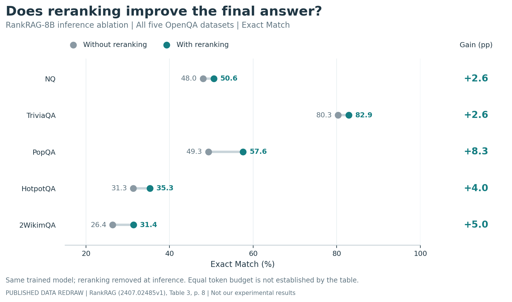

**文献数据重绘** · [代码](../rerank_expansion/2026-11-15/code/R01_rerank_qa.py) · [rankrag_qa_ablation.csv](../rerank_expansion/2026-11-15/data/rankrag_qa_ablation.csv) · [SVG](../rerank_expansion/2026-11-15/figures/R01_rerank_qa.svg)

同一训练模型的推理重排开关与最终 EM；包含全部五个 OpenQA 任务，原表未证明同 token 预算。

来源：[RankRAG](https://arxiv.org/pdf/2407.02485v1#page=8)，2407.02485v1，Table 3。

### 02 · 前 5 条中的含答案材料召回

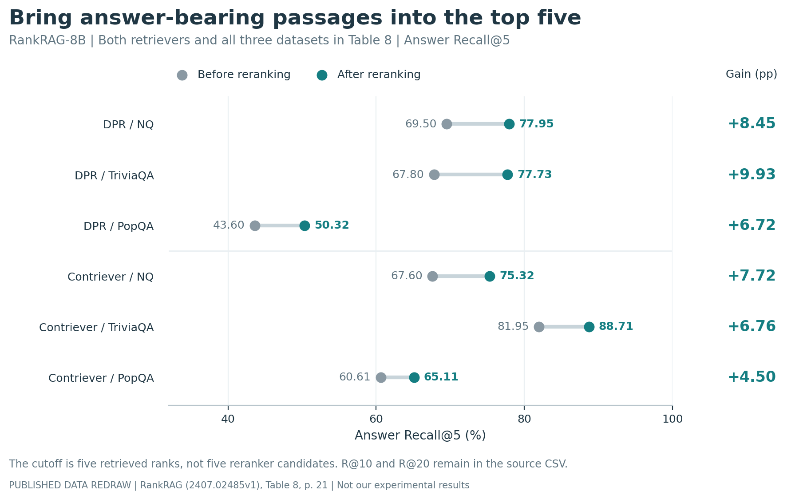

**文献数据重绘** · [代码](../rerank_expansion/2026-11-15/code/R02_answer_recall.py) · [rankrag_answer_recall.csv](../rerank_expansion/2026-11-15/data/rankrag_answer_recall.csv) · [SVG](../rerank_expansion/2026-11-15/figures/R02_answer_recall.svg)

固定前5条的评价位置，比较含答案材料的召回；全部六组R@5，R@10/20保留CSV。k不是重排候选数。

来源：[RankRAG](https://arxiv.org/pdf/2407.02485v1#page=21)，2407.02485v1，Table 8。

### 03 · 主结果表

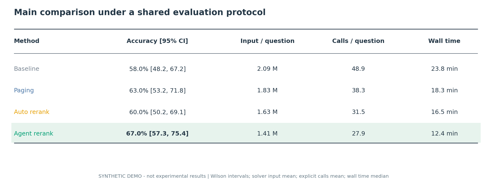

**合成数据模板** · [代码](../examples/19_results_table/plot.py) · [questions.csv](../data/demo/questions.csv)、[tool_calls.csv](../data/demo/tool_calls.csv) · [SVG](../assets/19_results_table.svg)

在相同问题集、模型与返回字符预算下汇总准确率、主模型用量和耗时。

图型参考：[SciencePlots](https://github.com/garrettj403/SciencePlots)。

## 二、排序鲁棒性与 Query 诊断

### 04 · 输入顺序鲁棒性

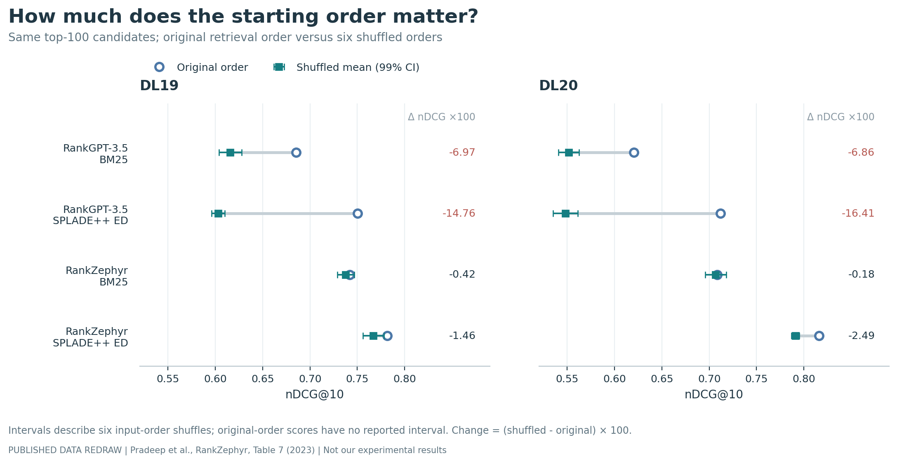

**文献数据重绘** · [代码](../rerank_expansion/2026-11-15/code/R03_order_robustness.py) · [rankzephyr_order_robustness.csv](../rerank_expansion/2026-11-15/data/rankzephyr_order_robustness.csv) · [SVG](../rerank_expansion/2026-11-15/figures/R03_order_robustness.svg)

固定候选集合后打乱初始顺序，检查重排收益是否依赖原始位置；误差线仅为原文六次打乱的99%置信区间。

来源：[RankZephyr](https://arxiv.org/pdf/2312.02724v1#page=11)，2312.02724v1，Table 7。

### 05 · Query 配对比较

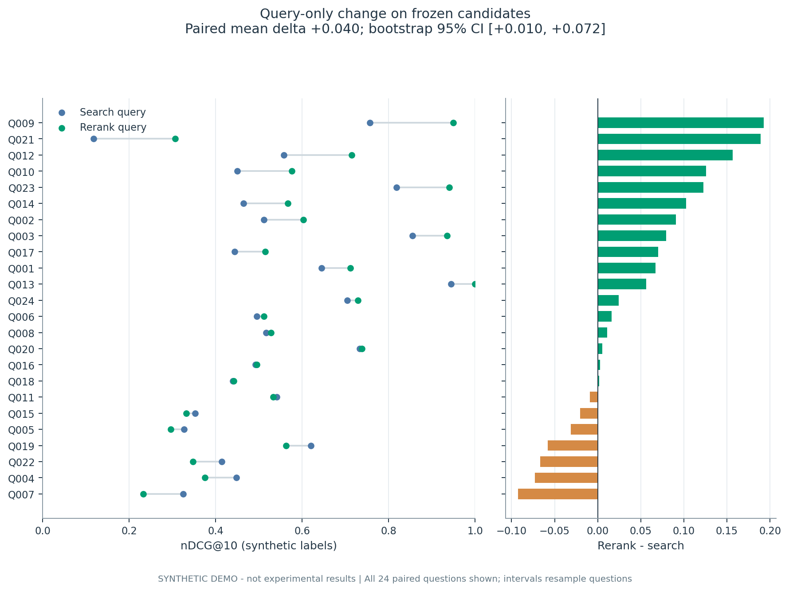

**合成数据模板** · [代码](../examples/08_query_paired_comparison/plot.py) · [query_pairs.csv](../data/demo/query_pairs.csv) · [SVG](../assets/08_query_paired_comparison.svg)

同题两种 query 在相同候选池、reranker 与片段设置下配对比较，直接观察逐题差值。

图型参考：[The-Python-Graph-Gallery](https://github.com/holtzy/The-Python-Graph-Gallery)。

### 06 · 证据排名迁移

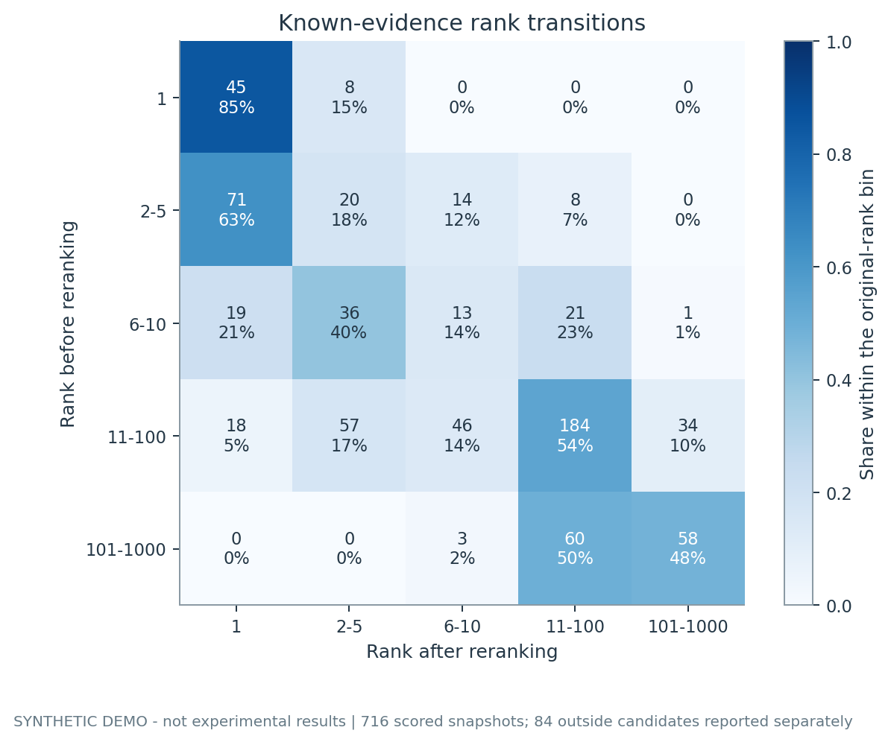

**合成数据模板** · [代码](../examples/07_rank_transition/plot.py) · [ranks.csv](../data/demo/ranks.csv) · [SVG](../assets/07_rank_transition.svg)

保留完整候选集中的前后排名；候选集外证据另计，避免只展示被提升的证据。

图型参考：[PyComplexHeatmap](https://github.com/DingWB/PyComplexHeatmap)。

## 三、重排配置与模型选择

### 07 · 重排窗口重叠的成本与收益

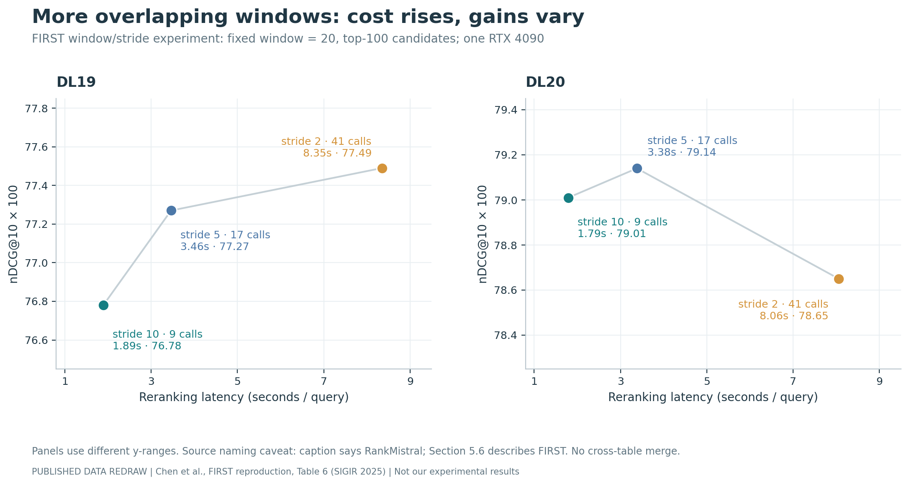

**文献数据重绘** · [代码](../rerank_expansion/2026-11-15/code/R05_window_budget.py) · [first_window_budget.csv](../rerank_expansion/2026-11-15/data/first_window_budget.csv) · [SVG](../rerank_expansion/2026-11-15/figures/R05_window_budget.svg)

固定窗口20，比较步长10/5/2的调用量、时延和nDCG；图示DL19/20，完整五数据集保留CSV。原文caption的模型名与正文存在不一致，按同表实验呈现。

来源：[Accelerating Listwise Reranking](https://zijianchen.ca/papers/Accelerating%20Listwise%20Reranking%20Reproducing%20and%20Enhancing%20FIRST.pdf#page=7)，SIGIR 2025 author PDF; SHA256 snapshot 2026-11-15，Table 6。

### 08 · 模型规模与任务差异

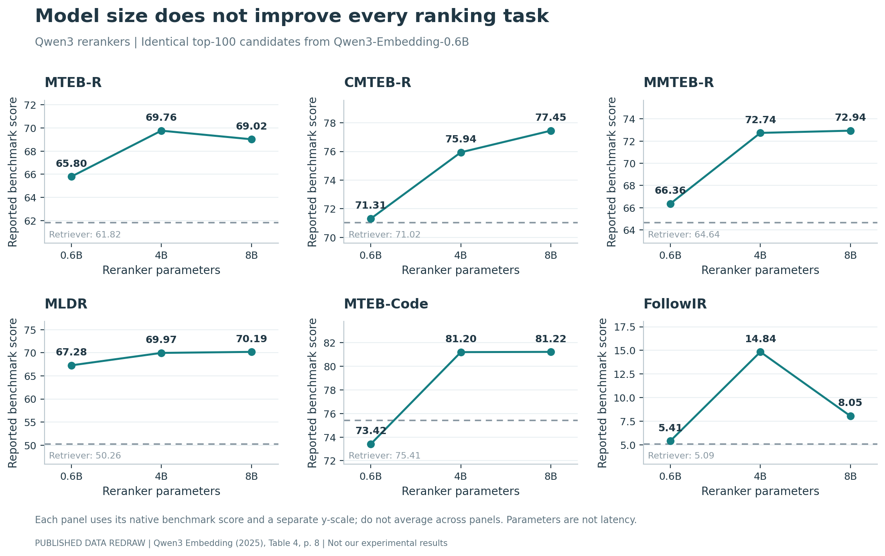

**文献数据重绘** · [代码](../rerank_expansion/2026-11-15/code/R06_model_scaling.py) · [qwen3_scaling.csv](../rerank_expansion/2026-11-15/data/qwen3_scaling.csv) · [SVG](../rerank_expansion/2026-11-15/figures/R06_model_scaling.svg)

比较相同候选集合上的0.6B/4B/8B重排器，保留下降项与不同任务差异。 六列均采用各自原生分数与独立纵轴；不平均混合指标；参数量不是延迟。

来源：[Qwen3 Embedding](https://arxiv.org/pdf/2506.05176v3#page=8)，2506.05176v3，Table 4。

### 09 · 组件消融森林图

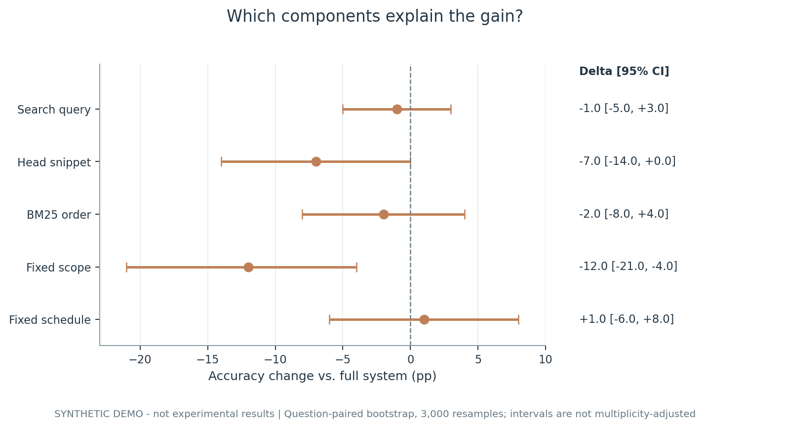

**合成数据模板** · [代码](../examples/17_ablation_forest/plot.py) · [ablations.csv](../data/demo/ablations.csv) · [SVG](../assets/17_ablation_forest.svg)

展示 query、snippet、候选范围与调用时机的贡献；每项对照只改变一个变量。

图型参考：[SciencePlots](https://github.com/garrettj403/SciencePlots)。

## 四、推理开销与调用行为

### 10 · 解码方式与重排时延

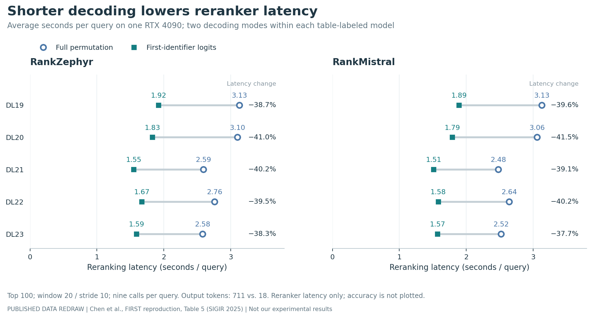

**文献数据重绘** · [代码](../rerank_expansion/2026-11-15/code/R04_decoding_latency.py) · [first_decoding_latency.csv](../rerank_expansion/2026-11-15/data/first_decoding_latency.csv) · [SVG](../rerank_expansion/2026-11-15/figures/R04_decoding_latency.svg)

比较完整排序输出和首标识符logits读取的重排时延；单卡RTX4090、top100、窗口20/步长10，不能当作agent端到端耗时。

来源：[Accelerating Listwise Reranking](https://zijianchen.ca/papers/Accelerating%20Listwise%20Reranking%20Reproducing%20and%20Enhancing%20FIRST.pdf#page=6)，SIGIR 2025 author PDF; SHA256 snapshot 2026-11-15，Table 5。

### 11 · 逐题 Token 用量分布

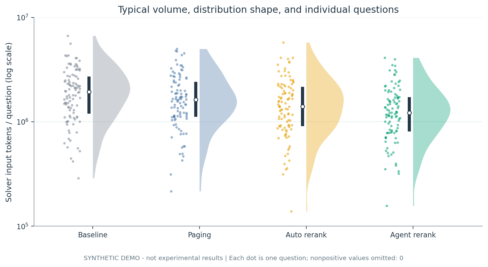

**合成数据模板** · [代码](../examples/02_token_raincloud/plot.py) · [questions.csv](../data/demo/questions.csv) · [SVG](../assets/02_token_raincloud.svg)

观察典型问题用量、离散程度和长尾；这里仅统计主模型输入，输出与 reranker 开销另计。

图型参考：[RainCloudPlots](https://github.com/RainCloudPlots/RainCloudPlots)。

### 12 · 工具调用与返回文本占比

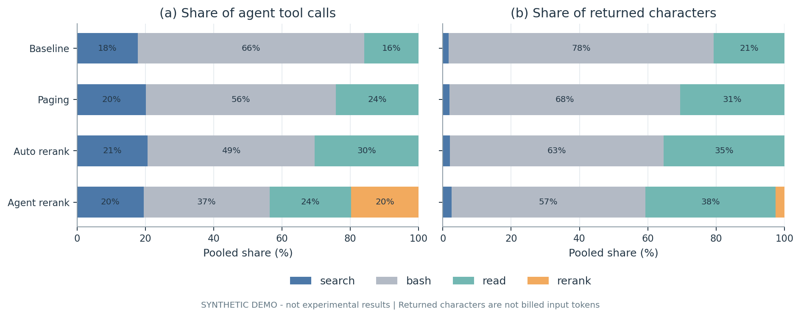

**合成数据模板** · [代码](../examples/04_call_vs_output_share/plot.py) · [tool_calls.csv](../data/demo/tool_calls.csv) · [SVG](../assets/04_call_vs_output_share.svg)

调用次数与返回字符采用各自分母；自动重排的后台计算需单独统计。

图型参考：[The-Python-Graph-Gallery](https://github.com/holtzy/The-Python-Graph-Gallery)。

### 13 · 模块耗时分解

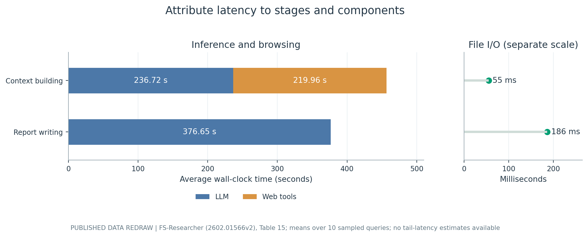

**文献数据重绘** · [代码](../paper_expansion/2026-11-01/code/N06_latency_components.py) · [fs_latency.csv](../paper_expansion/2026-11-01/data/fs_latency.csv) · [SVG](../paper_expansion/2026-11-01/figures/N06_latency_components.svg)

按模块定位瓶颈；参考数据中的 I/O 单列毫秒轴，我们的 reranker 需单独计时。

来源：[FS-Researcher](https://arxiv.org/pdf/2602.01566v2#page=22)，2602.01566v2，Table 15。

## 五、失败与证据使用

### 14 · 证据充分对照

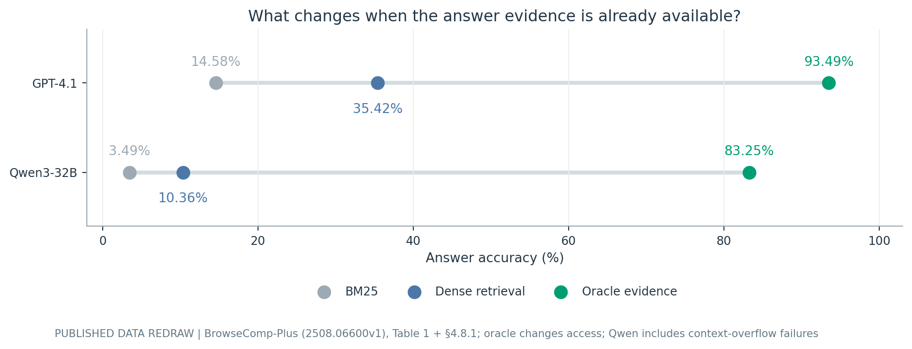

**文献数据重绘** · [代码](../paper_expansion/2026-11-01/code/N03_oracle_evidence.py) · [browse_oracle.csv](../paper_expansion/2026-11-01/data/browse_oracle.csv) · [SVG](../paper_expansion/2026-11-01/figures/N03_oracle_evidence.svg)

诊断证据获取与后续推理的差距；Oracle 改变证据访问条件，不作为相同返回预算下的基线。

来源：[BrowseComp-Plus](https://arxiv.org/pdf/2508.06600v1#page=10)，2508.06600v1，Table 1 and §4.8.1。

### 15 · 分层失败归因

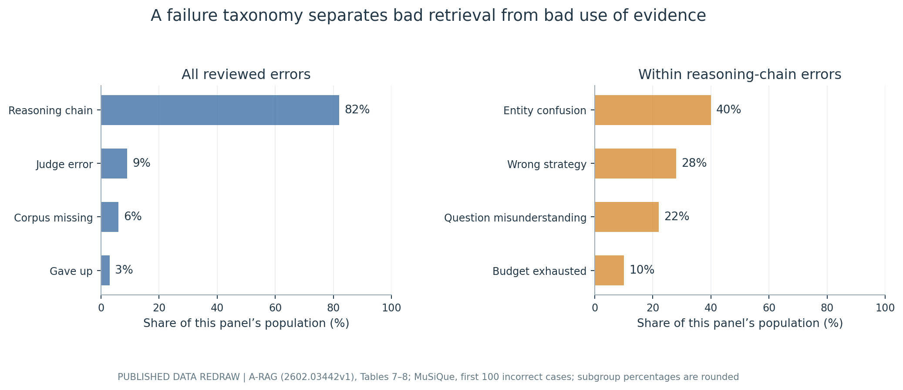

**文献数据重绘** · [代码](../paper_expansion/2026-11-01/code/N02_failure_hierarchy.py) · [arag_failures.csv](../paper_expansion/2026-11-01/data/arag_failures.csv) · [SVG](../paper_expansion/2026-11-01/figures/N02_failure_hierarchy.svg)

区分推理链、查询策略、语料缺失和 judge 问题；主类与子类使用不同分母，不能相加。

来源：[A-RAG](https://arxiv.org/pdf/2602.03442v1#page=15)，2602.03442v1，Tables 7–8; Figure 5。

## 运行与替换数据

Python 3.10+。图片和 CSV 已存入仓库；更新目录与校验时保留已有图片：

```bash
python -m venv .venv
source .venv/bin/activate
python -m pip install -r requirements-lock.txt
python scripts/build_gallery.py --keep-existing-images
```

单图脚本均支持 `--data-dir`、`--output-dir` 和 `--formats`。建议输出到单独目录：

```bash
# 模板示例
python examples/08_query_paired_comparison/plot.py --data-dir data/demo --output-dir dist/query-pairs
# 文献数值重绘
python paper_expansion/2026-11-01/code/N02_failure_hierarchy.py --output-dir dist/failure-hierarchy --formats png svg
# 本轮 Rerank 文献图重建与目录验证
python rerank_expansion/2026-11-15/build.py
```

模板字段定义见 [数据说明](../data/README.md)；文献数值的原表、页码与文件校验信息见 [Deep Research 来源审计](../paper_expansion/2026-11-01/data_provenance.json)和 [Rerank 来源审计](../rerank_expansion/2026-11-15/data_provenance.json)。接入真实实验时重新核验指标、分母、配对关系和脚注。

```bash
python -m unittest discover -s tests -v
python scripts/package_release.py
```

## 目录与维护

- [catalog.json](../catalog.json)：主图库的顺序、分类与补充条目；本文由它与来源清单统一生成。
- `examples/`、`paper_expansion/2026-11-01/code/`、`rerank_expansion/2026-11-15/code/`：实际绘图脚本；`gallery.json` 和各文献 `manifest.json` 保存源文件映射。
- [SUPPLEMENT.md](../SUPPLEMENT.md)：未进入主图库的图及理由，图片与代码保留。
- `dist/verification.json`：完整构建生成的文件摘要、代码与目录检查记录；不验证实验结论。

本仓库自编代码采用 [MIT 许可](../LICENSE)。文献重绘保留论文署名与出处；独立 GitHub 参考目录中的原图和源码保留各自的上游许可证。参考项目的完整说明见 [REFERENCES.md](../REFERENCES.md)。
