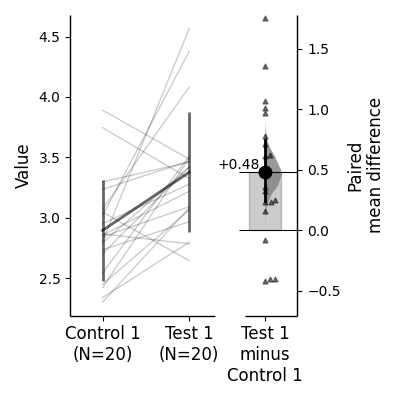
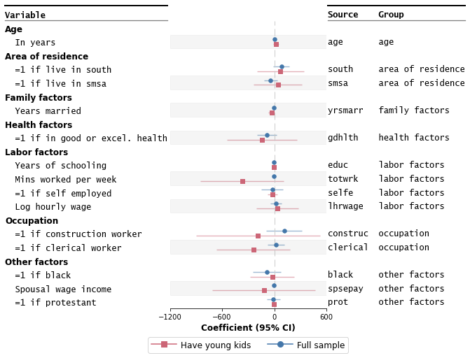
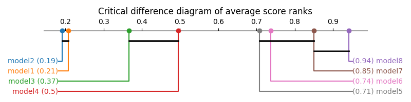
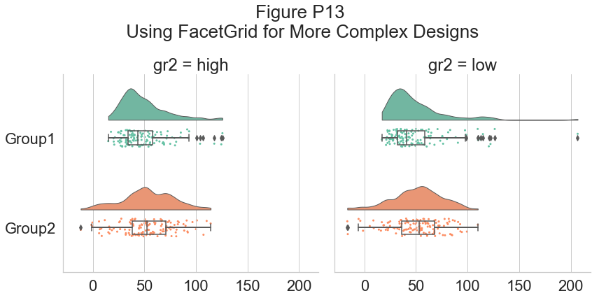
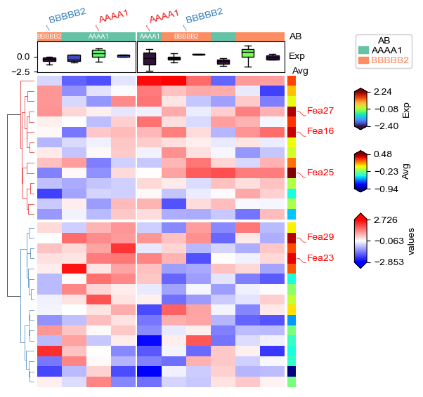
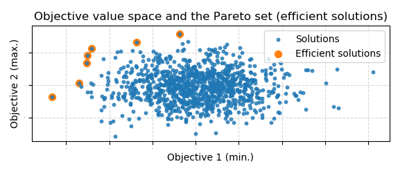
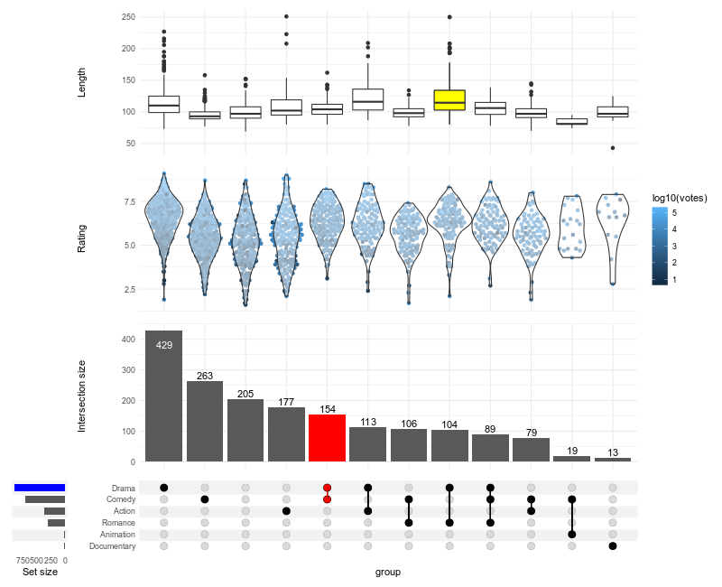
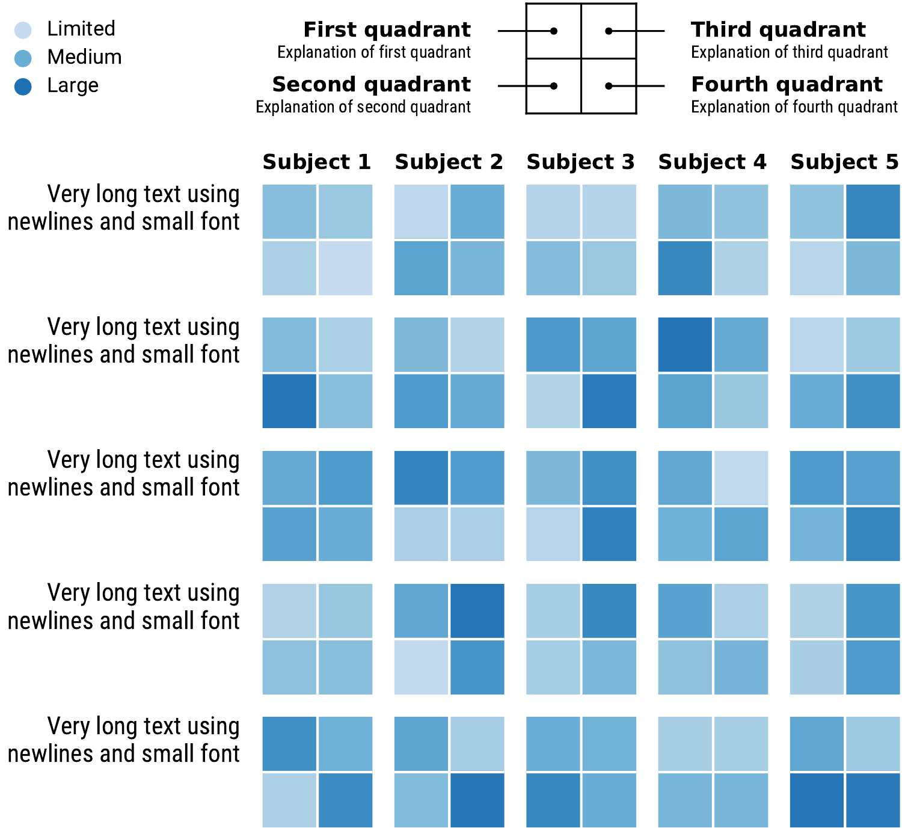

# GitHub 科研绘图参考：面向 Rerank 实验

整理日期：2026-11-15。来自 **8 个 GitHub 仓库的 8 张原始示例图**，用于选图、代码借鉴与实验设计。所有图片与代码均固定到 commit，并保留本地原文件。

**这些图中的数值是上游教程、测试或演示数据，不是我们的实验结果，也不是 rerank 论文数值。** 图片未重画；G08 保留原 PDF，另有栅格化预览。源码已核对对应关系，尚未在本项目中执行。

[打开离线图文版](../../dist/GitHub科研绘图参考.html) · [来源清单与 SHA256](manifest.json) · [返回现有图库](../../README.md)

## 优先选择

当前 rerank 正文优先考虑 **G02 森林图**（哪些子集受益）、**G04 雨云图**（耗时长尾）和 **G06 Pareto 图**（质量—实测开销）。G01 适合同题配对分析；G05、G07 用于诊断与证据互补性；G03、G08 适合统计补充和多面板排版。

这里的优先级是针对当前实验用途的编辑判断，不代表仓库质量排名。

| 编号 | 要回答的问题 | 图型 | 建议位置 |
| --- | --- | --- | --- |
| [G01](#g01) | 同一道题，rerank 改善了多少？ | 配对样本与均值差分布 | 配对分析 |
| [G02](#g02) | 哪些子集受益，哪些子集退化？ | 多方法分组森林图 | 正文优先 |
| [G03](#g03) | 跨 benchmark 的排序是否稳定？ | 平均百分位秩与差异检验（模拟演示） | 统计比较补充 |
| [G04](#g04) | 平均延迟背后是否有长尾？ | 分面雨云图：分布、散点与四分位 | 正文优先 |
| [G05](#g05) | 错误集中在哪类 query 与候选文档？ | 附注释的分组热图 | 诊断 / 附录 |
| [G06](#g06) | 质量与真实开销的折中在哪里？ | 非支配方案的 Pareto 散点图 | 正文优先 |
| [G07](#g07) | 不同方法找到的是同一批证据吗？ | 证据集合交集与分布联合图 | 互补性分析 |
| [G08](#g08) | 多个模型与消融条件如何对齐展示？ | 共享说明的矩阵式多面板布局 | 排版 / 附录 |

## G01 · 配对样本与均值差分布

原作者 / 项目：ACCLAB / DABEST contributors。来源：[ACCLAB/DABEST-python](https://github.com/ACCLAB/DABEST-python)。

**用于回答：**同一道题，rerank 改善了多少？ 比较同题 rerank 前后 nDCG、证据召回、token 或耗时；左侧保留配对，右侧单列差值和不确定性。

**需要的数据：**每题的 query_id、方法、nDCG/Recall 或 token/延迟；配对单位与重采样单位一致。

**迁移建议：**保留逐题连线与差值分布，方法名称换为真实对照；延迟与质量分开成图。

**使用边界：**需要逐题配对观测及明确 bootstrap 单位；不能由论文均值凭空补出分布。原图为仓库模拟数据测试基线，不是 rerank 实验。

[GitHub 原图](https://github.com/ACCLAB/DABEST-python/blob/ec6172724e0397bf0546863c76949d40da9c5457/nbs/tests/mpl_image_tests/baseline_images/test_04_gardner_altman_paired_meandiff.png) · [对应源码](https://github.com/ACCLAB/DABEST-python/blob/ec6172724e0397bf0546863c76949d40da9c5457/nbs/tests/mpl_image_tests/test_03_plotting.py) · [本地原图](sources/effectiveness/G01_paired_estimation.png) · [本地源码](sources/effectiveness/source_code/G01_source.py)

源码对应：test_03_plotting.py lines 16-64 generate a 20-row normal toy dataset (fixed seed 9999); lines 68-70 load Control 1/Test 1 with paired="baseline", id_col="ID"; lines 153-155 define test_04_gardner_altman_paired_meandiff and return two_groups_paired.mean_diff.plot(). The upstream baseline PNG filename exactly matches the test function.

许可：**Apache-2.0 in LICENSE; README badge says BSD-3-Clause-Clear (conflicting repository notices).**。[上游声明](https://github.com/ACCLAB/DABEST-python/blob/ec6172724e0397bf0546863c76949d40da9c5457/LICENSE) · [本地许可全文](sources/effectiveness/G01_paired_estimation_LICENSE.txt)。仅作带来源的研究参考；若对外再分发或改编应先澄清仓库许可冲突。

固定版本：`ec6172724e0397bf0546863c76949d40da9c5457`。

## G02 · 多方法分组森林图

原作者 / 项目：Lucas Shen Y. S. / LSYS。来源：[LSYS/forestplot](https://github.com/LSYS/forestplot)。

**用于回答：**哪些子集受益，哪些子集退化？ 比较不同 reranker、数据子集或消融条件的效应估计及区间，适合一行放两种方法。

**需要的数据：**每个任务或子集的效果差值、区间上下界、样本数；同题对照优先使用配对区间。

**迁移建议：**行换为 benchmark 或题型，颜色/形状区分 reranker；零线表示相对基线无变化。

**使用边界：**原图是回归系数示例；迁移时可换成 EM/nDCG 差值，但每条区间需从我们的逐题数据计算。

[GitHub 原图](https://github.com/LSYS/forestplot/blob/b7591e3be7004f9962fd7cd7f91aa4cac91c45fc/docs/images/multimodel.png) · [对应源码](https://github.com/LSYS/forestplot/blob/b7591e3be7004f9962fd7cd7f91aa4cac91c45fc/README.md) · [本地原图](sources/effectiveness/G02_multimodel_forest.png) · [本地源码](sources/effectiveness/source_code/G02_source_README.md)

源码对应：README Multi-models section includes fp.mforestplot code and links docs/images/multimodel.png; local main-commit image verified.

许可：**MIT**。[上游声明](https://github.com/LSYS/forestplot/blob/b7591e3be7004f9962fd7cd7f91aa4cac91c45fc/LICENSE) · [本地许可全文](sources/effectiveness/G02_multimodel_forest_LICENSE.txt)。仓库 LICENSE 为 MIT，保留版权与许可证；未发现该原图的独立许可声明。

固定版本：`b7591e3be7004f9962fd7cd7f91aa4cac91c45fc`。

## G03 · 平均百分位秩与差异检验（模拟演示）

原作者 / 项目：Maksim Terpilovskii / scikit-posthocs contributors。来源：[maximtrp/scikit-posthocs](https://github.com/maximtrp/scikit-posthocs)。

**用于回答：**跨 benchmark 的排序是否稳定？ 多个 benchmark 上比较多种 reranker 的平均秩，并标示未检出显著差异的方法组。

**需要的数据：**统一指标下的 benchmark × method 分数矩阵，以及与设计匹配的多重比较结果。

**迁移建议：**先明确越大或越小越好，再按 benchmark 计算真实名次；建议正文用 1–K 平均名次标尺。

**使用边界：**原横轴是 30 个模拟分块内 rank(pct=True) 的平均百分位秩（普通升序秩/8），不是 1..8 平均名次，也不是平均性能分数；越大代表模拟分数越高。不得当作真实 benchmark 的平均秩。迁移时需明确排序方向、分块独立性、多重检验和排名单位；连接线表示未检出差异，不证明等效。

[GitHub 原图](https://github.com/maximtrp/scikit-posthocs/blob/07e4c182b83314785eb879c3046de8ac5cf4febc/docs/source/_static/cd_diagram1.png) · [对应源码](https://github.com/maximtrp/scikit-posthocs/blob/07e4c182b83314785eb879c3046de8ac5cf4febc/docs/source/tutorial.rst) · [本地原图](sources/effectiveness/G03_critical_difference.png) · [本地源码](sources/effectiveness/source_code/G03_source_tutorial.rst)

源码对应：Tutorial Critical difference diagrams section builds avg_rank and test_results, calls critical_difference_diagram, then embeds _static/cd_diagram1.png.

许可：**MIT**。[上游声明](https://github.com/maximtrp/scikit-posthocs/blob/07e4c182b83314785eb879c3046de8ac5cf4febc/LICENSE) · [本地许可全文](sources/effectiveness/G03_critical_difference_LICENSE.txt)。仓库 LICENSE 为 MIT，保留版权与许可证；未发现该原图的独立许可声明。

固定版本：`07e4c182b83314785eb879c3046de8ac5cf4febc`。

## G04 · 分面雨云图：分布、散点与四分位

原作者 / 项目：Micah Allen, Davide Poggiali, Kirstie Whitaker, Tom Rhys Marshall & Rogier Kievit。来源：[RainCloudPlots/RainCloudPlots](https://github.com/RainCloudPlots/RainCloudPlots)。

**用于回答：**平均延迟背后是否有长尾？ 按任务类型分面比较 rerank token/耗时分布，同时显示典型值和长尾。

**需要的数据：**逐题 latency_ms 或 token 数、方法和题型；保留异常值与实际样本量。

**迁移建议：**按题型分面，各方法共用轴尺度；显示散点、分位数与平滑分布，说明是否采用对数轴。

**使用边界：**需要逐题样本；图中 KDE 宽度不是样本量，密度平滑需固定规则。原图为教程示例数据，不是 rerank 实验。

[GitHub 原图](https://github.com/RainCloudPlots/RainCloudPlots/blob/4ceeb06dc5bd5b9911e7147d1b0b452c4c2f9b1d/figs/tutorial_python/figureP13.png) · [对应源码](https://github.com/RainCloudPlots/RainCloudPlots/blob/4ceeb06dc5bd5b9911e7147d1b0b452c4c2f9b1d/tutorial_python/raincloud_tutorial_python.ipynb) · [本地原图](sources/effectiveness/G04_faceted_raincloud.png) · [本地源码](sources/effectiveness/source_code/G04_source.ipynb)

源码对应：Notebook Rainclouds with FacetGrid cell creates sns.FacetGrid and pt.RainCloud and explicitly saves ../figs/tutorial_python/figureP13.png.

许可：**MIT**。[上游声明](https://github.com/RainCloudPlots/RainCloudPlots/blob/4ceeb06dc5bd5b9911e7147d1b0b452c4c2f9b1d/LICENSE) · [本地许可全文](sources/effectiveness/G04_faceted_raincloud_LICENSE.txt)。仓库 LICENSE 为 MIT，保留版权与许可证；未发现该原图的独立许可声明。

固定版本：`4ceeb06dc5bd5b9911e7147d1b0b452c4c2f9b1d`。

## G05 · 附注释的分组热图

原作者 / 项目：Wubin Ding / PyComplexHeatmap。来源：[DingWB/PyComplexHeatmap](https://github.com/DingWB/PyComplexHeatmap)。

**用于回答：**错误集中在哪类 query 与候选文档？ 按题型/检索器分组展示候选排名、证据得分或错误率；上方附加 query 类型，右侧标记关注案例。

**需要的数据：**query × candidate 或 query × method 矩阵，加题型、相关性标签等注释。

**迁移建议：**保留少量关键注释，使用感知均匀色图；排名和候选顺序有含义时固定顺序。

**使用边界：**示例数值为随机生物信息演示；侧边彩虹色不宜直接照搬。论文用图应减少旁注，并保持排名分箱的自然顺序，不为美观随意聚类。

[GitHub 原图](https://github.com/DingWB/PyComplexHeatmap/blob/2db32554c62c99b7e1823f5b2059a8b341ad0a9b/docs/build/html/_images/notebooks_clustermap_7_0.png) · [对应源码](https://github.com/DingWB/PyComplexHeatmap/blob/2db32554c62c99b7e1823f5b2059a8b341ad0a9b/notebooks/clustermap.ipynb) · [本地原图](sources/efficiency/annotated_heatmap.png) · [本地源码](sources/efficiency/clustermap.ipynb)

源码对应：cell 7 (zero-based); embedded PNG bytes exactly match the committed image

许可：**MIT**。[上游声明](https://github.com/DingWB/PyComplexHeatmap/blob/2db32554c62c99b7e1823f5b2059a8b341ad0a9b/LICENSE) · [本地许可全文](sources/efficiency/PyComplexHeatmap_LICENSE.txt)。原图与代码按上游许可保留；原始许可证随文件保存。

固定版本：`2db32554c62c99b7e1823f5b2059a8b341ad0a9b`。

## G06 · 非支配方案的 Pareto 散点图

原作者 / 项目：Tommy / tommyod。来源：[tommyod/paretoset](https://github.com/tommyod/paretoset)。

**用于回答：**质量与真实开销的折中在哪里？ 横轴使用 rerank 延迟或总费用、纵轴使用 nDCG/答案准确率，突出同一候选池下不被其他配置同时压过的方案。

**需要的数据：**同硬件、同候选池下各配置的质量与实测延迟/费用；明确聚合方式与重复次数。

**迁移建议：**横轴实测成本越低越好，纵轴质量越高越好；突出非支配配置，恢复刻度和方法标签。

**使用边界：**原图是随机优化演示，并没有实际模型比较。迁移时需明确定义一轴最小化、一轴最大化；不要把任意连线都叫作 Pareto 前沿，也不要跨不同硬件直接比较。

[GitHub 原图](https://github.com/tommyod/paretoset/blob/6f2803057085a696cbe10118ca3164d993cee175/scripts/example_optimization.png) · [对应源码](https://github.com/tommyod/paretoset/blob/6f2803057085a696cbe10118ca3164d993cee175/scripts/examples.py) · [本地原图](sources/efficiency/pareto_optimization.png) · [本地源码](sources/efficiency/paretoset_examples.py)

源码对应：EXAMPLE 3: OPTIMIZATION; plt.savefig('example_optimization.png')

许可：**MIT**。[上游声明](https://github.com/tommyod/paretoset/blob/6f2803057085a696cbe10118ca3164d993cee175/LICENSE) · [本地许可全文](sources/efficiency/paretoset_LICENSE.txt)。原图与代码按上游许可保留；原始许可证随文件保存。

固定版本：`6f2803057085a696cbe10118ca3164d993cee175`。

## G07 · 证据集合交集与分布联合图

原作者 / 项目：Michał Krassowski / ComplexUpset。来源：[krassowski/complex-upset](https://github.com/krassowski/complex-upset)。

**用于回答：**不同方法找到的是同一批证据吗？ 比较 BM25、Dense、rerank、最终读取四个集合中证据的独有与共享部分；上方可附证据排名或 token 分布。

**需要的数据：**统一 document/chunk ID 后的集合成员表；逐题交集与全局交集不可混用。

**迁移建议：**比较不同方法保留的证据集合；精简到核心交集，必要时按相关性标签区分有效证据。

**使用边界：**原图数据为电影类别，并非检索结果。使用前需统一文档ID、切块粒度与去重规则；集合数量过多时组合会膨胀，应保留核心交集。

[GitHub 原图](https://github.com/krassowski/complex-upset/blob/79fa000ca4087d55ee2d8cf1a0fb7a01bb5aba7e/movies.png) · [对应源码](https://github.com/krassowski/complex-upset/blob/79fa000ca4087d55ee2d8cf1a0fb7a01bb5aba7e/README.md) · [本地原图](sources/efficiency/complex_upset_movies.png) · [本地源码](sources/efficiency/complex_upset_README.md)

源码对应：Showcase code block directly below movies.png (R / ComplexUpset)

许可：**MIT**。[上游声明](https://github.com/krassowski/complex-upset/blob/79fa000ca4087d55ee2d8cf1a0fb7a01bb5aba7e/LICENSE) · [本地许可全文](sources/efficiency/ComplexUpset_LICENSE.txt)。原图与代码按上游许可保留；原始许可证随文件保存。

固定版本：`79fa000ca4087d55ee2d8cf1a0fb7a01bb5aba7e`。

## G08 · 共享说明的矩阵式多面板布局

原作者 / 项目：Nicolas P. Rougier / Scientific Visualization Book。来源：[rougier/scientific-visualization-book](https://github.com/rougier/scientific-visualization-book)。

**用于回答：**多个模型与消融条件如何对齐展示？ 将模型作为列、任务或消融作为行，统一四格子指标的含义和颜色说明，减少每面板重复图例。

**需要的数据：**每个小面板内语义一致的指标；所有面板共用明确的标尺和颜色含义。

**迁移建议：**借鉴共享图例与行列对齐；缩减到易读的行列数，不能把不同指标直接映射到同一色阶。

**使用边界：**这是随机布局示例；颜色级别的方向和数值含义必须在正式实验中重新定义。五乘五小面板对短文可能过密，应缩减行列或放附录。

[GitHub 原图](https://github.com/rougier/scientific-visualization-book/blob/62fa569f30333c817c13e4dc757877c1192fd15a/figures/layout/complex-layout.pdf) · [对应源码](https://github.com/rougier/scientific-visualization-book/blob/62fa569f30333c817c13e4dc757877c1192fd15a/code/layout/complex-layout.py) · [本地原图](sources/efficiency/complex_layout.pdf) · [本地源码](sources/efficiency/complex_layout.py)

源码对应：GridSpec(7×7), final plt.savefig('../../figures/layout/complex-layout.pdf')

许可：**Book/figure: CC BY-NC-SA 4.0; code: BSD-2-Clause**。[上游声明](https://github.com/rougier/scientific-visualization-book/blob/62fa569f30333c817c13e4dc757877c1192fd15a/LICENSE.txt) · [本地许可全文](sources/efficiency/Rougier_LICENSE.txt)。原图与代码按上游许可保留；原始许可证随文件保存。

固定版本：`62fa569f30333c817c13e4dc757877c1192fd15a`。

书籍图像采用 [CC BY-NC-SA 4.0](https://creativecommons.org/licenses/by-nc-sa/4.0/)；代码采用 BSD-2-Clause。预览仅由原 PDF 栅格化，内容未改动。

## 检索、筛选与保存方式

从 GitHub 仓库检索科研绘图与 scientific visualization 示例，进一步查找配对估计图、森林图、临界差异图、雨云图、注释热图、Pareto、UpSet 和多面板布局。只收录仓库内实际存在的图片或 PDF，并检查对应代码及许可证；不以仓库截图或自行重画代替原图。

例如 ARPeeketi/Template_Scientifc_Figures 的 filled_area_plot 示例经检查后未入选：大图例、重叠填充和装饰标记使信息过密。此处只保留适合当前研究问题的 8 个互补示例。

图片通过 Git blob SHA 与固定版本核对，另记录 SHA256。下载的原图各保留一份；HTML 内嵌图片以便离线阅读，Markdown 引用同一份原文件。来源目录中的 README / Notebook / RST 是上游源码快照，并非新增图库文档。

现有论文重绘和合成模板仍在主图库，当前共 23 张（15 主图、8 补充）；这 8 张 GitHub 参考单独计数。去重详情见 [删除记录](../../curation/2026-11-15-dedup/README.md)。

可通过 `python github_references/2026-11-15/build_document.py` 重新生成本文件与 dist/ 中的离线 HTML，过程只校验和排版，不执行上游绘图源码。
