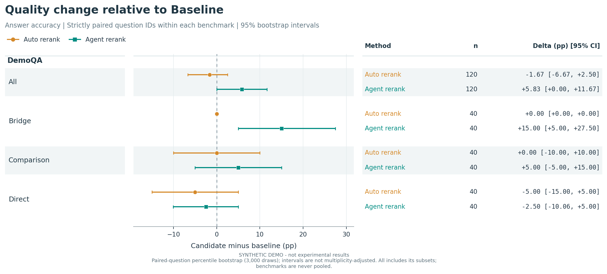
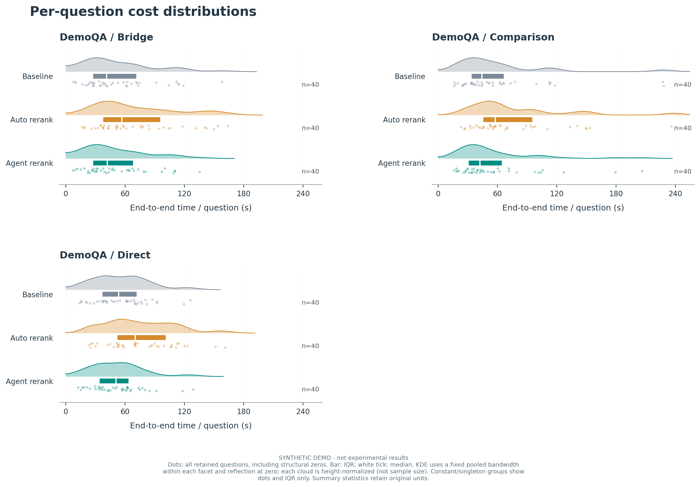
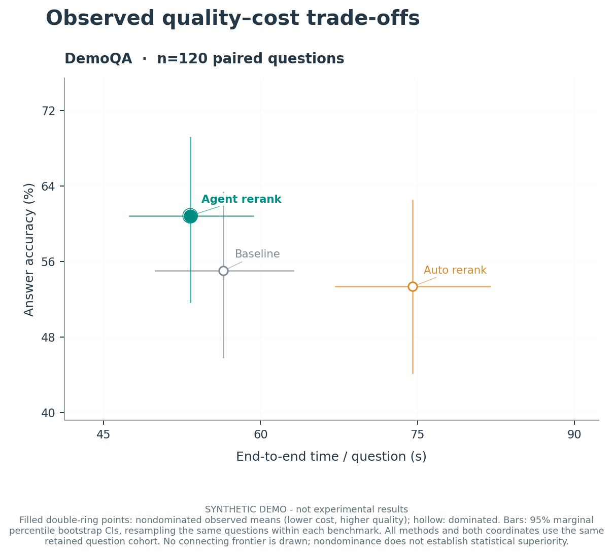

# Rerank 实验绘图模板 · 2026-11-16

把 GitHub 参考中的 **G02 多方法森林图、G04 分面雨云图、G06 Pareto 图**做成三个独立可运行模板。使用一份逐题 CSV 和一份 JSON 配置；无需安装上游绘图项目。随附数据是 **120 题 × 3 方法的合成演示**，图片明确标注，不代表我们的实验结果。

选择这三张，是因为它们分别回答当前实验的三个问题：**哪些题型受益、耗时是否有长尾、质量与实测开销如何折中**。现有 23 张图库与 8 张 GitHub 原图参考仍独立保留，这里提供接入新实验数据的工具。

## 直接运行

在本目录运行，Python 3.10+：

```bash
python -m venv .venv
source .venv/bin/activate
python -m pip install -r requirements-lock.txt
python run_all.py
```

Windows 激活命令为 `.venv\Scripts\activate`。已有可用环境时只需安装依赖后运行最后一行。没有 GPU、模型权重或网络调用要求；安装依赖后可离线运行。

默认输出到 `figures/`：三张图的 **PNG、SVG、PDF**，各自的 `*_summary.csv`、`*_provenance.json`，以及 [三图总览](figures/overview.png)。SVG/PDF 为矢量图，适合论文排版。

| 模板 | 脚本 | 需要的数据 | 输出数值 |
| --- | --- | --- | --- |
| 子集效果森林图 | [plot_forest.py](plot_forest.py) | 每题各方法的 score；相同题目、同一指标 | 配对 n、平均差值、95% bootstrap 区间 |
| 分面耗时雨云图 | [plot_raincloud.py](plot_raincloud.py) | 每题耗时或 token；可按题型分面 | n、均值、中位数、p90/p95、零值数 |
| 质量—开销 Pareto 图 | [plot_pareto.py](plot_pareto.py) | 同一题集上的 score 与所选成本 | 质量/成本均值及区间、非支配标记、支配者 |

### 1. 子集效果森林图



相对配置中的 `baseline`，计算每一道题的候选方法分数减基线分数，再对题目差值做 bootstrap。每个 benchmark 分别给出 All 与各 subset，保留负收益；右侧给出实际配对 n 和区间。

```bash
python plot_forest.py --formats png svg pdf
```

默认是准确率差值，单位为百分点（pp）。若改为 nDCG@10，把配置中的 score 改为 `kind: bounded`、`label: nDCG@10`、`scale: 1`、`unit: score`、`delta_unit: score`，CSV 中每题仍为 [0,1]。All 包含子集，不能把这些行当成独立重复实验。区间未做多重比较校正，也不等同于模型随机种子的方差。

### 2. 分面耗时雨云图



默认显示逐题端到端耗时，按 benchmark × subset 分面。保留散点、分位数和密度形状；同一分面各方法使用一致的密度带宽。常数或单样本组保留点与分位数，不伪造密度形状。

```bash
python plot_raincloud.py --metric wall_seconds
# 重排评分耗时中，baseline 的 0 也保留；log1p 可压缩长尾
python plot_raincloud.py --metric rerank_seconds --scale log1p --output-dir outputs/rerank_time
# 只有实际逐题 token 完整时才使用此图
python plot_raincloud.py --metric main_input_tokens --scale log1p --output-dir outputs/main_tokens
```

`log1p` 指坐标位置使用 ln(1+x)，刻度仍显示原单位；不会删除 0。点代表问题，KDE 宽度不代表样本量；p95 是样本分位数，不是置信区间。默认不筛掉超时或未完成题，只要资源值有记录就保留。

### 3. 质量—开销 Pareto 图



每个 benchmark 单独一面板，每个方法/配置一个点：横轴平均实测成本越小越好，纵轴平均质量越大越好。只有不存在另一个点“成本不更高、质量不更低，且至少一项严格更好”时，才标为非支配；坐标相同的两个配置都保留。图不连接前沿，不暗示未测量配置或连续可达解。

```bash
python plot_pareto.py --metric wall_seconds
python plot_pareto.py --metric rerank_seconds --output-dir outputs/pareto_rerank_time
```

质量与成本必须来自相同问题，各方法也使用相同题目集合。误差条为逐题 bootstrap 的边际 95% 区间，不是联合置信区域；非支配标记仅根据样本均值，不代表统计显著胜出。

## 替换成实验数据

1. 参照 [完整字段定义](DATA_FORMAT.md) 导出逐题长表，或从 [空 CSV 表头](data/observations_header.csv) 开始填写。相同题目在各方法下各占一行。
2. 复制 [真实实验配置样例](config.measured.example.json) 为自己的配置，填写 `conditions` 的所有 `REPLACE_...` 项，并核对方法 ID、指标含义和单位。未填写会报错。
3. 为真实数据指定新的输出目录，保留合成示例。

```bash
python run_all.py \
  --data /path/to/my_observations.csv \
  --config /path/to/my_config.json \
  --output-dir /path/to/my_figures \
  --metric wall_seconds
```

方法名、颜色、baseline、质量指标及其显示单位都通过配置修改，无需改绘图源码。成本由 `--metric` 从六个已定义字段中选择，标签与单位由 `common.py` 的 `METRICS` 定义。演示配置中的方法 ID 只用于合成示例。要加入新方法，在 `methods` 增加对应 ID/label/color，并提供每个 benchmark 完整的同题记录。新方法的不同预算也可作为不同 method ID，但必须记录各配置的实际测量条件。

**缺成本时默认报错。** 假设一组虚构数据有 10 题判分、其中 2 题缺少资源记录，可单独用森林图分析全部 10 题；若要画成本图，显式选择共同完整样本：

```bash
python plot_forest.py --data /path/to/my_observations.csv --config /path/to/my_config.json --output-dir outputs/quality_all
python run_all.py --data /path/to/my_observations.csv --config /path/to/my_config.json \
  --output-dir outputs/common_cost_cohort --missing-cost complete-case
```

`complete-case` 会把缺所选成本的题目从**所有方法**的雨云图和 Pareto 图中一起移除，并用剩余共同题集重新计算 Pareto 的质量。森林图仍使用完整质量数据。每张成本图的 provenance 记录排除题号、缺失方法和前后 n；这不会消除缺失机制带来的偏差。绝不把空值补成零、把总 token 均摊给各题，或将不同题集的准确率与成本配成一个点。

## 文件与可复现性

| 文件 | 用途 |
| --- | --- |
| [common.py](common.py) | CSV 校验、严格配对、共同成本样本、bootstrap、非支配判断和输出 |
| [config.json](config.json) | 合成演示的样式、方法、指标与条件 |
| [data/demo/observations.csv](data/demo/observations.csv) | 360 行合成逐题数据，含零开销和未完成状态 |
| [generate_demo.py](generate_demo.py) | 固定种子生成合成数据，不读取真实实验 |
| [sources.json](sources.json) | 三个 GitHub 图型来源，固定 commit；代码为本库独立实现 |
| [tests/test_contracts.py](tests/test_contracts.py) | 配对、缺失、零值、指标范围和 Pareto 的手工边界测试 |
| [verification.json](verification.json) | 运行验证、输入/产物摘要和环境记录 |

```bash
python -m unittest discover -s tests -v
# 可选：确定性重建演示数据，再画图
python generate_demo.py
python run_all.py --bootstrap 3000 --seed 20261116
# 验证完整默认示例，或生成可独立解压运行的压缩包
python verify.py
python package.py
```

默认 3,000 次逐题重采样。每个 summary.csv 保存实际绘图的数值，provenance 保存输入 CSV/config 的 SHA256、配置内容、随机种子和样本筛选。输入路径使用带基准说明的相对路径；外部输入只记录文件名和内容哈希，详见 [可移植的输入溯源](DATA_FORMAT.md#可移植的输入溯源)。它们验证计算和绘图过程，不证明输入日志正确或研究结论成立。

图型来源为 LSYS/forestplot、RainCloudPlots/RainCloudPlots、tommyod/paretoset；详细链接在 [sources.json](sources.json)。本目录代码采用 [MIT 许可](LICENSE)，未复制上游实现，也不需要安装 forestplot、ptitprince 或 paretoset。上游原图仍见独立 GitHub 参考文档。
